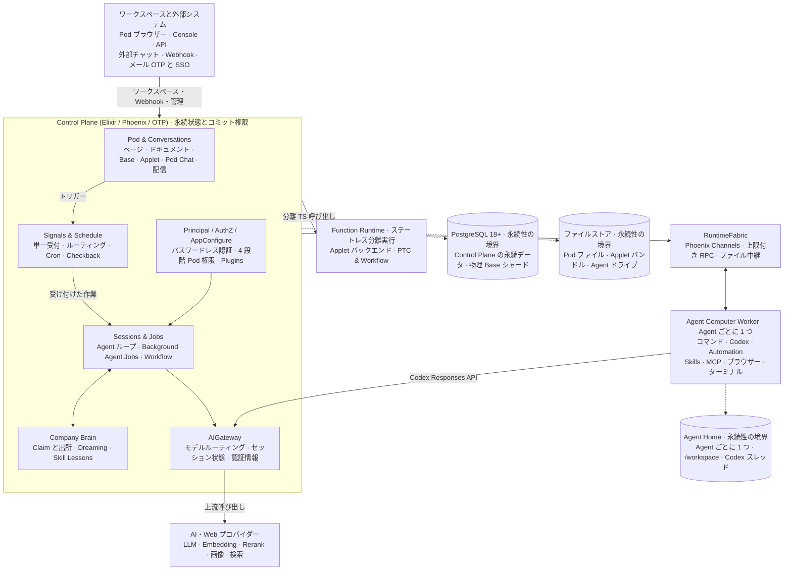

<div align="center">


# Ankole

**人と AI Agent が共に業務を回す、オープンソースのデジタル本社（Pod）**

[](LICENSE)
[](https://github.com/AgentBull/ankole/releases)

[](https://deepwiki.com/AgentBull/ankole)

[Web サイト](https://ankole.agentbull.com/ja-JP/) · [ドキュメント](https://ankole.agentbull.com/ja-JP/docs/introduction/) · [クイックスタート](#クイックスタート) · [仕組み](#仕組み) · [Discussions](https://github.com/AgentBull/ankole/discussions)

[English](./README.md) · [简体中文](./README.zh-Hans.md) · **日本語** · [한국어](./README.ko.md)

</div>

Ankole は、AI ネイティブなチームのためのオープンソースのオンラインワークスペース（**Pod**）兼マルチエージェントランタイムです。1 つのブラウザー上のワークスペースで、メンバーと AI Agent が**共同編集ドキュメント**や**スライド**、リレーショナルな業務テーブル（**Base**）、ステートレスなクラウドバックエンド付きのカスタム業務ツール（**Applet**）、および複数人・複数 Agent 参加の **Pod Chat** を共有します。Slack、Lark/Feishu、Microsoft Teams、DingTalk、WeCom、メールは外部チャネルとして接続されます。

単発のプロンプトや野放しの完全自動化ではなく、Ankole は日々の業務を**人が要所で判断する業務ループ（Loop）**として構成します。データの監視、社内ツールの構築、専用 Linux コンテナーでの長時間ジョブは Agent が継続実行し、現場の文脈の付与や高リスク操作の承認は人間が**選択カード（Choice Card）**で行います。共有の **Company Brain**、**Skill 教訓（Skill Lessons）**、パスワードレス認証、4 段階のデータ権限はすべて Apache 2.0 のセルフホスト版コアに含まれています。

<p align="center">
  <a href="https://x.com/AgentBullLab/status/2108582424959721707/video/1">
    
  </a>
</p>

## クイックスタート

Docker Compose を使うと、Linux、macOS、Windows の 1 台のホストに完全な環境をデプロイできます。スタックには PostgreSQL 18、`ankole-function-runtime`（Applet とスクリプトのステートレス分離実行環境）、データベースマイグレーション、Control Plane、HTTPS サーバーの Caddy が含まれます。必要なもの：

- Linux の `amd64` または `arm64` コンテナーを実行できる Docker と、PostgreSQL、ファイルストレージ、および稼働する Agent ごとに 1 つの Worker コンテナー分のメモリーとディスク。
- Ankole に Docker ソケットへのアクセスを許可できるホスト。Control Plane は `/var/run/docker.sock` を通じて Worker コンテナーを作成します（このソケットへのアクセスはホストの root 権限と同等です）。
- ホストを指す DNS 名と開放された `80` / `443` 番ポート（手元のマシンで試す場合は `ankole.localhost` を使用できます）。
- モデルプロバイダーの API キー、およびパスワードレスメール認証用の SMTP 設定またはエンタープライズ SSO アプリ。Slack、Lark/Feishu、DingTalk、WeCom、Discord、Telegram、メールは Ankole から外向きに接続するためローカル試用でも動作します。Microsoft Teams、LINE、WhatsApp はホストへ Webhook を送るため公開 HTTPS アドレスが必要です。

1. デプロイ用ファイルを取得します：

```bash
git clone https://github.com/AgentBull/ankole.git
cd ankole/tools/deploy/docker-compose
cp .env.example .env
chmod 600 .env
```

2. `.env` に次の必須項目を設定します：

| 変数 | 値 |
| --- | --- |
| `ANKOLE_HOST`、`ACME_EMAIL` | ホストの DNS 名（ローカル試用では `ankole.localhost`）と、TLS 証明書通知用のメールアドレス |
| `POSTGRES_PASSWORD` | `openssl rand -hex 24` で生成した 16 進数の値 |
| `ANKOLE_SECRET_BASE`、`RELEASE_COOKIE`、`ANKOLE_FUNCTION_RUNTIME_TOKEN` | `openssl rand -hex 32` で別々に生成した 3 つの独立した 16 進数の値 |
| `ANKOLE_DOCKER_GID` | Linux では `stat -c %g /var/run/docker.sock` の出力、macOS の Docker Desktop では `0` |

3. スタックを起動し、1 回限りのアクティベーションコードを確認します：

```bash
docker compose pull
docker compose up -d
docker compose logs control-plane | grep "SETUP ACTIVATION CODE"
```

Control Plane の起動完了後にコードが出力されます。何も表示されない場合は数秒待ってから再実行してください。

`ankole.localhost` を使う場合、Caddy は独自のローカル認証局で証明書に署名し、`/setup` には信頼された HTTPS が必要です。ローカル認証局のルート証明書をコピーし、OS の証明書ツールで信頼させます：

```bash
docker compose cp caddy:/data/caddy/pki/authorities/local/root.crt ./ankole-local-ca.crt
```

4. `https://<ANKOLE_HOST>/setup` を開き、コードを入力して必要なプラグインを選択し、管理者のパスワードレスサインイン方式を **6 桁のメール認証コード（SMTP、保存前に実際のテスト送信で締め出しを防止）**または**エンタープライズ SSO** で設定します。続いて管理コンソールでモデルプロバイダーを追加し、Agent を作成します（API キーは `.env` ではなくコンソールに保存します）。設定後はそのまま **Pod ワークスペース**でドキュメント、Base、Applet、Pod Chat を使い始めるか、外部チャットを接続して Agent にメッセージを送れます。

<details>
<summary>Claude Code や Codex と一緒にセットアップを進める</summary>

```text
https://ankole.agentbull.com/ja-JP/docs/quickstart/index.md を使って、Ankole のプライベートデプロイメントインスタンスのデプロイと設定を手伝ってください。まず、私の環境を調査し、Docker Compose、Kubernetes、またはソースからのインストールのいずれかを推奨してください。次に、パスワードレスのメール認証（Email OTP）またはエンタープライズ SSO の Identity Provider（IdP）によるサインインと、LLM Provider、Agent、Channel Provider、Signal Routing Rule（Signal Binding）のセットアップを手伝ってください。サインイン方式と IM プラットフォームを指定していない場合は、使用したいサインイン方式（SMTP メール認証またはエンタープライズ IdP）とチャットプラットフォームを尋ねてください。勝手に選択しないでください。chat やコマンドの出力に secret を露出しないでください。選択した IM で実際の Agent の返信を受け取ったときにだけ、作業は完了とみなします。
```

</details>

その他の実行方法：

- **Kubernetes**：同梱または外部 PostgreSQL を使う [Helm チャート](tools/deploy/helm/ankole-agent/README.md)（英語）。
- **Cloudflare Containers**：[Cloudflare Worker アダプター](tools/deploy/cloudflare/agent-workers/README.md)（英語）。
- **ソースから実行**：[CONTRIBUTING.md](CONTRIBUTING.md)（英語）（`bun install`、`bun run services:start`、`bun run control-plane:setup`、`bun dev`）。

各 ID プロバイダー、モデルプロバイダー、チャットプラットフォームの詳細手順は[クイックスタート](https://ankole.agentbull.com/ja-JP/docs/quickstart/)を、バックアップやアップグレードは [Compose ガイド](tools/deploy/docker-compose/README.md)（英語）を参照してください。

## Pod を構成する 5 つのモジュール

各企業やチームは独立した **Pod** を持ち、互いに連携する 5 つのモジュールを利用できます：

- **ワークスペースページ（`Pod Home`）**：チーム共有の**スペース**と個人の**プライベート**に分かれた階層ディレクトリと、閲覧権限に厳密に従う高速全文検索を備えます。
  - **共同編集ドキュメント（`Doc`）**：人と Agent がカーソルを奪い合わずに同じドキュメントを同時編集できます。埋め込まれたレポートスナップショットは当時の数値を固定するため、後から元テーブルが更新されても過去の週次・月次報告の数値が書き換わりません。
  - **リレーショナル業務テーブル（`Base`）**：複数サブテーブル、グリッド・カンバン・ギャラリービュー、数式、リレーション、添付ファイルに対応します。小規模な表は即座に開き、大規模な表は物理シャーディングされた PostgreSQL 上で単一テーブル **10 万行以上**でも軽快に動作し、人・Agent・Applet が同じリアルタイムデータを読み書きします。
  - **オンデマンド業務アプレット（`Applet`）**：業務ルールを自然言語で伝えるだけで、Agent が React フロントエンドと任意のステートレス TypeScript バックエンド（`Function Runtime`）を持つ業務ツールを構築・公開します。原価計算スライダー、絞り込み、スマホからの現場検品フォームなどの定型 UI 操作は通常のプログラムとして動くため、**LLM トークンを一切消費しません**。各 Applet は分離された環境と操作者の権限で動作し、エンジニアは `applet pull` でフロントエンド・バックエンドの全ソースコードと設定をいつでもエクスポートできます。
  - **ファイルとスライド（`File` / `Slides`）**：PDF、プレゼンテーション、スプレッドシート、画像、音声・動画をブラウザー内でプレビューでき、どのページやチャットからも `@` で参照できます。
- **マルチプレイヤー・マルチ Agent チャット（`Pod Chat`）とページチャット**：1 対 1 の会話からいつでも同僚や別の専門 Agent を招いてグループチャットに拡張でき、`@Agent`、`@メンバー`、`@ページ` に対応します。各 Agent には独立した**「会話への自発的な割り込み許可」**スイッチがあり、オフにしておけば人間同士の議論でトークンを消費せず、**Agent の返信が別の Agent を自動起動しない**ため無限ループも起きません。判断が必要な場面では Agent が `1〜4` 個の選択肢（自由入力可）を持つ**選択カード**を出し、権限を持つ最初の 1 人が選ぶと即座にロックして決定者を記録します。実行中のジョブに対する送信待ちキューの編集や、やり直さずに軌道修正する **Steer（即時補足）**、ページの閲覧権限と連動する右サイドバーの**ページチャット**も備えています。
- **Company Brain と Skill 教訓（`Skill Lessons`）**：
  - **Company Brain** は、ドキュメント、Base レコード、Applet、ファイル、Pod Chat、外部スレッドを権限境界内で自動的に関連付けます。すべての Claim に出所、日時、保有者、公開範囲、および認識上の区分を記録し、**客観的事実**、**未検証の仮説**、**AI の推測**、**人が下した決定**を厳密に区別します。未検証の推測が何度も引用されても事実には昇格せず、矛盾する記述は自動検知して人の確認を促し、AI の推測が Base の業務レコードを勝手に書き換えることもありません。
  - **Skill 教訓（`Skill Lessons`）**は、日々の修正やトラブル対応から得られた注意点を事例付きのルールとして **Skill** に蓄積し（人がいつでも確認・編集可能）、チーム全体の知見として次の実行に引き継ぎます。
- **外部システムコネクターとバックグラウンド継続実行**：共通コネクターが EC カート、倉庫システム、既存 ERP、チケット管理、チャットツールを Applet・チャット・自動トリガーへ接続します。外部システムの状態は**実際の API 応答と受領証**を正とし（表のメモ変更だけでは外部返金や在庫ロック完了とみなさない）、影響の大きい外部操作は選択カードで責任者の承認を待ちます。Lark/Feishu、WeCom、Slack などから届く外部メッセージ（`Externals`）は接続・ルーム・スレッド単位で整理され、ルーム間の情報漏洩を防ぎます。スケジュールや Webhook により PC を閉じた後もバックグラウンドで処理が進み、承認や外部返信待ちの間はスリープし、障害後も PostgreSQL から復旧します。
- **パスワードレス認証とエンタープライズ権限ガバナンス**：
  - **パスワードレス認証とタブ単位の ID 分離**：個人の**メール OTP** と企業の **SSO**（Lark/Feishu、Slack、Microsoft Entra ID、Google Workspace、DingTalk、WeCom）の併用、メールドメイン許可リスト、正規メンバーへの SSO 強制、複数 Pod の切り替えとブラウザーのタブごとの ID 分離、最後の有人管理者の削除・ロックアウト防止を備えます。
  - **4 段階のページ・データ権限**（**50 万ページ**規模でも即座に判定）：**閲覧可能**（読み取り専用）、**データを送信可能**（現場入力向け：Applet からレコード追加や写真添付はできるが、別管理の仕入原価テーブルの閲覧、列構造の変更、Applet ソースや認証情報の閲覧は不可）、**編集可能**（ドキュメントや Base 構造の編集、Applet の公開・ソース書き出し）、**フルアクセス**（共有設定、テーブル削除、ゴミ箱管理）。
  - **3 つのセキュリティ境界**：① **AI 経由の権限昇格防止**——人が起点の対話やタスクは厳密に **`人の権限 ∩ Agent の権限`** の共通部分のみで動作し、管理者が承認した無人ジョブのみが Agent 自身の主体で動作（Agent 単位の予算上限付き）。② **外部ゲスト隔離**——プライベート領域なし、社内名簿・設定・社内共有 Company Brain へのアクセスを遮断し、明示的に共有されたページのみ表示。③ **一時停止と退職処理の分離**——休職時は一時停止で即時凍結・復帰でき、正式な退職処理では全アクセスと所有スケジュールの停止に加えて**社内メールアドレスと電話番号の紐付けを自動解放**し、同名の後任者に前任者のデータが混ざるのを防ぎます。

## 業務ループと開発タスクの例

| シナリオ | Ankole での動き |
| --- | --- |
| **現場スマホ検品 Applet と原価の秘匿** | BOM の **Base** に対して検品ルールを伝え、スマホ用検品 **Applet** を公開。工場の検査員には**データを送信可能**権限だけを付与して写真と合格率を登録させ、工場別の段階仕入単価テーブルは経営陣と購買のみ閲覧可能に保ちます。 |
| **複数倉庫の在庫監視と補充ループ** | 定期実行 Agent が倉庫在庫、海上輸送の到着予定日、施策スケジュールを照合して経営ダッシュボード Applet を更新。欠品リスクを検知すると物流ルームに倉庫間転送の**選択カード**を出し、承認後にコネクター経由で出荷指示を送ります。 |
| **ロット品質サーキットブレーカー** | 修理受付の追加イベントで Agent が起動。同一製造ロットの不良件数が閾値を超えると、**Company Brain** から出荷検査記録と未出荷在庫をたどり、在庫ロックと工場へのクレーム起票をまとめた承認カードを提示します。 |
| **リポジトリの Issue 修正と PR 作成** | チャットで `@Ankole` に Issue 番号を伝えると、隔離された **Agent Computer Worker** コンテナー内で事前設定済みのリポジトリ認証情報を使って Codex を実行し、PR リンクを返します。 |
| **競合仮説の Deep Research と週次レビュー資料** | 分離された複数コンテキストで証拠を集めて仮説を検証する **Deep Research** レポートを作成したり、毎週月曜朝に実績データから定例用の**スライド**下書きと数値固定スナップショット付き週報を自動生成します。 |

## 対応プラットフォーム

| 分野 | 対応範囲 |
| --- | --- |
| ワークスペース（`Pod`） | 共同編集ドキュメント、リレーショナルテーブル Base（グリッド / カンバン / ギャラリー、インラインおよび物理シャード PostgreSQL）、React + TypeScript 製カスタム Applet（`Function Runtime`）、ファイル・スライドプレビュー、マルチプレイヤー Pod Chat |
| 外部チャットとメール | Slack、Microsoft Teams、Lark/Feishu、DingTalk、WeCom、Telegram、Discord、LINE、WhatsApp、メール |
| サインインとディレクトリ同期 | パスワードレスメール OTP（SMTP）、Lark/Feishu、Slack、Microsoft Entra ID、Google Workspace、DingTalk、WeCom（OIDC/OAuth SSO と組織ディレクトリ同期） |
| モデル | OpenAI、Azure OpenAI、Claude、Google AI Studio、OpenRouter、AgentBull Cloud、ChatGPT サブスクリプション、OpenAI API 互換の任意のエンドポイント（自社ホストモデルを含む）。中国市場向けプラグインで Volcengine Ark、Alibaba Cloud DashScope CN、Z.AI Coding Plan、Xiaomi MiMo にも対応。 |
| Web 検索とページ読み取り | AgentBull Cloud、Parallel（`parallel.ai`）、Jina、Bright Data SERP、およびローカル Chromium レンダリング取得（`ankole-browser`） |
| Agent コンピューター | Docker、Kubernetes、Cloudflare Containers、Vercel、AWS Lambda MicroVMs、Alibaba Cloud Function Compute |
| デプロイ形態 | 1 台のホストでの Docker Compose、Kubernetes の Helm チャート、またはソースビルド（機能制限のない Apache 2.0 オープンソースコア。オプションで AgentBull Cloud の集約 API キーから各種モデルと Web 検索を一括利用可能） |

## 仕組み

1 つの Ankole サイトには、分離された複数のテナントをホストできます。各テナントは独自の Pod ページ、Base レコード（テナントに割り当てられた物理 Base シャードに保存）、Principal、Agent、Company Brain、外部チャネル接続を持ち、サイト運用者が共有のモデルプロバイダー、Worker プロバイダー、基盤を管理します。

Ankole は 5 つのランタイム要素で構成されます：

- **Control Plane**（Elixir、Phoenix、OTP）：永続状態、スーパービジョン、コミット権限を保持し、Pod ワークスペース、Principal / AuthZ、設定、Conversations、Signals、Schedule、Sessions、Background Agent Jobs、Workflow、Company Brain、AIGateway を動かします。
- **Function Runtime**（`ankole-function-runtime`）：Pod Applet のバックエンドルートと決定論的 TypeScript（`PTC` および `Workflow`）プログラムをステートレスな Edge Runtime 分離環境で実行します。永続状態は保持しません。
- **Agent Computer Worker**（Bun と TypeScript、Agent ごとに 1 つの Linux コンテナー）：コマンド、ブラウザー、Codex、MCP サーバー、Skill、Automation スクリプトを実行します。Control Plane はコンピューターが必要な作業のときだけ Docker、Kubernetes、またはクラウド基盤上で Worker を起動します。
- **Kernel**（Rust、Rustler と Node-API 経由でロード）：暗号処理、不透明 UID と短縮 URL、CEL 権限評価、Markdown/Markdoc 解析と UTF-16 ページ差分、AI 通信を担います。
- **PostgreSQL 18+ とファイルストレージ**：PostgreSQL が Control Plane の永続ドメインデータと物理シャード化された Base テーブル（`BASE_DB_URLS`）を保存します。ファイルストアは Pod ファイル、ビルド済み Applet バンドル、Agent ドライブ、添付ファイルを保持し、各 Agent の `/workspace`（Agent Home）はコンテナー置換後も永続化されます（`/var/cache/ankole` は再構築可能）。

<details>
<summary>アーキテクチャ図</summary>

所有権と永続性の境界を示します（モジュール内部の呼び出しは省略）。



</details>

[docs/README.md](docs/README.md)（英語）は各モジュールの全体像を示し、[設計ドキュメント](docs/design-docs/)（英語）は各サブシステムの契約を定めます。[なぜ OTP はより良いマルチエージェント・オーケストレーションのランタイムなのか](https://ding.ee/ja-JP/why-otp-is-a-better-runtime-for-multi-agent-orchestration/)ではランタイム選定の理由を解説しています。

## 現状と既知の制限

Ankole は本番環境で稼働しており、Ankole の Agent 自身も企業向けと同じ Pod、Company Brain、ツール、作業ルールを使ってこのリポジトリの保守に参加しています。重要なコードと主要なステートマシンには形式検証を適用し、専用のエンドツーエンドテストが Pod 共同編集、Base シャーディング、Applet、Slack/Lark/DingTalk/WeCom のメッセージ経路、スケジュール、Worker コンピューター、障害復旧、並行処理、アップグレードを検証しています。パブリック API はまだ互換性を保証していないため、アップグレード前に[変更履歴](CHANGELOG.md)（英語）を確認してください。

[トレードオフと既知の制限](docs/TradeoffsAndKnownLimits.md)（英語）に Ankole が保証しない境界をまとめています：

- 1 つのサイトで組織データが分離された複数テナントを運用できますが、全テナントはサイト運用者を信頼し、Control Plane、`Function Runtime`、モデルプロバイダー、Worker プロバイダーを共有します。
- Worker コンテナーがその Agent の唯一の隔離境界であり、Agent 自身の操作から Worker を保護する仕組みはありません。
- クラウド Worker プロバイダーごとに検証範囲が異なります。詳細は [Agent Workers](docs/design-docs/AgentWorkers.md#provider-verification)（英語）を参照してください。

## ドキュメント

| ガイド | 内容 |
| --- | --- |
| [はじめに](https://ankole.agentbull.com/ja-JP/docs/introduction/) | Pod、Agent、Company Brain、Skill、権限、デプロイの構成要素 |
| [クイックスタート](https://ankole.agentbull.com/ja-JP/docs/quickstart/) | デプロイ、メール OTP・SSO サインイン、モデルプロバイダー、チャット接続の手順 |
| [アーキテクチャ](https://ankole.agentbull.com/ja-JP/docs/architecture/) | Control Plane、Function Runtime、Worker、永続化の境界 |
| [FAQ とトラブルシューティング](https://ankole.agentbull.com/ja-JP/docs/faq/) | よくある障害の原因と対処方法 |
| [デプロイガイド](tools/deploy/README.md)（英語） | Docker Compose、Kubernetes Helm、Cloudflare Containers |
| [設計ドキュメント](docs/design-docs/)（英語） | 各サブシステムの契約と不変条件 |

## コントリビュート

コントリビューションを歓迎します。[CONTRIBUTING.md](CONTRIBUTING.md)（英語）はクリーンな環境から検証済みのエンドツーエンド構築までを案内し、[AGENTS.md](AGENTS.md)（英語）はエンジニアリングルールを定めています。コーディングエージェントに次のプロンプトを渡してセットアップを進めることもできます：

```text
https://github.com/AgentBull/ankole/blob/main/CONTRIBUTING.md を最初から最後まで読み、そのガイドに厳密に従って、現在の Ankole リポジトリで完全なローカル環境の構築と文書化された end-to-end 検証を案内してください。安全で可逆な手順と検証はあなたが実行し、アカウント、secret、OAuth、または破壊的操作の承認が必要な場合だけ停止して私を案内し、記載された成功条件をすべて満たすまで完了と報告しないでください。
```

## コミュニティ

- 質問や Ankole で構築した業務ループ・Applet の共有は [GitHub Discussions](https://github.com/AgentBull/ankole/discussions) へどうぞ。
- バグ報告や機能要望は [GitHub Issues](https://github.com/AgentBull/ankole/issues) へお寄せください。
- Ankole が役に立ったら、ぜひリポジトリに Star を付けてください。リリース通知を受け取るには **Watch** → **Custom** → **Releases** を選択します。

## ライセンス

Ankole のライセンスは [Apache License 2.0](LICENSE) です。
