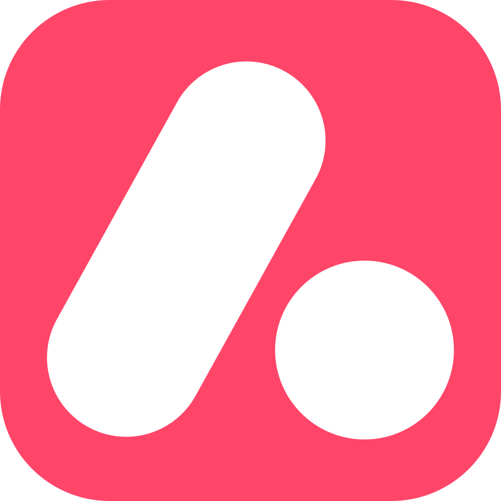
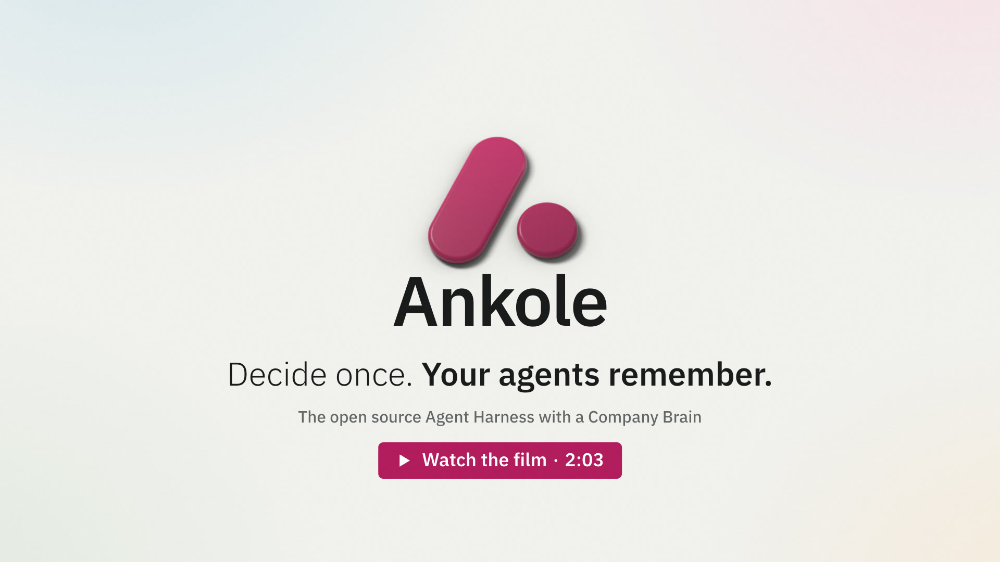
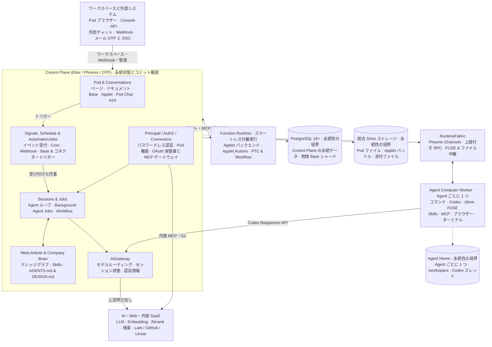

<div align="center">



# Ankole

**人と AI Agent が共に業務を回す、オープンソースのデジタル本社（Pod）**

[](LICENSE)
[](https://github.com/AgentBull/ankole/releases)

[](https://deepwiki.com/AgentBull/ankole)

[Web サイト](https://ankole.agentbull.com/ja-JP/) · [ドキュメント](https://ankole.agentbull.com/ja-JP/docs/introduction/) · [クイックスタート](#クイックスタート) · [仕組み](#仕組み) · [Discussions](https://github.com/AgentBull/ankole/discussions)

[English](./README.md) · [简体中文](./README.zh-Hans.md) · **日本語** · [한국어](./README.ko.md)

</div>

Ankole は、AI ネイティブなチームのためのオープンソースのオンラインワークスペース（**Pod**）兼マルチエージェントランタイムです。1 つのブラウザー上のワークスペースで、メンバー、各メンバー専属の**パーソナルアシスタント（Personal Assistant）**、および職能別の **AI 同僚（AI Colleague）** が、**共同編集ドキュメント**や**スライド**、リレーショナルな業務テーブル（**Base**）、ステートレスなクラウドバックエンドと決定論的な自動アクション（**Applet Actions**）を備えたカスタム業務ツール（**Applet**）、ピアツーピアの Agent 間委任に対応する **Pod Chat**、さらに組織の知識と規約を集約する **`Meta Ankole`**（**Company Brain**、共有 **Skill**、**`AGENTS.md` / `DESIGN.md`**）を共有します。Slack、Lark/Feishu、Microsoft Teams、DingTalk、WeCom、GitHub、Linear、メールは統合**コネクター（Connectors）**として接続されます。

単発のプロンプトや野放しの完全自動化ではなく、Ankole は日々の業務を**人が要所で判断する業務ループ（Loop）**として構成します。定型のスケジュール実行や Webhook・テーブル更新トリガーは公開済みの **Applet Actions** が LLM トークン消費ゼロで決定論的に処理し、社内ツールの構築や専用 Linux コンテナーでの高度な調査・長時間ジョブは Agent が継続実行します。現場の文脈の付与や重要操作の承認は人間が**選択カード（Choice Card）**や**操作承認カード（Action Approval Card）**で行います。すべての機能は Apache 2.0 のセルフホスト版コアに含まれています。

<p align="center">
  <a href="https://x.com/AgentBullLab/status/2108582424959721707/video/1">
    
  </a>
</p>

## クイックスタート

Docker Compose を使うと、Linux、macOS、Windows の 1 台のホストに完全な環境をデプロイできます。スタックには PostgreSQL 18、`ankole-function-runtime`（Applet バックエンド、Applet Actions、決定論的プログラムのステートレス分離実行環境）、データベースマイグレーション、Control Plane、HTTPS サーバーの Caddy が含まれます。必要なもの：

- Linux の `amd64` または `arm64` コンテナーを実行できる Docker と、PostgreSQL、ファイルストレージ、および稼働する Agent ごとに 1 つの Worker コンテナー分のメモリーとディスク。
- Ankole に Docker ソケットへのアクセスを許可できるホスト。Control Plane は `/var/run/docker.sock` を通じて Worker コンテナーを作成します（このソケットへのアクセスはホストの root 権限と同等です）。
- ホストを指す DNS 名と開放された `80` / `443` 番ポート（手元のマシンで試す場合は `ankole.localhost` を使用できます）。
- モデルプロバイダーの API キー、およびパスワードレスメール認証用の SMTP 設定またはエンタープライズ SSO アプリ。Slack、Lark/Feishu、DingTalk、WeCom、Discord、Telegram、メールは Ankole から外向きに接続するためローカル試用でも動作します。Microsoft Teams、LINE、WhatsApp はホストへ Webhook を送るため公開 HTTPS アドレスが必要です。

1. デプロイ用ファイルを取得します：

```bash
git clone https://github.com/AgentBull/ankole.git
cd ankole/tools/deploy/docker-compose
cp .env.example .env
chmod 600 .env
```

2. `.env` に次の必須項目を設定します：

| 変数 | 値 |
| --- | --- |
| `ANKOLE_HOST`、`ACME_EMAIL` | ホストの DNS 名（ローカル試用では `ankole.localhost`）と、TLS 証明書通知用のメールアドレス |
| `POSTGRES_PASSWORD` | `openssl rand -hex 24` で生成した 16 進数の値 |
| `ANKOLE_SECRET_BASE`、`RELEASE_COOKIE`、`ANKOLE_FUNCTION_RUNTIME_TOKEN` | `openssl rand -hex 32` で別々に生成した 3 つの独立した 16 進数の値 |
| `ANKOLE_DOCKER_GID` | Linux では `stat -c %g /var/run/docker.sock` の出力、macOS の Docker Desktop では `0` |

3. スタックを起動し、1 回限りのアクティベーションコードを確認します：

```bash
docker compose pull
docker compose up -d
docker compose logs control-plane | grep "SETUP ACTIVATION CODE"
```

Control Plane の起動完了後にコードが出力されます。何も表示されない場合は数秒待ってから再実行してください。

`ankole.localhost` を使う場合、Caddy は独自のローカル認証局で証明書に署名し、`/setup` には信頼された HTTPS が必要です。ローカル認証局のルート証明書をコピーし、OS の証明書ツールで信頼させます：

```bash
docker compose cp caddy:/data/caddy/pki/authorities/local/root.crt ./ankole-local-ca.crt
```

4. `https://<ANKOLE_HOST>/setup` を開き、コードを入力して必要なプラグインを選択し、管理者のパスワードレスサインイン方式を **6 桁のメール認証コード（SMTP、保存前に実際のテスト送信で締め出しを防止）**または**エンタープライズ SSO** で設定します。続いて管理コンソールでモデルプロバイダーを追加し、Agent を作成します（API キーは `.env` ではなくコンソールに保存します）。設定後はそのまま **Pod ワークスペース**でドキュメント、Base、Applet、Pod Chat を使い始めるか、外部チャットを接続して Agent にメッセージを送れます。

<details>
<summary>Claude Code や Codex と一緒にセットアップを進める</summary>

```text
https://ankole.agentbull.com/ja-JP/docs/quickstart/index.md を使って、Ankole のプライベートデプロイメントインスタンスのデプロイと設定を手伝ってください。まず、私の環境を調査し、Docker Compose、Kubernetes、またはソースからのインストールのいずれかを推奨してください。次に、パスワードレスのメール認証（Email OTP）またはエンタープライズ SSO の Identity Provider（IdP）によるサインインと、LLM Provider、Agent、Channel Provider、Signal Routing Rule（Signal Binding）のセットアップを手伝ってください。サインイン方式と IM プラットフォームを指定していない場合は、使用したいサインイン方式（SMTP メール認証またはエンタープライズ IdP）とチャットプラットフォームを尋ねてください。勝手に選択しないでください。chat やコマンドの出力に secret を露出しないでください。選択した IM で実際の Agent の返信を受け取ったときにだけ、作業は完了とみなします。
```

</details>

その他の実行方法：

- **Kubernetes**：同梱または外部 PostgreSQL を使う [Helm チャート](tools/deploy/helm/ankole-agent/README.md)（英語）。
- **Cloudflare Containers**：[Cloudflare Worker アダプター](tools/deploy/cloudflare/agent-workers/README.md)（英語）。
- **ソースから実行**：[CONTRIBUTING.md](CONTRIBUTING.md)（英語）（`bun install`、`bun run services:start`、`bun run control-plane:setup`、`bun dev`）。

各 ID プロバイダー、モデルプロバイダー、チャットプラットフォームの詳細手順は[クイックスタート](https://ankole.agentbull.com/ja-JP/docs/quickstart/)を、バックアップやアップグレードは [Compose ガイド](tools/deploy/docker-compose/README.md)（英語）を参照してください。

## Pod を構成する 5 つのモジュール

各企業やチームは独立した **Pod** を持ち、`Home`・`Chat`・`Meta Ankole` を軸に連携する 5 つのモジュールを利用できます：

- **ワークスペースページ（`Pod Home`）**：チーム共有の**スペース**と個人の**プライベート**に分かれた階層ディレクトリ、読みやすい `<title-slug>-<short-id>` URL、閲覧権限に厳密に従う高速全文検索を備えます。
  - **共同編集ドキュメント（`Doc`）**：人と Agent がカーソルを奪い合わずに同時編集でき、`@` によるメンバーやページのインライン参照、Base ビューやサブページの埋め込みに対応します。段落・コード行・CSV 行・音声動画タイムスタンプに紐づくマルチモーダルな**アンカー付きコメント**（`@Agent` 起動対応）で議論でき、`30` 日間の自動バージョン履歴からいつでも比較・復元できます。
  - **リレーショナル業務テーブル（`Base`）**：複数サブテーブル、グリッド・カンバン・ギャラリービュー、数式、リレーション、添付ファイル、業務キーによる自動名寄せ更新（Upsert）、データ変更トリガーに対応します。小規模な表は即座に開き、大規模な表は物理シャーディングされた PostgreSQL 上で単一テーブル **10 万行以上**でも軽快に動作します。
  - **オンデマンド業務アプレットと自動アクション（`Applet` & `Applet Actions`）**：業務ルールを自然言語で伝えるだけで、Agent が React フロントエンドとステートレス TypeScript バックエンド（`Function Runtime`）を持つ業務ツールを構築・公開します。通常の参照・操作は利用者の権限（`AnkoleRuntime`）で動き、現場からの限定送信などは公開者が明示した管理経路（`AnkoleRuntime.admin`）で安全に処理されます。公開済みの **Applet Actions** は Cron・Webhook・Base 変更・コネクターイベントを契機にスライス単位で再開可能に動作し、**LLM トークン消費ゼロ**で定型処理を実行します。エンジニアは `applet pull` で全ソースコードと設定をいつでもエクスポートできます。
  - **ファイル、スライド、統合ドライブ（`File` / `Slides` / `Drive`）**：PDF、プレゼンテーション、スプレッドシート、コード、画像、音声・動画をブラウザー内でプレビュー・コメントでき、Agent は `/drive` の FUSE マウントを通じて許可されたページやファイルを直接読み書きします。
- **パーソナルアシスタント、AI 同僚、マルチプレイヤー `Pod Chat`**：すべての正規メンバーに専属の**パーソナルアシスタント**（`New Chat` の既定相手、本人の日常コラボ権限を投影）が付き、職能別の **AI 同僚**は固有の 1 対 1 スレッドと役割別の権限を持ちます（1 対 1 会話に他のメンバーを追加すると**新しいグループチャット**が作られ、既存の個別履歴は秘匿されます）。**ピアツーピア A2A 委任**（`send_to_agent`）により、パーソナルアシスタントが裏側の専用ルームで専門の AI 同僚に作業を委任し、確認質問があれば中継なしで元の会話へ直接届けます。`@Agent`・`@メンバー`・`@ページ` 参照、Agent ごとの**自発的な割り込み許可**スイッチ（オフ時は人間同士の議論でトークン消費ゼロ、Agent の返信が他 Agent を起動しない）、**選択カード**と権限外変更時の**操作承認カード**（`propose_action_card`）、実行中の軌道修正 **Steer**、複数メッセージの画像共有・ドキュメント書き出し、および各ページ右側の**個人専用アシスタントパネル**を備えています。
- **`Meta Ankole`：Company Brain、Skill センター、Agent 規約**：
  - **Company Brain** は、「業務事実の抽出」を有効にしたスペースページ、Base レコード、Applet、ファイル、Pod Chat、外部スレッドを対話型のナレッジグラフ（オントロジー分類・最大 `200` 世代の履歴保持）として結び付けます。すべての Claim に出所・日時・保有者・公開範囲を記録して**客観的事実**・**未検証の仮説**・**AI の推測**・**人の決定**を厳密に区別し、矛盾を自動検知し、Base の業務レコードを勝手に書き換えません。裏側の抽出や Dreaming は専用の `ankole_brain` システム主体が実行します。
  - **Skill センターと `AGENTS.md` / `DESIGN.md` 規約**：組み込み・プラグイン Skill に加えてメンバーが独自 **Skill** を共同編集でき、Agent は共有 `SKILL.md` を書き換えずに事例付きの **Skill 教訓（`Skill Lessons`）**を蓄積します。全体および Agent 個別の `AGENTS.md` と `DESIGN.md` により、行動規範とデザイン品質を全社で統一できます。
- **統合コネクター（`Connectors`）とバックグラウンド継続実行**：Pod のコネクター保管庫がアプリ認証情報とメンバー個人の PKCE OAuth 連携を一元管理し、エンタープライズ SSO、外部チャット（`Externals`）、Applet、Turn 単位の Git 認証、および Control Plane のステートレス **MCP ゲートウェイ**（Lark/Feishu の IM・承認・タスク・カレンダー、GitHub、Linear、リモート HTTP MCP サーバー）で安全に共有します（生の秘密鍵を Worker や Applet サンドボックスに渡しません）。定型処理は **Applet Actions**、長時間の調査・推論は **Background Agent Jobs** とアイドル時のコールドウェイク・ローテーションが継続実行します。
- **パスワードレス認証とエンタープライズ権限ガバナンス**：
  - **パスワードレス認証とタブ単位の ID 分離**：個人の**メール OTP** と企業の **SSO**（Lark/Feishu、Slack、Microsoft Entra ID、Google Workspace、DingTalk、WeCom）の併用、メールドメイン許可リスト、正規メンバーへの SSO 強制、複数 Pod の切り替えとブラウザーのタブごとの ID 分離、最後の有人管理者の削除・ロックアウト防止を備えます。
  - **2 階層共有とページ権限**（当該ページのみ `self` または配下サブツリー全体 `container` を個人・グループに付与可能、**50 万ページ**規模でも即座に判定）：**閲覧可能**、**データを送信可能**（現場入力向け：Applet からレコード追加や添付送信はできるが、別管理の仕入原価テーブル閲覧や列構造変更、ソース・秘密情報の閲覧は不可）、**編集可能**、**フルアクセス**の 4 段階に加え、独立した**コメント権限**を制御できます。
  - **3 つのセキュリティ境界**：① **役割に忠実な Agent 権限とルーム参加者積集合**——メンバーのパーソナルアシスタントは本人の日常コラボ権限を投影（管理コンソール特権は除外）し、職能別の AI 同僚は自身の付与権限で動作して権限外の変更時は**操作承認カード**で有権者の承認を求め、会話および Company Brain の情報開示は **`依頼者 ∩ Agent ∩ ルーム全員`** の共通部分に厳密制限してグループチャットからの情報漏洩を防ぎます。② **外部ゲスト隔離**——プライベート領域・パーソナルアシスタントなし、社内名簿・設定・社内 Company Brain を遮断し、明示的に共有されたページのみ表示。③ **一時停止と退職処理の分離**——休職時は一時停止で即時凍結・復帰でき、正式な退職処理ではパーソナルアシスタントの無効化、個人 OAuth コネクター連携と所有ジョブの失効に加えて**社内メールアドレスと電話番号の紐付けを自動解放**します。

## 業務ループと開発タスクの例

| シナリオ | Ankole での動き |
| --- | --- |
| **現場スマホ検品 Applet と原価の秘匿** | BOM の **Base** に対して検品ルールを伝え、スマホ用検品 **Applet** を公開。工場の検査員には**データを送信可能**権限だけを付与して写真と合格率を登録させ、工場別の段階仕入単価テーブルは経営陣と購買のみ閲覧可能に保ちます。 |
| **複数倉庫の在庫監視と補充ループ** | 定期実行の Applet Action と担当 Agent が倉庫在庫、海上輸送の到着予定日、施策スケジュールを照合して経営ダッシュボード Applet を更新。欠品リスクを検知すると物流ルームに倉庫間転送の**選択カード**を出し、承認後にコネクター経由で出荷指示を送ります。 |
| **ロット品質サーキットブレーカー** | 修理受付の追加を Base トリガーで検知。同一製造ロットの不良件数が閾値を超えると、Agent が **Company Brain** から出荷検査記録と未出荷在庫をたどり、在庫ロックと工場へのクレーム起票をまとめた承認カードを提示します。 |
| **リポジトリの Issue 修正と PR 作成** | チャットで `@Ankole` に Issue 番号を伝えると、隔離された **Agent Computer Worker** コンテナー内でコネクターの Turn 限定 Git 認証情報を使って Codex を実行し、PR リンクを返します。 |
| **競合仮説の Deep Research と週次レビュー資料** | 分離された複数コンテキストで証拠を集めて仮説を検証する **Deep Research** レポートを作成したり、毎週月曜朝に実績データから定例用の**スライド**下書きとアーカイブ週報ページを自動生成します。 |

## 対応プラットフォーム

| 分野 | 対応範囲 |
| --- | --- |
| ワークスペース（`Pod`） | 共同編集ドキュメント、リレーショナルテーブル Base（グリッド / カンバン / ギャラリー、インラインおよび物理シャード PostgreSQL）、React + TypeScript 製カスタム Applet と Applet Actions（`Function Runtime`）、アンカー付きコメント対応のファイル・スライドプレビュー、パーソナルアシスタントと Pod Chat、`Meta Ankole`（`Company Brain`、`Skills`、`AGENTS.md` / `DESIGN.md`） |
| コネクターと MCP ツールキット | アプリ認証・個人 PKCE OAuth 統合保管庫（`Ankole.Connectors`）、Lark/Feishu（IM・承認・タスク・カレンダー）・GitHub・Linear・リモート HTTP MCP サーバー向け Control Plane ステートレス MCP ゲートウェイ、Turn 単位の Git 認証ヘルパー |
| 外部チャットとメール | Slack、Microsoft Teams、Lark/Feishu、DingTalk、WeCom、Telegram、Discord、LINE、WhatsApp、メール |
| サインインとディレクトリ同期 | パスワードレスメール OTP（SMTP）、Lark/Feishu、Slack、Microsoft Entra ID、Google Workspace、DingTalk、WeCom（OIDC/OAuth SSO と組織ディレクトリ同期） |
| モデル | OpenAI、Azure OpenAI、Claude、Google AI Studio、Google Vertex AI、OpenRouter、AgentBull Cloud、ChatGPT サブスクリプション、OpenAI API 互換の任意のエンドポイント（自社ホストモデルを含む）。中国市場向けプラグインで Volcengine Ark、Alibaba Cloud DashScope CN、Z.AI Coding Plan、Xiaomi MiMo にも対応。 |
| Web 検索とページ読み取り | AgentBull Cloud、Parallel（`parallel.ai`）、Jina、Bright Data SERP、およびローカル Chromium レンダリング取得（`ankole-browser`） |
| Agent コンピューター | Docker、Kubernetes、Cloudflare Containers、Vercel、AWS Lambda MicroVMs、Alibaba Cloud Function Compute |
| デプロイ形態 | 1 台のホストでの Docker Compose、Kubernetes の Helm チャート、またはソースビルド（機能制限のない Apache 2.0 オープンソースコア。オプションで AgentBull Cloud の集約 API キーから各種モデルと Web 検索を一括利用可能） |

## 仕組み

1 つの Ankole サイトには、分離された複数のテナントをホストできます。各テナントは独自の Pod ページ、Base レコード（テナントに割り当てられた物理 Base シャードに保存）、Principal、パーソナルアシスタントと AI 同僚、Company Brain、Skill、コネクターを持ち、サイト運用者が共有のモデルプロバイダー、Worker プロバイダー、基盤を管理します。

Ankole は 5 つのランタイム要素で構成されます：

- **Control Plane**（Elixir、Phoenix、OTP）：永続状態、スーパービジョン、コミット権限を保持し、Pod ワークスペース、`Meta Ankole`（`Library` と `Company Brain`）、Principal / AuthZ、`Connectors`（資格情報保管庫とステートレス MCP ゲートウェイ）、設定、Conversations、Signals、Schedule、`AutomationJobs`（公開済み Applet Actions のオーケストレーション）、Sessions、Background Agent Jobs、Workflow、AIGateway を動かします。
- **Function Runtime**（`ankole-function-runtime`）：Pod Applet のバックエンドルート、**公開済み Applet Actions**、および決定論的 TypeScript（`PTC`・`Workflow`）プログラムをステートレスな Edge Runtime 分離環境で実行し、Control Plane のホスト・MCP ブリッジ経由で連携します（永続状態や生の秘密鍵は保持しません）。
- **Agent Computer Worker**（Bun と TypeScript、Agent ごとに 1 つの Linux コンテナー）：コマンド、ブラウザー、Codex、ローカル MCP サーバー、Skill を実行し、許可された Pod ページやファイルを `/drive` に FUSE マウントして Turn ごとに Control Plane 経由で Git 認証を行います。コンピューターが必要な作業のときだけ Docker、Kubernetes、またはクラウド基盤上で Worker を起動します。
- **Kernel**（Rust、Rustler と Node-API 経由でロード）：暗号処理、テナントスコープの UID と短縮 URL、CEL 権限評価、Page XML / OKF Markdown / WebDAV VFS コーデック、UTF-16 ページ差分、AI 通信を担います。
- **PostgreSQL 18+ と統合 Drive ストレージ**：PostgreSQL が Control Plane の永続ドメインデータと物理シャード化された Base テーブル（`BASE_DB_URLS`）を保存します。統合 Drive オブジェクトストレージは Pod ファイル、ビルド済み Applet バンドル、添付ファイルを保持し、各 Agent の `/workspace`（Agent Home）はコンテナー置換後も永続化されます（`/var/cache/ankole` は再構築可能）。

<details>
<summary>アーキテクチャ図</summary>

所有権と永続性の境界を示します（モジュール内部の呼び出しは省略）。



</details>

[docs/README.md](docs/README.md)（英語）は各モジュールの全体像を示し、[設計ドキュメント](docs/design-docs/)（英語）は各サブシステムの契約を定めます。[なぜ OTP はより良いマルチエージェント・オーケストレーションのランタイムなのか](https://ding.ee/ja-JP/why-otp-is-a-better-runtime-for-multi-agent-orchestration/)ではランタイム選定の理由を解説しています。

## 現状と既知の制限

Ankole は本番環境で稼働しており、Ankole の Agent 自身も企業向けと同じ Pod、Company Brain、ツール、作業ルールを使ってこのリポジトリの保守に参加しています。重要なコードと主要なステートマシンには形式検証を適用し、専用のエンドツーエンドテストが Pod 共同編集、Base シャーディング、Applet、Slack/Lark/DingTalk/WeCom のメッセージ経路、スケジュール、Worker コンピューター、障害復旧、並行処理、アップグレードを検証しています。パブリック API はまだ互換性を保証していないため、アップグレード前に[変更履歴](CHANGELOG.md)（英語）を確認してください。

[トレードオフと既知の制限](docs/TradeoffsAndKnownLimits.md)（英語）に Ankole が保証しない境界をまとめています：

- 1 つのサイトで組織データが分離された複数テナントを運用できますが、全テナントはサイト運用者を信頼し、Control Plane、`Function Runtime`、モデルプロバイダー、Worker プロバイダーを共有します。
- Worker コンテナーがその Agent の唯一の隔離境界であり、Agent 自身の操作から Worker を保護する仕組みはありません。
- クラウド Worker プロバイダーごとに検証範囲が異なります。詳細は [Agent Workers](docs/design-docs/AgentWorkers.md#provider-verification)（英語）を参照してください。

## ドキュメント

| ガイド | 内容 |
| --- | --- |
| [はじめに](https://ankole.agentbull.com/ja-JP/docs/introduction/) | Pod、Agent、Company Brain、Skill、権限、デプロイの構成要素 |
| [クイックスタート](https://ankole.agentbull.com/ja-JP/docs/quickstart/) | デプロイ、メール OTP・SSO サインイン、モデルプロバイダー、チャット接続の手順 |
| [アーキテクチャ](https://ankole.agentbull.com/ja-JP/docs/architecture/) | Control Plane、Function Runtime、Worker、永続化の境界 |
| [FAQ とトラブルシューティング](https://ankole.agentbull.com/ja-JP/docs/faq/) | よくある障害の原因と対処方法 |
| [デプロイガイド](tools/deploy/README.md)（英語） | Docker Compose、Kubernetes Helm、Cloudflare Containers |
| [設計ドキュメント](docs/design-docs/)（英語） | 各サブシステムの契約と不変条件 |

## コントリビュート

コントリビューションを歓迎します。[CONTRIBUTING.md](CONTRIBUTING.md)（英語）はクリーンな環境から検証済みのエンドツーエンド構築までを案内し、[AGENTS.md](AGENTS.md)（英語）はエンジニアリングルールを定めています。コーディングエージェントに次のプロンプトを渡してセットアップを進めることもできます：

```text
https://github.com/AgentBull/ankole/blob/main/CONTRIBUTING.md を最初から最後まで読み、そのガイドに厳密に従って、現在の Ankole リポジトリで完全なローカル環境の構築と文書化された end-to-end 検証を案内してください。安全で可逆な手順と検証はあなたが実行し、アカウント、secret、OAuth、または破壊的操作の承認が必要な場合だけ停止して私を案内し、記載された成功条件をすべて満たすまで完了と報告しないでください。
```

## コミュニティ

- 質問や Ankole で構築した業務ループ・Applet の共有は [GitHub Discussions](https://github.com/AgentBull/ankole/discussions) へどうぞ。
- バグ報告や機能要望は [GitHub Issues](https://github.com/AgentBull/ankole/issues) へお寄せください。
- Ankole が役に立ったら、ぜひリポジトリに Star を付けてください。リリース通知を受け取るには **Watch** → **Custom** → **Releases** を選択します。

## ライセンス

Ankole のライセンスは [Apache License 2.0](LICENSE) です。
