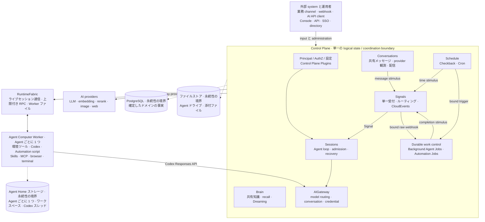

<div align="center">


# Ankole

**Company Brain を備えたオープンソースの Agent Harness**

[](LICENSE)
[](https://github.com/AgentBull/ankole/releases)

[](https://deepwiki.com/AgentBull/ankole)

[Web サイト](https://ankole.agentbull.com/ja-JP/) · [ドキュメント](https://ankole.agentbull.com/ja-JP/docs/introduction/) · [クイックスタート](#クイックスタート) · [Discussions](https://github.com/AgentBull/ankole/discussions)

[English](./README.md) · [简体中文](./README.zh-Hans.md) · **日本語** · [한국어](./README.ko.md)

</div>

[](https://x.com/AgentBullLab/status/2108582424959721707/video/1)

Ankole は、会社のために継続して働く AI Agent を動かします。一人会社から大企業まで使えます。利用者は Slack、Microsoft Teams、Lark、DingTalk、WeCom など、普段使っているチャットツールから Agent に仕事を頼みます。

プロンプトといくつかのツールを与えただけのモデルは、毎回ゼロから仕事を始めます。チームが先週決めたことを知らず、持っている権限をそのまま使い、プロセスが止まれば仕事も止まります。Ankole は、この欠けた部分を補う Harness です。Ankole の Agent は、チームの決定を覚えている Company Brain を共有します。Agent は与えられた権限の範囲で働き、クラッシュや再起動の後も長いタスクを復旧します。各 Agent はコンテナーの中に専用の Linux コンピューターを持ちます。システム全体は、自分たちが管理する基盤で運用します。

Ankole は Claude Tag のオープンソース代替です。Claude Tag は Anthropic がホストする Slack 用エージェントです。Ankole は Slack にも Claude のモデルにも縛られず、会社のコンテキストを自社のサーバーに保存します。モデルと検索の呼び出しは設定したプロバイダーにだけ送られ、自社でホストするモデルも指定できます。

> **#リサーチ** · グループチャット
>
> **Ravi：** 景気循環株は景気の一巡を通して見る。3 年では短すぎる\
> **Mia：** 同意、最低 7 年
>
> *3 日後*
>
> **Sam：** @Ankole 非鉄金属銘柄のバリュエーションを頼む\
> **Ankole：** 了解。3 日前にこのチャンネルで決まったとおり、景気循環株のパーセンタイルは 7 年分のデータで算出します。\
> 添付：`非鉄金属バリュエーション.pdf`（14 ページ）

このルールを覚えるよう Ankole に頼んだ人はいません。Company Brain は Ankole が参加しているチャットからルールを学び、出所と日付を記録し、それを必要とする次の依頼に適用しました。

## Ankole を選ぶ理由

推論するのはモデルです。モデルを取り巻く Harness は、モデルに何を見せ、何を許すかを決めます。障害の後に仕事をどう続けるか、結果をどう次の判断に生かすかも決めます。Ankole は、これらの判断をプロンプトごとに任せず、システムに組み込みます。

- **Agent は会社が決めたことを覚えています。** Company Brain は、会話、登録したファイルと URL、Agent が書いたメモから学習します。知識は 1 件ずつ Claim として保存され、出所、時点、確信度、閲覧範囲、保有者（その見解を持つ人または Agent）が記録されます。新しい証拠は現在の見解を更新し、履歴も残します。矛盾する Claim は、確認できるように表示されたままになります。
- **各 Agent は与えられた権限の範囲で働きます。** 人と Agent にはそれぞれ ID と権限があり、Agent 同士がコンピューター、ホームディレクトリ、認証情報を共有することはありません。モデルが社内知識を読む前に、Company Brain は質問者に閲覧権限のない内容を取り除きます。グループチャットでは、メンバー全員の権限を適用することもできます。PostgreSQL は、各 Agent が受けた依頼、行ったモデル呼び出し、届けた結果を記録します。Agent ごとの token クォータがモデルの利用量に上限を設けます。退職者をオフボーディングすると、その人のサインインが無効になり、その人が所有するタスクとスケジュールも止まります。
- **何かが起きたときに仕事が始まります。** メッセージ、スケジュール、Webhook などの外部イベントが、その仕事を担当する Agent を起動します。Agent は自分でリマインダーを設定し、後で改めて確認することもできます。
- **長い仕事は障害から復旧します。** タスクは数時間から数日実行でき、実行中も新しい入力を受け取れます。Control Plane は Elixir/OTP で動くので、クラッシュは発生した会話の中だけにとどまり、ほかの仕事は続きます。PostgreSQL は、Ankole が仕事を続けるために使う入力、モデル履歴、ツールの結果を保存します。
- **各 Agent に専用のコンピューターがあります。** Linux コンテナーが、ブラウザー、ターミナル、ファイル、Codex、MCP（Model Context Protocol）サーバー、Skill を Agent に提供します。Skill は、ある種類の仕事のために承認された手順です。ホームディレクトリは再起動やアップグレードの後も残ります。
- **修正と結果が後の仕事に生かされます。** Deep Research は、互いに分かれた複数のコンテキストで証拠を集め、競合する仮説を検証し、出典付きのレポートを返します。修正が繰り返されると、Agent は Skill 教訓を提案できます。Skill 教訓は Skill に追加される短いルールで、人が承認すると有効になります。Company Brain に記録された予測の期限が来ると、Company Brain は予測と実際の結果を比べます。

Ankole は、会社の仕事のための完結したシステムで、ライブラリではありません。Control Plane、データベース、Agent コンピューターを含みます。自分のアプリケーションにエージェントループを組み込みたい場合や、私生活の用事を手伝うアシスタントが欲しい場合は、より小さなツールが向いています。

## よくある依頼

次のような依頼が、グループチャットやダイレクトメッセージで届きます。

| 依頼 | Ankole の対応 |
| --- | --- |
| 「毎週金曜 17:00 に、X のこの 9 つのアカウントの投稿をトピック別にまとめた PDF をこのチャンネルに送って」 | 毎週のスケジュールを作成します。毎週、各アカウントの投稿を読み、PDF を作成して投稿します。 |
| 「@Ankole うちのリポジトリの issue #482 を直して、プルリクエストを作って」 | 管理者が設定したリポジトリの認証情報を使ってバックグラウンドジョブで Codex を実行し、プルリクエストのリンクを返信します。 |
| 「今週このグループで話した内容を要約して、未完了のアクションアイテムを挙げて」 | 閲覧権限のあるチャンネル履歴を読み、要約と一覧を返信します。 |
| 「この段落をスライドにして」「この PDF を韓国語に翻訳して」 | PowerPoint ファイルまたは翻訳した PDF を返します。 |
| 「取引先についてのこの噂は本当？」 | Deep Research を実行し、噂を支持する証拠と否定する証拠を示した出典付きの概要を返します。 |
| 「公開されている算出ルールからこの株価指数を再計算して、公式の値と並べたグラフにして」 | データを取得し、Jupyter ノートブックで指数を計算して、グラフを送ります。 |

## 対応プラットフォーム

| 分野 | 対応 |
| --- | --- |
| チャットとメール | Slack、Microsoft Teams、Lark/Feishu、DingTalk、WeCom、Telegram、Discord、LINE、WhatsApp、メール |
| サインインとディレクトリ同期 | Slack、Microsoft Entra ID、Google Workspace、Lark/Feishu、DingTalk、WeCom、組み込みのパスワードアカウント |
| モデル | OpenAI、Azure OpenAI、Claude、Google AI Studio、OpenRouter、ChatGPT サブスクリプション、OpenAI API 互換の任意のエンドポイント。中国市場向けプラグインを使うと、Volcengine Ark、Alibaba Cloud DashScope CN、Z.AI Coding Plan、Xiaomi MiMo も使えます。 |
| Web 検索とページ読み取り | Parallel（parallel.ai）、Jina、Bright Data SERP、AgentBull Cloud |
| Agent コンピューター | Docker、Kubernetes、Cloudflare Containers、Vercel、AWS Lambda MicroVMs、Alibaba Cloud Function Compute |
| デプロイ | 1 台のホストでの Docker Compose、Kubernetes での Helm チャート |

## クイックスタート

Docker Compose を使うと、Linux、macOS、Windows のいずれか 1 台のホストに完全な環境をデプロイできます。スタックには PostgreSQL、Control Plane、HTTPS サーバーの Caddy が含まれます。必要なものは次のとおりです。

- Linux の `amd64` または `arm64` コンテナーを実行できる Docker と、実行中の Agent 1 つにつきコンテナー 1 つ分のメモリーとディスク。
- Ankole に root 権限を与えてよいホスト。Control Plane は Docker ソケットを通じて Agent のコンテナーを作成します。このソケットへのアクセスは、ホストの root 権限と同じです。
- ホストを指す DNS 名と、開いているポート 80 と 443。自分のマシンで試す場合は、代わりにホスト名 `ankole.localhost` を使います。
- モデルプロバイダーの API キーと、チャットプラットフォームでボットを作成する権限。Ankole は Slack、Lark、DingTalk、WeCom、Discord、Telegram、メールに自分から接続するので、これらはローカルでの試用にも使えます。Microsoft Teams、LINE、WhatsApp はホストへイベントを送るため、公開 HTTPS アドレスが必要です。

デプロイ用のファイルを取得します。

```bash
git clone https://github.com/AgentBull/ankole.git
cd ankole/tools/deploy/docker-compose
cp .env.example .env
chmod 600 .env
```

`.env` に次の値を設定します。

| 変数 | 値 |
| --- | --- |
| `ANKOLE_HOST`、`ACME_EMAIL` | ホスト名と、証明書の通知を受け取るメールアドレス |
| `POSTGRES_PASSWORD`、`ANKOLE_SECRET_BASE`、`RELEASE_COOKIE` | `openssl rand -hex 32` で別々に生成した 3 つの値 |
| `ANKOLE_DOCKER_GID` | Linux では `stat -c %g /var/run/docker.sock` の出力、macOS の Docker Desktop では `0` |

スタックを起動し、1 回限りのアクティベーションコードを確認します。

```bash
docker compose pull
docker compose up -d
docker compose logs control-plane | grep "SETUP ACTIVATION CODE"
```

コードは Control Plane の起動後に出力されます。最後のコマンドで何も表示されない場合は、少し待ってからもう一度実行します。

`ankole.localhost` を使う場合、Caddy は独自のローカル認証局で証明書に署名します。セットアップページには信頼された HTTPS が必要です。その認証局のルート証明書をコピーし、OS の証明書ツールで信頼させます。

```bash
docker compose cp caddy:/data/caddy/pki/authorities/local/root.crt ./ankole-local-ca.crt
```

`https://<ANKOLE_HOST>/setup` を開き、コードを入力します。チャットプラットフォーム用のプラグインなど、必要なプラグインを選びます。管理者のサインイン方法として、Slack や Microsoft Entra ID などの ID プロバイダーか、ローカルパスワードを設定します。その後、管理者用の Web 画面であるコンソールで、モデルプロバイダーを追加し、Agent を作成し、その Agent にチャットプラットフォームを接続します。プロバイダーの API キーは `.env` ではなくコンソールに保存します。そのチャットで Agent にメッセージを送り、返信が届けばセットアップは完了です。

Claude Code や Codex などのコーディングエージェントと一緒に、セットアップ全体を進めることもできます。次のプロンプトを渡してください。

```text
https://ankole.agentbull.com/ja-JP/docs/quickstart/index.md を使って、Ankole のプライベートデプロイメントインスタンスのデプロイと設定を手伝ってください。まず、私の環境を調査し、Docker Compose、Kubernetes、またはソースからのインストールのいずれかを推奨してください。次に、Identity Provider（IdP）、LLM Provider、Agent、Channel Provider、Signal Routing Rule（Signal Binding）のセットアップを手伝ってください。IdP と IM プラットフォームを指定していない場合は、使用したい identity ソースとチャットプラットフォームを尋ねてください。勝手に選択しないでください。chat やコマンドの出力に secret を露出しないでください。選択した IM で実際の Agent の返信を受け取ったときにだけ、作業は完了とみなします。
```

その他の実行方法：

- Kubernetes：[Helm チャート](tools/deploy/helm/ankole-agent/README.md)（英語）は、同梱または外部の PostgreSQL を使います。
- Cloudflare Containers で Agent コンピューターを動かす：[Cloudflare アダプター](tools/deploy/cloudflare/agent-workers/README.md)（英語）
- ソースから実行する：[CONTRIBUTING.md](CONTRIBUTING.md)（英語）

完全な[クイックスタート](https://ankole.agentbull.com/ja-JP/docs/quickstart/)では、ID プロバイダー、モデルプロバイダー、チャットプラットフォームごとの手順を説明しています。バックアップ、アップグレード、トラブルシューティングは [Compose ガイド](tools/deploy/docker-compose/README.md)（英語）にあります。

## 仕組み

1 つの Ankole サイトには、分離された複数のテナントをホストできます。各テナントは独自の人、Agent、Company Brain、外部チャネル接続を持ち、サイト管理者が共有のモデルプロバイダー、Worker プロバイダー、基盤を管理します。

Ankole は、Control Plane、Agent ごとに 1 つの Worker、共有の Rust Kernel、永続ストレージで構成されます。

- **Control Plane**（Elixir、Phoenix、OTP）は、プロセスが終わっても残すべきことをすべて決定し、記録します。これには、ID と権限、設定、会話とメッセージ、シグナル、スケジュール、ジョブ、Company Brain、モデルプロバイダーを呼び出す AI ゲートウェイが含まれます。Sessions は各 Agent のモデルループをスーパーバイザー配下のプロセスとして動かします。
- 各 Agent には **Agent Computer Worker** が 1 つあります。これは Linux コンテナー内で動く Bun と TypeScript のプログラムです。Worker はコマンド、ブラウザー、Codex、MCP サーバー、Skill、Automation スクリプトを実行します。Control Plane は Docker、Kubernetes、またはクラウドプラットフォームで Worker を作成し、コンピューターが必要な作業のときだけ呼び出します。
- **Kernel** は、Elixir が読み込む Rust ライブラリです。暗号処理、識別子、権限評価、AI 通信を提供します。
- **PostgreSQL** は、再起動後も残す必要がある事実をすべて保存します。ファイルストアは各 Agent のドライブと添付ファイルを保存し、各 Agent のホームディレクトリ（Agent Home）はそれぞれのストレージに残ります。

<details>
<summary>アーキテクチャ図</summary>

この図は、所有権と永続性の境界を示します。内部呼び出しは省略しています。



</details>

[docs/README.md](docs/README.md)（英語）は各部分の全体像を示し、[設計ドキュメント](docs/design-docs/)（英語）は各部分の契約を定めます。[なぜ OTP はより良いマルチエージェント・オーケストレーションのランタイムなのか](https://ding.ee/ja-JP/why-otp-is-a-better-runtime-for-multi-agent-orchestration/)では、このランタイムを選んだ理由を説明しています。

## 現状と既知の制限

Ankole は本番環境で稼働しています。Ankole の Agent も、会社が使うのと同じ Company Brain、ツール、作業ルールで、このリポジトリの保守に参加しています。重要なコードと主要なステートマシンには形式検証を適用しています。専用のエンドツーエンドテストが、Slack、Lark、DingTalk、WeCom のメッセージ経路、スケジュール、Worker コンピューター、クラッシュからの復旧、並行処理、アップグレードを検証しています。パブリック API はまだ互換性を保証していないため、リリースに互換性のない変更が含まれることがあります。アップグレードの前に[変更履歴](CHANGELOG.md)（英語）を確認してください。

[トレードオフと既知の制限](docs/TradeoffsAndKnownLimits.md)（英語）に、Ankole が保証しないことをまとめています。特に重要な点は次のとおりです。

- 1 つのサイトで、組織データが分離された複数のテナントを運用できます。すべてのテナントはサイト運用者を信頼し、サイトのモデルプロバイダーと Worker プロバイダーを共有します。
- Worker コンテナーが、その Agent の唯一の隔離境界です。Ankole は Agent 自身の操作から Worker を守りません。
- Worker プロバイダーごとにクラウド検証の範囲が異なります。[Agent Workers](docs/design-docs/AgentWorkers.md#provider-verification-evidence)（英語）に、記録された根拠と未検証の項目をまとめています。

## ドキュメント

| ガイド | 内容 |
| --- | --- |
| [はじめに](https://ankole.agentbull.com/ja-JP/docs/introduction/) | Agent、Company Brain、Skill、権限など、デプロイメントの構成要素 |
| [クイックスタート](https://ankole.agentbull.com/ja-JP/docs/quickstart/) | デプロイ、サインイン、モデルプロバイダー、チャットプラットフォームの手順 |
| [アーキテクチャ](https://ankole.agentbull.com/ja-JP/docs/architecture/) | 各コンポーネントとその境界 |
| [FAQ とトラブルシューティング](https://ankole.agentbull.com/ja-JP/docs/faq/) | よくある障害の原因と対処 |
| [デプロイガイド](tools/deploy/README.md)（英語） | Docker Compose、Helm、Cloudflare Containers |
| [設計ドキュメント](docs/design-docs/)（英語） | 各サブシステムの契約 |

## コントリビュート

コントリビューションを歓迎します。[CONTRIBUTING.md](CONTRIBUTING.md)（英語）は、まっさらなマシンから検証済みのエンドツーエンド環境までを案内します。[AGENTS.md](AGENTS.md)（英語）はエンジニアリングのルールを定めています。どちらもコーディングエージェントが従える内容です。始めるときは、次のプロンプトをコーディングエージェントに渡してください。

```text
https://github.com/AgentBull/ankole/blob/main/CONTRIBUTING.md を最初から最後まで読み、そのガイドに厳密に従って、現在の Ankole リポジトリで完全なローカル環境の構築と文書化された end-to-end 検証を案内してください。安全で可逆な手順と検証はあなたが実行し、アカウント、secret、OAuth、または破壊的操作の承認が必要な場合だけ停止して私を案内し、記載された成功条件をすべて満たすまで完了と報告しないでください。
```

## コミュニティ

- 質問や、Ankole で作ったものの共有は [GitHub Discussions](https://github.com/AgentBull/ankole/discussions) へどうぞ。
- バグ報告や機能の要望は [GitHub Issues](https://github.com/AgentBull/ankole/issues) へどうぞ。
- Ankole が役に立ったら、リポジトリに Star を付けてください。ほかのチームが Ankole を見つけやすくなります。リリース通知を受け取るには、**Watch**、**Custom**、**Releases** の順に選びます。

## ライセンス

Ankole のライセンスは [Apache License 2.0](LICENSE) です。
