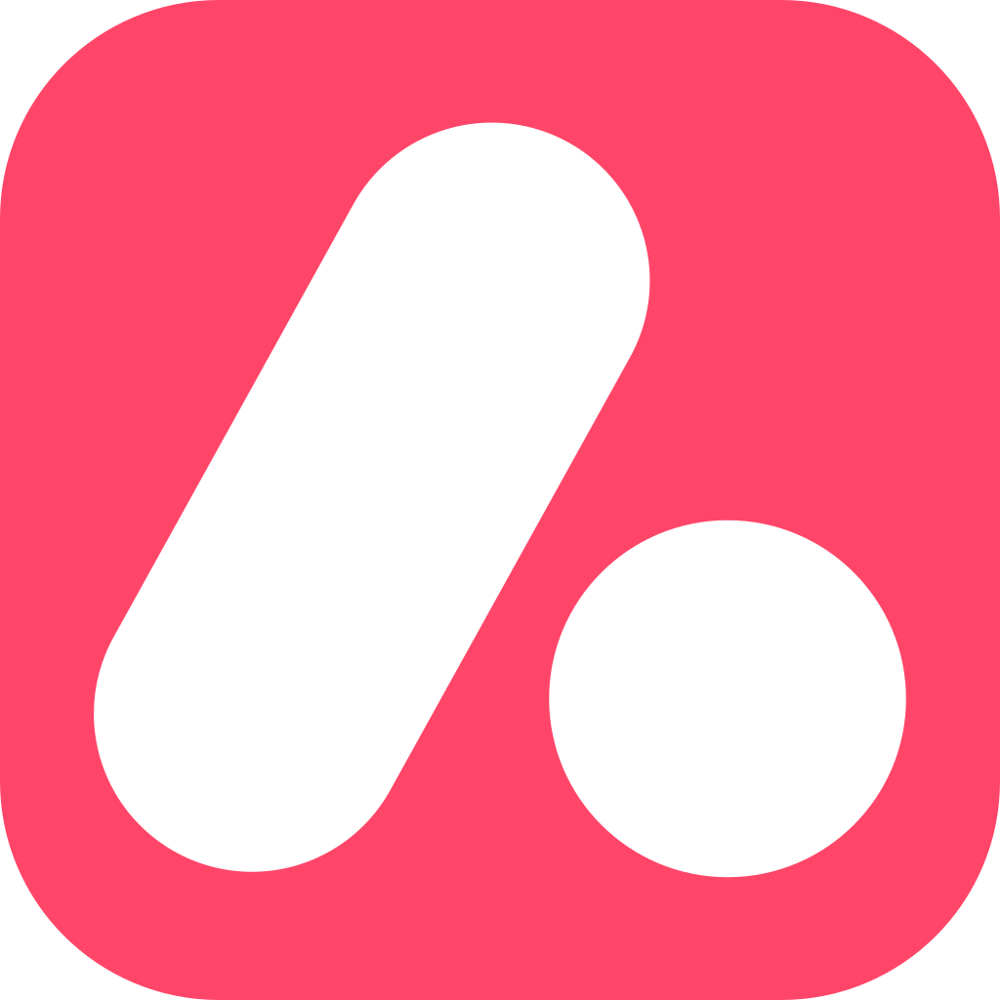
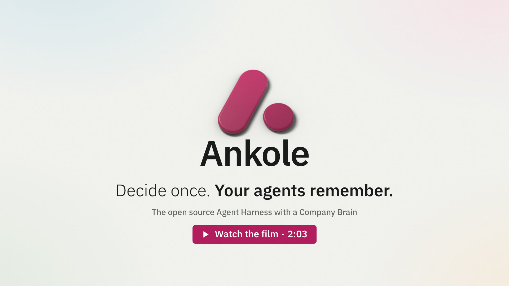
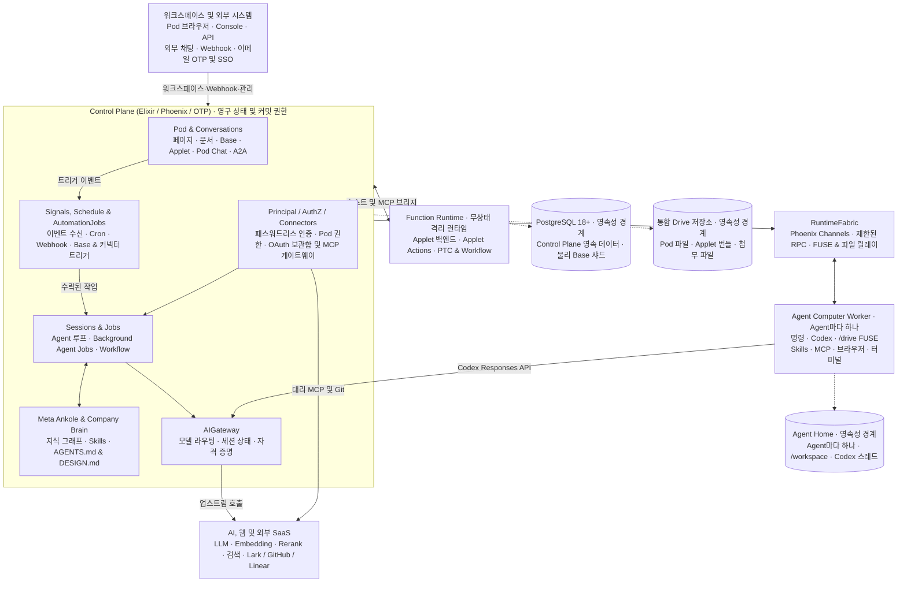

<div align="center">



# Ankole

**사람과 AI Agent가 함께 회사 업무를 운영하는 오픈 소스 디지털 본사(Pod)**

[](LICENSE)
[](https://github.com/AgentBull/ankole/releases)

[](https://deepwiki.com/AgentBull/ankole)

[웹사이트](https://ankole.agentbull.com/ko-KR/) · [문서](https://ankole.agentbull.com/ko-KR/docs/introduction/) · [빠른 시작](#빠른-시작) · [작동 방식](#작동-방식) · [Discussions](https://github.com/AgentBull/ankole/discussions)

[English](./README.md) · [简体中文](./README.zh-Hans.md) · [日本語](./README.ja.md) · **한국어**

</div>

Ankole은 AI 네이티브 팀을 위한 오픈 소스 온라인 워크스페이스(**Pod**)이자 멀티 에이전트 런타임입니다. 하나의 브라우저 워크스페이스 안에서 구성원, 각 구성원 전용 **개인 비서(Personal Assistant)**, 직무별 **AI 동료(AI Colleague)**가 **공동 편집 문서**와 **슬라이드**, 관계형 업무 테이블(**Base**), 무상태 클라우드 백엔드 및 결정론적 자동 작업(**Applet Actions**)을 갖춘 맞춤형 업무 도구(**Applet**), 피어 투 피어 Agent 위임을 지원하는 **Pod Chat**, 그리고 조직 지식과 규범을 통합 관리하는 **`Meta Ankole`**(**Company Brain**, 공유 **Skill**, **`AGENTS.md` / `DESIGN.md`**)을 함께 사용하며, 통합 **커넥터(Connectors)**로 Slack, Lark/Feishu, Microsoft Teams, DingTalk, WeCom, GitHub, Linear, 이메일을 연결합니다.

단발성 프롬프트나 무분별한 완전 자동화 대신, Ankole은 회사 업무를 **사람이 핵심 지점을 책임지는 업무 루프(Loop)**로 조직합니다. 정형 일정 실행, Webhook, 테이블 변경 트리거는 게시된 **Applet Actions**가 LLM 토큰 소모 없이 결정론적으로 처리하고, 내부 도구 제작과 전용 Linux 컨테이너에서의 심층 분석·장시간 작업은 Agent가 지속해서 수행하며, 현장의 맥락 입력과 중요 변경 승인은 사람이 **선택 카드(Choice Card)** 및 **작업 승인 카드(Action Approval Card)**로 확정합니다. 모든 기능이 Apache 2.0 셀프 호스팅 코어에 기본 포함되어 있습니다.

<p align="center">
  <a href="https://x.com/AgentBullLab/status/2108582424959721707/video/1">
    
  </a>
</p>

## 빠른 시작

Docker Compose로 Linux, macOS, Windows 호스트 한 대에 전체 환경을 배포할 수 있습니다. 스택은 PostgreSQL 18, `ankole-function-runtime`(무상태 Applet 백엔드, Applet Actions 및 결정론적 프로그램 격리 실행 환경), 데이터베이스 마이그레이션, Control Plane, HTTPS 서버인 Caddy를 실행합니다. 준비 사항:

- Linux `amd64` 또는 `arm64` 컨테이너를 실행할 수 있는 Docker와, PostgreSQL, 파일 저장소, 활성 Agent당 하나씩 생성되는 Worker 컨테이너용 메모리 및 디스크.
- Ankole에 Docker 소켓 접근을 허용할 수 있는 호스트. Control Plane은 `/var/run/docker.sock`을 통해 Worker 컨테이너를 생성하며, 이 소켓 접근 권한은 호스트의 root 권한과 같습니다.
- 호스트를 가리키는 DNS 이름과 열린 `80` / `443`번 포트(로컬 컴퓨터에서 시험할 때는 `ankole.localhost`를 사용할 수 있습니다).
- 모델 제공자의 API 키, 그리고 패스워드리스 이메일 OTP용 SMTP 설정 또는 엔터프라이즈 SSO 앱. Slack, Lark/Feishu, DingTalk, WeCom, Discord, Telegram, 이메일은 Ankole이 밖으로 연결하므로 로컬 시험에서도 동작하며, Microsoft Teams, LINE, WhatsApp은 호스트로 Webhook을 보내므로 공개 HTTPS 주소가 필요합니다.

1. 배포 파일을 가져옵니다:

```bash
git clone https://github.com/AgentBull/ankole.git
cd ankole/tools/deploy/docker-compose
cp .env.example .env
chmod 600 .env
```

2. `.env`에 다음 필수 값을 설정합니다:

| 변수 | 값 |
| --- | --- |
| `ANKOLE_HOST`, `ACME_EMAIL` | 호스트 DNS 이름(로컬 시험 시 `ankole.localhost`)과 TLS 인증서 알림을 받을 이메일 주소 |
| `POSTGRES_PASSWORD` | `openssl rand -hex 24`로 생성한 16진수 값 |
| `ANKOLE_SECRET_BASE`, `RELEASE_COOKIE`, `ANKOLE_FUNCTION_RUNTIME_TOKEN` | `openssl rand -hex 32`로 각각 따로 생성한 독립적인 16진수 값 세 개 |
| `ANKOLE_DOCKER_GID` | Linux에서는 `stat -c %g /var/run/docker.sock`의 출력, macOS Docker Desktop에서는 `0` |

3. 스택을 시작하고 일회용 활성화 코드를 확인합니다:

```bash
docker compose pull
docker compose up -d
docker compose logs control-plane | grep "SETUP ACTIVATION CODE"
```

코드는 Control Plane 시작이 끝난 뒤 출력됩니다. 마지막 명령에 출력이 없으면 잠시 기다렸다가 다시 실행하세요.

`ankole.localhost`를 사용할 때는 Caddy가 자체 로컬 인증 기관으로 인증서에 서명하며, `/setup`에는 신뢰할 수 있는 HTTPS가 필요합니다. 로컬 루트 인증서를 복사한 뒤 운영 체제의 인증서 도구로 신뢰 설정을 추가합니다:

```bash
docker compose cp caddy:/data/caddy/pki/authorities/local/root.crt ./ankole-local-ca.crt
```

4. `https://<ANKOLE_HOST>/setup`을 열고 활성화 코드를 입력한 뒤, 필요한 플러그인을 고르고 관리자 패스워드리스 로그인 방식을 **6자리 이메일 인증 코드(SMTP, 저장 전 실제 테스트 메일 발송으로 잠김 방지)** 또는 **엔터프라이즈 SSO**로 설정합니다. 이어서 관리 콘솔에서 모델 제공자를 추가하고 Agent를 생성합니다(API 키는 `.env`가 아니라 콘솔에 저장합니다). 설정을 마치면 곧바로 **Pod 워크스페이스**에서 문서, Base 테이블, Applet, Pod Chat을 사용하거나 외부 채팅 플랫폼을 연결해 Agent와 대화할 수 있습니다.

<details>
<summary>Claude Code 또는 Codex와 함께 설치 진행하기</summary>

```text
https://ankole.agentbull.com/ko-KR/docs/quickstart/index.md 문서를 참고하여 Ankole 프라이빗 인스턴스를 배포하고 구성하도록 도와주세요. 먼저 내 실행 환경을 점검해 Docker Compose, Kubernetes, 소스 빌드 설치 중 가장 알맞은 방식을 추천해 주세요. 이어서 이메일 인증(Email OTP) 또는 엔터프라이즈 SSO Identity Provider(IdP) 로그인 설정과 LLM Provider, Agent, Channel Provider, Signal Routing Rule(Signal Binding) 구성을 안내해 주세요. 로그인 방식과 메신저 플랫폼을 아직 지정하지 않았다면 어떤 방식(SMTP 이메일 인증 또는 엔터프라이즈 IdP)과 메신저를 쓸지 먼저 물어보고, 임의로 선택하지 마세요. 대화창이나 명령 출력에 비밀 키를 절대 노출하지 마세요. 선택한 메신저에서 Agent의 실제 응답을 확인했을 때만 작업을 완료로 처리하세요.
```

</details>

다른 실행 방법:

- **Kubernetes**: 내장 또는 외부 PostgreSQL을 사용하는 [Helm 차트](tools/deploy/helm/ankole-agent/README.md)(영어).
- **Cloudflare Containers**: [Cloudflare Worker 어댑터](tools/deploy/cloudflare/agent-workers/README.md)(영어).
- **소스에서 실행**: [CONTRIBUTING.md](CONTRIBUTING.md)(영어)(`bun install`, `bun run services:start`, `bun run control-plane:setup`, `bun dev`).

ID 제공자, 모델 제공자, 채팅 플랫폼별 상세 절차는 전체 [빠른 시작](https://ankole.agentbull.com/ko-KR/docs/quickstart/)에서, 백업·업그레이드·문제 해결은 [Compose 가이드](tools/deploy/docker-compose/README.md)(영어)에서 확인하세요.

## Pod를 구성하는 5가지 핵심 모듈

각 기업이나 팀은 격리된 **Pod** 안에서 `Home`·`Chat`·`Meta Ankole`을 중심으로 연결된 다섯 가지 모듈을 사용합니다:

- **워크스페이스 페이지(`Pod Home`)**: 팀 공유 **스페이스**와 개인용 **비공개** 페이지 트리로 나뉘며, 하위 페이지 구성, 읽기 쉬운 `<title-slug>-<short-id>` URL, 권한 범위가 즉시 반영되는 전문 검색을 지원합니다.
  - **공동 편집 문서(`Doc`)**: 사람과 Agent가 커서를 빼앗지 않고 동시에 편집하며, `@`로 동료와 페이지를 인라인 참조하고 실시간 Base 보기와 하위 페이지를 삽입할 수 있습니다. 문단, 코드 줄, CSV 행, 오디오·비디오 타임스탬프에 결합되는 멀티모달 **앵커 댓글**(`@Agent` 호출 지원)로 논의하고 `30`일 자동 버전 기록에서 언제든 비교·복원할 수 있습니다.
  - **관계형 다차원 테이블(`Base`)**: 여러 하위 테이블, 그리드·칸반·갤러리 보기, 수식, 관계형 연결, 첨부 파일, 비즈니스 키 기준 자동 병합 갱신(Upsert), 데이터 변경 트리거를 지원합니다. 작은 표는 즉시 열리고, 대규모 표는 물리 샤딩된 PostgreSQL 위에서 단일 테이블 **10만 행 이상**도 쾌적하게 동작합니다.
  - **온디맨드 업무 애플릿 및 자동 작업(`Applet` & `Applet Actions`)**: 업무 규칙을 일상 언어로 설명하면 Agent가 몇 분 만에 React 프론트엔드와 무상태 TypeScript 백엔드(`Function Runtime`)를 갖춘 도구를 만들어 게시합니다. 일반 조회·조작은 현재 사용자의 권한(`AnkoleRuntime`)으로 실행되고 현장 제한 제출 같은 경로는 게시자가 명시한 관리 경로(`AnkoleRuntime.admin`)로 안전하게 처리됩니다. 게시된 **Applet Actions**는 Cron 일정, Webhook, Base 변경, 커넥터 이벤트를 받아 슬라이스 단위로 이어서 실행되며 **LLM 토큰을 전혀 소모하지 않고** 정형 업무를 처리합니다. 엔지니어는 언제든 `applet pull`로 전체 소스 코드와 설정을 내려받을 수 있습니다.
  - **파일, 슬라이드 및 통합 드라이브(`File` / `Slides` / `Drive`)**: PDF, 발표 슬라이드, 스프레드시트, 코드, 이미지, 오디오·비디오를 브라우저에서 미리 보고 댓글을 남길 수 있으며, Agent는 `/drive` FUSE 마운트로 권한 범위 내 페이지와 파일을 직접 읽고 씁니다.
- **개인 비서, AI 동료 및 멀티플레이어 `Pod Chat`**: 모든 정식 구성원에게 본인의 일상 협업 권한을 투영하는 전용 **개인 비서**(`New Chat` 기본 대상)가 제공되며, 직무별 **AI 동료**는 고유한 1:1 대화창과 역할별 권한을 유지합니다(1:1 대화에 다른 구성원을 초대하면 **새 그룹 채팅방**이 생성되어 기존 개인 대화 기록이 보호됩니다). **피어 투 피어 A2A 위임**(`send_to_agent`)을 통해 개인 비서가 백그라운드 전용 방에서 전문 AI 동료에게 업무를 위임하고 확인 질문이 있으면 중간 전달 없이 원래 대화창으로 바로 표시합니다. `@Agent`·`@동료`·`@페이지` 멘션, Agent별 **대화방 자율 개입 허용** 스위치(꺼 두면 사람끼리 논의 시 모델 비용 0, Agent 응답이 다른 Agent를 깨우지 않음), **선택 카드**와 권한 외 변경을 위한 **작업 승인 카드**(`propose_action_card`), 실행 중 방향을 바꾸는 **Steer**, 다중 메시지 이미지 공유 및 문서 내보내기, 모든 페이지 우측의 **개인 전용 비서 패널**을 제공합니다.
- **`Meta Ankole`: Company Brain, Skill 센터 및 Agent 규범**:
  - **Company Brain**은 ‘비즈니스 사실 학습’을 켠 스페이스 페이지, Base 레코드, Applet, 파일, Pod Chat, 외부 대화 스레드를 대화형 지식 그래프(온톨로지 분류 및 최대 `200`개 스냅샷 보관)로 연결합니다. 모든 Claim에 출처·시점·보유자·공개 범위를 기록해 **객관적 사실**, **미검증 가설**, **AI의 추론**, **사람이 확정한 결정**을 엄격히 구분하고 상충 내용을 표시하며, Base의 실제 업무 상태를 임의로 덮어쓰지 않습니다. 백그라운드 추출과 Dreaming은 전용 `ankole_brain` 시스템 주체가 실행합니다.
  - **Skill 센터 및 `AGENTS.md` / `DESIGN.md` 규범**: 내장·플러그인 Skill과 함께 구성원이 팀 맞춤형 **Skill**을 공동 작성할 수 있고, Agent는 공유 `SKILL.md` 원본을 변조하지 않고 사례 출처가 담긴 **Skill 교훈(`Skill Lessons`)**을 축적합니다. 전역 및 Agent별 `AGENTS.md`와 `DESIGN.md`로 전사 행동 원칙과 디자인 품질을 일관되게 유지합니다.
- **통합 커넥터(`Connectors`) 및 백그라운드 지속 실행**: Pod 커넥터 보관함이 앱 자격 증명과 구성원 개인의 PKCE OAuth 계정을 한곳에서 관리하며 엔터프라이즈 SSO, 외부 메신저(`Externals`), Applet, Turn 단위 Git 인증, 그리고 Control Plane 무상태 **MCP 게이트웨이**(Lark/Feishu 메신저·결재·작업·캘린더, GitHub, Linear, 원격 HTTP MCP 서버)에서 안전하게 공유합니다(원본 비밀 키는 Worker나 Applet 샌드박스로 전달되지 않음). 정형 자동화는 **Applet Actions**, 장시간 추론은 **Background Agent Jobs**와 유휴 세션 콜드 웨이크 순환이 재시작 후에도 끊김 없이 이어 갑니다.
- **패스워드리스 로그인 및 엔터프라이즈 권한 거버넌스**:
  - **패스워드리스 인증과 탭별 계정 격리**: 개인 **이메일 OTP**와 **엔터프라이즈 SSO**(Lark/Feishu, Slack, Microsoft Entra ID, Google Workspace, DingTalk, WeCom) 병행, 이메일 도메인 허용 목록, 정직원 SSO 강제 옵션, 다중 Pod 전환 및 브라우저 탭별 신원 격리, 마지막 인간 관리자 삭제·잠김 방지 기능을 갖추고 있습니다.
  - **2단계 공유 및 페이지 권한**(현재 페이지 `self` 또는 하위 트리 전체 `container` 단위로 개인·그룹에 부여 가능, **50만 페이지** 규모에서도 즉시 검증): **보기 가능**, **데이터 제출 가능**(현장 입력 전용: Applet으로 레코드 추가와 첨부 업로드는 가능하지만 별도 보안 처리된 원가 테이블 열람, 스키마 변경, Applet 소스·키 조회는 불가), **편집 가능**, **전체 액세스** 4단계와 독립적인 **댓글 권한**을 제어합니다.
  - **3가지 보안 원칙**: ① **역할 기반 Agent 권한 및 대화방 참석자 교집합** — 구성원의 개인 비서는 본인의 일상 협업 권한을 투영(관리 콘솔 특권 제외)하고, 직무별 AI 동료는 부여된 자체 권한으로 동작하되 권한 밖 쓰기는 **작업 승인 카드**로 권한 보유자의 승인을 거치며, 대화방과 Company Brain 메모리 공개는 **`요청자 ∩ Agent ∩ 대화방 전원`**의 교집합으로 엄격히 제한해 그룹 채팅에서의 기밀 유출을 막습니다. ② **외부 게스트 격리** — 비공개 공간 및 개인 비서 없음, 조직도·설정·내부 Company Brain 접근 차단, 명시적으로 공유된 페이지만 노출. ③ **계정 일시 정지와 퇴사 처리 분리** — 휴직 시 일시 정지로 즉시 동결·복구할 수 있고, 정식 퇴사 처리 시 개인 비서 비활성화, 개인 OAuth 커넥터 계정 및 소유 작업 해지와 함께 **회사 이메일과 전화번호를 자동 반환**합니다.

## 업무 루프 및 엔지니어링 활용 예시

| 시나리오 | Ankole에서의 실행 방식 |
| --- | --- |
| **현장 모바일 검수 Applet과 단가 보안** | BOM **Base** 위에서 검수 규칙을 설명해 모바일 검수 **Applet**을 게시합니다. 공장 검수원에게는 **데이터 제출 가능** 권한만 부여해 사진과 합격률을 등록하게 하고, 공장별 단가 테이블은 경영진과 구매팀만 볼 수 있도록 격리합니다. |
| **다중 창고 재고 및 해상 운송 보충 루프** | 정기 실행 Applet Action과 담당 Agent가 창고 재고, 해상 컨테이너 입항 예정일, 캠페인 일정을 대조해 운영 대시보드 Applet을 갱신하고, 품절 위험이 감지되면 물류 채팅방에 창고 간 이관 **선택 카드**를 올려 승인 즉시 커넥터로 출고 지시를 내립니다. |
| **배치 품질 서킷 브레이커** | 신규 수리 티켓 등록을 Base 트리거로 감지합니다. 특정 배치의 불량이 임계치를 넘으면 Agent가 **Company Brain**에서 출하 검수표와 미출고 재고를 추적해 재고 동결 및 공장 클레임 요청용 승인 카드를 발송합니다. |
| **리포지토리 이슈 수정 및 PR 생성** | 채팅에서 `@Ankole`에게 이슈 번호를 지정하면 격리된 **Agent Computer Worker** 컨테이너 안에서 커넥터의 Turn 범위 Git 자격 증명으로 Codex를 실행하고 풀 리퀘스트 링크를 반환합니다. |
| **경쟁 가설 Deep Research 및 주간 리뷰 자료** | 분리된 여러 컨텍스트에서 찬반 증거를 검증하는 **Deep Research** 보고서를 작성하거나, 매주 월요일 아침 실데이터를 바탕으로 주간 리뷰 **슬라이드** 초안과 보관용 주간 보고서 페이지를 자동 작성합니다. |

## 지원 생태계

| 분야 | 지원 범위 |
| --- | --- |
| 워크스페이스(`Pod`) | 공동 편집 문서, 관계형 테이블 Base(그리드·칸반·갤러리, 인라인 및 물리 샤드 PostgreSQL), React + TypeScript 맞춤형 Applet 및 Applet Actions(`Function Runtime`), 앵커 댓글을 지원하는 파일·슬라이드 미리 보기, 개인 비서 및 Pod Chat, `Meta Ankole`(`Company Brain`, `Skills`, `AGENTS.md` / `DESIGN.md`) |
| 커넥터 및 MCP 툴킷 | 앱 자격 증명 및 개인 PKCE OAuth 통합 보관함(`Ankole.Connectors`), Lark/Feishu(메신저·결재·작업·캘린더)·GitHub·Linear·원격 HTTP MCP 서버용 Control Plane 무상태 MCP 게이트웨이, Turn 범위 Git 자격 증명 도우미 |
| 외부 채팅 및 이메일 | Slack, Microsoft Teams, Lark/Feishu, DingTalk, WeCom, Telegram, Discord, LINE, WhatsApp, 이메일 |
| 로그인 및 디렉터리 동기화 | 패스워드리스 이메일 OTP(SMTP), Lark/Feishu, Slack, Microsoft Entra ID, Google Workspace, DingTalk, WeCom(OIDC/OAuth SSO 및 조직 디렉터리 동기화) |
| 모델 | OpenAI, Azure OpenAI, Claude, Google AI Studio, OpenRouter, AgentBull Cloud, ChatGPT 구독, OpenAI API 호환 모든 엔드포인트(자체 호스팅 모델 포함). 중국 시장 플러그인으로 Volcengine Ark, Alibaba Cloud DashScope CN, Z.AI Coding Plan, Xiaomi MiMo 추가 지원. |
| 웹 검색 및 페이지 읽기 | AgentBull Cloud, Parallel(`parallel.ai`), Jina, Bright Data SERP, 로컬 Chromium 렌더링 수집(`ankole-browser`) |
| Agent 컴퓨터 | Docker, Kubernetes, Cloudflare Containers, Vercel, AWS Lambda MicroVMs, Alibaba Cloud Function Compute |
| 배포 형태 | 단일 호스트 Docker Compose, Kubernetes Helm 차트, 또는 소스 빌드(기능 제한 없는 100% Apache 2.0 오픈 소스 코어, 선택 사항으로 AgentBull Cloud 통합 API 키 하나로 모델과 웹 검색 일괄 연동 가능) |

## 작동 방식

하나의 Ankole 사이트 배포에서 격리된 여러 테넌트를 호스팅할 수 있습니다. 각 테넌트는 고유한 Pod 페이지, Base 레코드(테넌트에 할당된 물리 Base 샤드에 저장), Principal, 개인 비서와 AI 동료, Company Brain, Skill, 커넥터를 소유하며, 사이트 운영자가 공유 모델 제공자, Worker 제공자, 인프라를 관리합니다.

Ankole 런타임은 다섯 부분으로 구성됩니다:

- **Control Plane**(Elixir, Phoenix, OTP): 영구 상태, 슈퍼비전, 커밋 권한을 보유하며 Pod 워크스페이스, `Meta Ankole`(`Library` 및 `Company Brain`), Principal 및 AuthZ, `Connectors`(자격 증명 보관함 및 무상태 MCP 게이트웨이), 설정, Conversations, Signals, Schedule, `AutomationJobs`(게시된 Applet Actions 오케스트레이션), Sessions, Background Agent Jobs, Workflow, AIGateway를 실행합니다.
- **Function Runtime**(`ankole-function-runtime`): Pod Applet 백엔드 라우트, **게시된 Applet Actions**, 결정론적 TypeScript(`PTC` 및 `Workflow`) 프로그램을 무상태 Edge Runtime 격리 인스턴스에서 실행하며 Control Plane 호스트 및 MCP 브리지를 통해 통신합니다(영구 상태나 원본 비밀 키를 보관하지 않음).
- **Agent Computer Worker**(Bun과 TypeScript, Agent마다 하나의 Linux 컨테이너): 명령, 브라우저, Codex, 로컬 MCP 서버, Skill을 실행하며 권한이 부여된 Pod 페이지와 파일을 `/drive`에 FUSE 마운트하고 Turn마다 Control Plane을 통해 Git 인증을 수행합니다. 컴퓨터가 필요한 작업에만 Docker, Kubernetes 또는 클라우드 플랫폼에 Worker를 생성합니다.
- **Kernel**(Rust, Rustler 및 Node-API로 로드): 암호화, 테넌트 범위 UID 및 단축 URL, CEL 권한 평가, Page XML / OKF Markdown / WebDAV VFS 코덱, UTF-16 페이지 diff, AI 전송을 제공합니다.
- **PostgreSQL 18+ 및 통합 Drive 저장소**: PostgreSQL이 Control Plane의 영속 도메인 데이터와 물리 샤딩된 Base 테이블(`BASE_DB_URLS`)을 저장합니다. 통합 Drive 오브젝트 저장소는 Pod 파일, 빌드된 Applet 번들, 첨부 파일을 보관하며, 각 Agent의 `/workspace`(Agent Home)는 컨테이너 교체 뒤에도 유지되고 `/var/cache/ankole` 캐시는 언제든 재구축할 수 있습니다.

<details>
<summary>아키텍처 다이어그램</summary>

소유권과 영속성 경계를 보여 줍니다(내부 호출 생략).



</details>

[docs/README.md](docs/README.md)(영어)는 각 모듈의 전체 구조를 보여 주고, [설계 문서](docs/design-docs/)(영어)는 각 하위 시스템의 계약을 정의합니다. [OTP가 멀티 에이전트 오케스트레이션에 더 나은 런타임인 이유](https://ding.ee/en-US/why-otp-is-a-better-runtime-for-multi-agent-orchestration/)(영어)에서 런타임 선택 배경을 설명합니다.

## 현재 상태와 알려진 제한

Ankole은 프로덕션 환경에서 운영 중이며, Ankole Agent가 기업 환경과 동일한 Pod, Company Brain, 도구, 업무 규칙으로 이 리포지토리 유지 관리에 참여하고 있습니다. 핵심 코드와 주요 상태 머신에는 정형 검증을 적용하며, 전용 end-to-end 테스트가 Pod 공동 편집, Base 샤딩, Applet, Slack/Lark/DingTalk/WeCom 메시지 경로, 일정, Worker 컴퓨터, 장애 복구, 동시 실행, 업그레이드를 검증합니다. 공개 API는 아직 버전 간 호환성을 보장하지 않으므로 업그레이드 전에 [변경 기록](CHANGELOG.md)(영어)을 확인하세요.

[트레이드오프와 알려진 제한](docs/TradeoffsAndKnownLimits.md)(영어)에 Ankole이 보장하지 않는 경계를 정리했습니다:

- 하나의 사이트에서 조직 데이터가 격리된 여러 테넌트를 운영할 수 있으나, 모든 테넌트는 사이트 운영자를 신뢰하며 Control Plane, `Function Runtime`, 모델 제공자, Worker 제공자를 공유합니다.
- Worker 컨테이너는 해당 Agent의 유일한 격리 경계이며, Ankole은 Agent 자신의 작업으로부터 Worker를 보호하지 않습니다.
- 클라우드 Worker 제공자마다 검증 범위가 다릅니다. 자세한 내용은 [Agent Workers](docs/design-docs/AgentWorkers.md#provider-verification)(영어)를 참조하세요.

## 문서

| 가이드 | 내용 |
| --- | --- |
| [소개](https://ankole.agentbull.com/ko-KR/docs/introduction/) | Pod, Agent, Company Brain, Skill, 권한 및 배포 구성 요소 |
| [빠른 시작](https://ankole.agentbull.com/ko-KR/docs/quickstart/) | 배포, 이메일 OTP 및 SSO 로그인, 모델 제공자, 채팅 플랫폼 설정 절차 |
| [아키텍처](https://ankole.agentbull.com/ko-KR/docs/architecture/) | Control Plane, Function Runtime, Worker 및 영속성 경계 |
| [FAQ 및 문제 해결](https://ankole.agentbull.com/ko-KR/docs/faq/) | 흔한 장애 원인과 해결 방법 |
| [배포 가이드](tools/deploy/README.md)(영어) | Docker Compose, Kubernetes Helm, Cloudflare Containers |
| [설계 문서](docs/design-docs/)(영어) | 각 하위 시스템의 계약과 불변 조건 |

## 기여

기여를 환영합니다. [CONTRIBUTING.md](CONTRIBUTING.md)(영어)는 깨끗한 머신에서 검증된 end-to-end 로컬 환경까지 안내하며, [AGENTS.md](AGENTS.md)(영어)는 엔지니어링 규칙을 정의합니다. 코딩 에이전트에게 다음 프롬프트를 전달해 설정을 진행할 수도 있습니다:

```text
https://github.com/AgentBull/ankole/blob/main/CONTRIBUTING.md 문서를 끝까지 읽고, 안내된 순서에 따라 로컬 Ankole 환경 구축과 문서화된 end-to-end 검증을 진행해 주세요. 해당 가이드를 기준 문서로 삼아 안전하고 되돌릴 수 있는 단계는 직접 실행·검증하되, 계정 로그인·비밀 키 입력·OAuth 인증이나 데이터 삭제처럼 되돌릴 수 없는 작업이 필요할 때는 멈추고 제 승인을 받으세요. 명시된 성공 기준을 모두 통과하기 전에는 완료로 보고하지 마세요.
```

## 커뮤니티

- 질문이나 Ankole로 만든 업무 루프·Applet 공유는 [GitHub Discussions](https://github.com/AgentBull/ankole/discussions)에 남겨 주세요.
- 버그 보고와 기능 요청은 [GitHub Issues](https://github.com/AgentBull/ankole/issues)에 등록해 주세요.
- Ankole이 도움이 되었다면 리포지토리에 Star를 눌러 주세요. 릴리스 알림을 받으려면 **Watch** → **Custom** → **Releases**를 차례대로 선택하세요.

## 라이선스

Ankole은 [Apache License 2.0](LICENSE)에 따라 배포됩니다.
