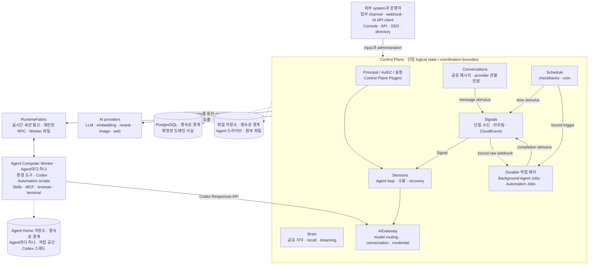

<div align="center">


# Ankole

**Company Brain을 갖춘 오픈 소스 Agent Harness**

[](LICENSE)
[](https://github.com/AgentBull/ankole/releases)

[](https://deepwiki.com/AgentBull/ankole)

[웹사이트](https://ankole.agentbull.com/ko-KR/) · [문서](https://ankole.agentbull.com/ko-KR/docs/introduction/) · [빠른 시작](#빠른-시작) · [Discussions](https://github.com/AgentBull/ankole/discussions)

[English](./README.md) · [简体中文](./README.zh-Hans.md) · [日本語](./README.ja.md) · **한국어**

</div>

[](https://x.com/AgentBullLab/status/2108582424959721707/video/1)

Ankole은 회사를 위해 계속 일하는 AI Agent를 실행합니다. 1인 회사부터 대기업까지 사용할 수 있습니다. 사용자는 Slack, Microsoft Teams, Lark, DingTalk, WeCom처럼 평소 쓰는 채팅 도구에서 Agent에게 일을 맡깁니다.

프롬프트와 몇 가지 도구만 갖춘 모델은 매번 처음부터 일을 시작합니다. 팀이 지난주에 무엇을 정했는지 모르고, 가진 권한을 그대로 쓰며, 프로세스가 멈추면 작업도 끝납니다. Ankole은 이 빈틈을 메우는 Harness입니다. Ankole의 Agent는 팀의 결정을 기억하는 Company Brain을 공유합니다. Agent는 부여된 권한 안에서 일하고, 장애나 재시작 뒤에도 긴 작업을 복구합니다. 각 Agent에게는 컨테이너 안에 자신만의 Linux 컴퓨터가 있습니다. 전체 시스템은 직접 관리하는 인프라에서 운영합니다.

Ankole은 Claude Tag의 오픈 소스 대안입니다. Claude Tag는 Anthropic이 호스팅하는 Slack용 에이전트입니다. Ankole은 Slack이나 Claude 모델에 묶이지 않으며, 회사의 컨텍스트를 자체 서버에 보관합니다. 모델과 검색 호출은 설정한 제공자에게만 전달되며, 직접 호스팅하는 모델도 지정할 수 있습니다.

> **#리서치** · 그룹 채팅
>
> **Ravi:** 경기순환주는 전체 주기로 봐야 해. 3년은 너무 짧아.\
> **Mia:** 동의, 최소 7년은 봐야지
>
> *3일 후*
>
> **Sam:** @Ankole 비철금속 종목 밸류에이션 부탁해\
> **Ankole:** 알겠습니다. 3일 전 이 채널에서 정한 대로 경기순환주는 7년 치 기준으로 진행하겠습니다.\
> 첨부: `비철금속 밸류에이션.pdf` (14페이지)

아무도 Ankole에게 이 규칙을 기억하라고 하지 않았습니다. Company Brain이 Ankole이 참여한 채팅에서 규칙을 배우고, 출처와 날짜를 기록한 뒤, 그 규칙이 필요한 다음 요청에 적용했습니다.

## Ankole을 선택하는 이유

추론은 모델이 합니다. 모델을 둘러싼 Harness는 모델이 무엇을 보고 무엇을 할 수 있는지 정합니다. 장애 뒤에 작업을 어떻게 이어 갈지, 결과를 다음 결정에 어떻게 활용할지도 정합니다. Ankole은 이런 결정을 프롬프트마다 맡기지 않고 시스템에 넣었습니다.

- **Agent는 회사가 결정한 내용을 기억합니다.** Company Brain은 대화, 등록한 파일과 URL, Agent가 쓴 메모에서 학습합니다. 지식은 하나씩 Claim으로 저장되며, 출처, 시점, 신뢰도, 공개 범위, 보유자(그 견해를 가진 사람이나 Agent)가 함께 기록됩니다. 새로운 증거는 현재 견해를 갱신하면서 이력도 남깁니다. 서로 충돌하는 Claim은 검토할 수 있도록 계속 표시됩니다.
- **각 Agent는 부여된 권한 안에서 일합니다.** 사람과 Agent에게는 각자의 ID와 권한이 있고, Agent끼리 컴퓨터, 홈 디렉터리, 자격 증명을 공유하지 않습니다. 모델이 회사 지식을 읽기 전에 Company Brain은 질문한 사람에게 볼 권한이 없는 내용을 제거합니다. 그룹 채팅에서는 모든 멤버의 권한을 적용할 수도 있습니다. PostgreSQL은 각 Agent가 받은 요청, 실행한 모델 호출, 전달한 결과를 기록합니다. Agent별 token 할당량이 모델 사용량에 상한을 둡니다. 퇴사 처리를 하면 그 사람의 로그인이 차단되고, 그 사람이 소유한 작업과 일정도 멈춥니다.
- **무언가 일어나면 업무가 시작됩니다.** 메시지, 일정, Webhook 같은 외부 이벤트가 해당 업무를 맡은 Agent를 깨웁니다. Agent는 스스로 알림을 설정해 나중에 다시 확인할 수도 있습니다.
- **긴 작업은 장애에서 복구됩니다.** 작업 하나는 몇 시간에서 며칠 동안 실행될 수 있고, 실행 중에도 새 입력을 받을 수 있습니다. Control Plane은 Elixir/OTP에서 실행되므로, 장애는 발생한 대화 안에만 머물고 다른 작업은 계속됩니다. PostgreSQL은 Ankole이 작업을 이어 가는 데 쓰는 입력, 모델 이력, 도구 결과를 저장합니다.
- **각 Agent에게는 자신만의 컴퓨터가 있습니다.** Linux 컨테이너가 Agent에게 브라우저, 터미널, 파일, Codex, MCP(Model Context Protocol) 서버, Skill을 제공합니다. Skill은 특정 종류의 업무를 위해 승인된 절차입니다. 홈 디렉터리는 재시작과 업그레이드 뒤에도 유지됩니다.
- **수정과 결과가 이후 업무에 반영됩니다.** Deep Research는 서로 분리된 여러 컨텍스트에서 증거를 모으고, 경쟁 가설을 검증하며, 출처가 있는 보고서를 돌려줍니다. 수정이 반복되면 Agent는 Skill 교훈을 제안할 수 있습니다. Skill 교훈은 Skill에 추가되는 짧은 규칙이며, 사람이 승인하면 적용됩니다. Company Brain에 기록된 예측의 기한이 되면 Company Brain이 예측을 실제 결과와 비교합니다.

Ankole은 라이브러리가 아니라 회사 업무를 위한 완결된 시스템입니다. Control Plane, 데이터베이스, Agent 컴퓨터를 함께 제공합니다. 자신의 애플리케이션에 에이전트 루프를 넣고 싶거나 개인 용무를 돕는 비서가 필요하다면 더 작은 도구가 잘 맞습니다.

## 자주 받는 요청

다음과 같은 요청이 그룹 채팅이나 다이렉트 메시지로 들어옵니다.

| 요청 | Ankole의 처리 |
| --- | --- |
| "매주 금요일 17:00에 X의 이 계정 9개의 게시물을 주제별로 정리한 PDF를 이 채널에 보내 줘." | 매주 실행되는 일정을 만듭니다. 매주 각 계정의 게시물을 읽고 PDF를 작성해 게시합니다. |
| "@Ankole 우리 리포지토리의 issue #482를 고치고 풀 리퀘스트를 열어 줘." | 관리자가 설정한 리포지토리 자격 증명으로 백그라운드 Job에서 Codex를 실행하고, 풀 리퀘스트 링크로 답합니다. |
| "이번 주 이 그룹에서 논의한 내용을 요약하고, 남은 할 일을 정리해 줘." | 볼 권한이 있는 채널 기록을 읽고 요약과 목록으로 답합니다. |
| "이 단락을 슬라이드로 만들어 줘." 또는 "이 PDF를 한국어로 번역해 줘." | PowerPoint 파일이나 번역한 PDF를 돌려줍니다. |
| "우리 공급업체에 대한 이 소문이 사실이야?" | Deep Research를 실행하고, 소문을 뒷받침하는 증거와 반박하는 증거를 담은 출처 있는 요약을 돌려줍니다. |
| "공개된 산정 규칙으로 이 주가지수를 다시 계산해서 공식 수치와 함께 차트로 그려 줘." | 데이터를 가져와 Jupyter 노트북에서 지수를 계산하고 차트를 보냅니다. |

## 지원 플랫폼

| 분야 | 지원 |
| --- | --- |
| 채팅과 이메일 | Slack, Microsoft Teams, Lark/Feishu, DingTalk, WeCom, Telegram, Discord, LINE, WhatsApp, 이메일 |
| 로그인과 디렉터리 동기화 | Slack, Microsoft Entra ID, Google Workspace, Lark/Feishu, DingTalk, WeCom, 내장 비밀번호 계정 |
| 모델 | OpenAI, Azure OpenAI, Claude, Google AI Studio, OpenRouter, ChatGPT 구독, OpenAI API와 호환되는 모든 엔드포인트. 중국 시장 플러그인을 쓰면 Volcengine Ark, Alibaba Cloud DashScope CN, Z.AI Coding Plan, Xiaomi MiMo도 사용할 수 있습니다. |
| 웹 검색과 페이지 읽기 | Parallel(parallel.ai), Jina, Bright Data SERP, AgentBull Cloud |
| Agent 컴퓨터 | Docker, Kubernetes, Cloudflare Containers, Vercel, AWS Lambda MicroVMs, Alibaba Cloud Function Compute |
| 배포 | 단일 호스트의 Docker Compose, Kubernetes의 Helm 차트 |

## 빠른 시작

Docker Compose로 Linux, macOS, Windows 호스트 한 대에 전체 환경을 배포할 수 있습니다. 스택에는 PostgreSQL, Control Plane, HTTPS 서버인 Caddy가 들어 있습니다. 다음이 필요합니다.

- Linux `amd64` 또는 `arm64` 컨테이너를 실행할 수 있는 Docker와, 실행 중인 Agent마다 컨테이너 하나에 필요한 메모리와 디스크.
- Ankole에 root 권한을 맡겨도 되는 호스트. Control Plane은 Docker 소켓으로 Agent 컨테이너를 만들며, 이 소켓에 접근할 수 있으면 호스트의 root 권한을 가진 것과 같습니다.
- 호스트를 가리키는 DNS 이름과 열린 80번, 443번 포트. 자신의 컴퓨터에서 시험해 볼 때는 대신 호스트 이름 `ankole.localhost`를 사용합니다.
- 모델 제공자의 API 키와 채팅 플랫폼에서 봇을 만들 권한. Ankole은 Slack, Lark, DingTalk, WeCom, Discord, Telegram, 이메일에 직접 연결하므로 로컬 시험에서도 이 플랫폼들을 쓸 수 있습니다. Microsoft Teams, LINE, WhatsApp은 호스트로 이벤트를 보내므로 공개 HTTPS 주소가 필요합니다.

배포 파일을 가져옵니다.

```bash
git clone https://github.com/AgentBull/ankole.git
cd ankole/tools/deploy/docker-compose
cp .env.example .env
chmod 600 .env
```

`.env`에 다음 값을 설정합니다.

| 변수 | 값 |
| --- | --- |
| `ANKOLE_HOST`, `ACME_EMAIL` | 호스트 이름과 인증서 알림을 받을 이메일 주소 |
| `POSTGRES_PASSWORD`, `ANKOLE_SECRET_BASE`, `RELEASE_COOKIE` | `openssl rand -hex 32`로 따로 생성한 세 값 |
| `ANKOLE_DOCKER_GID` | Linux에서는 `stat -c %g /var/run/docker.sock`의 출력, macOS의 Docker Desktop에서는 `0` |

스택을 시작하고 일회용 활성화 코드를 확인합니다.

```bash
docker compose pull
docker compose up -d
docker compose logs control-plane | grep "SETUP ACTIVATION CODE"
```

코드는 Control Plane이 시작된 뒤에 출력됩니다. 마지막 명령이 아무것도 출력하지 않으면 잠시 기다렸다가 다시 실행하세요.

`ankole.localhost`를 사용하면 Caddy가 자체 로컬 인증 기관으로 인증서에 서명하며, 설정 페이지에는 신뢰할 수 있는 HTTPS가 필요합니다. 그 인증 기관의 루트 인증서를 복사한 뒤 운영 체제의 인증서 도구로 신뢰하도록 설정합니다.

```bash
docker compose cp caddy:/data/caddy/pki/authorities/local/root.crt ./ankole-local-ca.crt
```

`https://<ANKOLE_HOST>/setup`을 열고 코드를 입력합니다. 채팅 플랫폼용 플러그인처럼 필요한 플러그인을 고릅니다. 관리자 로그인 방식으로 Slack이나 Microsoft Entra ID 같은 ID 제공자, 또는 로컬 비밀번호를 설정합니다. 그다음 관리자용 웹 화면인 콘솔에서 모델 제공자를 추가하고, Agent를 만들고, 그 Agent에 채팅 플랫폼을 연결합니다. 제공자 API 키는 `.env`가 아니라 콘솔에 저장합니다. 그 채팅에서 Agent에게 메시지를 보내 답장이 오면 설정이 끝난 것입니다.

Claude Code나 Codex 같은 코딩 에이전트와 함께 전체 설정을 진행할 수도 있습니다. 다음 프롬프트를 전달하세요.

```text
https://ankole.agentbull.com/ko-KR/docs/quickstart/index.md 를 사용하여 프라이빗 Ankole 배포 인스턴스를 배포하고 구성하도록 도와주세요. 먼저 내 환경을 검사하고 Docker Compose, Kubernetes, 또는 소스로부터의 설치 중 하나를 추천해 주세요. 그런 다음 Identity Provider(IdP), LLM Provider, Agent, Channel Provider, Signal Routing Rule(Signal Binding) 설정을 도와주세요. 내가 IdP와 IM 플랫폼을 지정하지 않았다면 어떤 identity 소스와 채팅 플랫폼을 사용할지 물어봐 주세요. 저를 대신해 선택하지 마세요. chat이나 명령 출력에 secrets를 노출하지 마세요. 내가 선택한 IM에서 실제 Agent 답변을 받았을 때만 작업을 완료하세요.
```

다른 실행 방법:

- Kubernetes: [Helm 차트](tools/deploy/helm/ankole-agent/README.md)(영어)는 내장 PostgreSQL이나 외부 PostgreSQL을 사용합니다.
- Cloudflare Containers에서 Agent 컴퓨터 실행: [Cloudflare 어댑터](tools/deploy/cloudflare/agent-workers/README.md)(영어)
- 소스에서 실행: [CONTRIBUTING.md](CONTRIBUTING.md)(영어)

전체 [빠른 시작](https://ankole.agentbull.com/ko-KR/docs/quickstart/)은 ID 제공자, 모델 제공자, 채팅 플랫폼별 단계를 설명합니다. 백업, 업그레이드, 문제 해결은 [Compose 가이드](tools/deploy/docker-compose/README.md)(영어)에 있습니다.

## 작동 방식

하나의 Ankole 사이트 배포에서 격리된 여러 테넌트를 호스팅할 수 있습니다. 각 테넌트는 고유한 구성원, Agent, Company Brain, 외부 채널 연결을 가지며, 사이트 운영자가 공유 모델 제공자, Worker 제공자, 인프라를 관리합니다.

Ankole은 Control Plane, Agent마다 하나인 Worker, 공유 Rust Kernel, 영속 저장소로 구성됩니다.

- **Control Plane**(Elixir, Phoenix, OTP)은 프로세스가 끝난 뒤에도 남아야 하는 모든 것을 결정하고 기록합니다. 여기에는 ID와 권한, 설정, 대화와 메시지, 시그널, 일정, Job, Company Brain, 모델 제공자를 호출하는 AI 게이트웨이가 포함됩니다. Sessions는 각 Agent의 모델 루프를 슈퍼바이저가 관리하는 프로세스로 실행합니다.
- 각 Agent에는 **Agent Computer Worker**가 하나 있습니다. Linux 컨테이너에서 실행되는 Bun과 TypeScript 프로그램입니다. Worker는 명령, 브라우저, Codex, MCP 서버, Skill, Automation 스크립트를 실행합니다. Control Plane은 Docker, Kubernetes 또는 클라우드 플랫폼에 Worker를 만들고, 컴퓨터가 필요한 작업에만 Worker를 호출합니다.
- **Kernel**은 Elixir가 로드하는 Rust 라이브러리입니다. 암호화, 식별자, 권한 평가, AI 통신을 제공합니다.
- **PostgreSQL**은 재시작 뒤에도 남아야 하는 모든 사실을 저장합니다. 파일 저장소는 각 Agent의 드라이브와 첨부 파일을 보관하고, 각 Agent의 홈 디렉터리(Agent Home)는 각자의 저장소에 유지됩니다.

<details>
<summary>아키텍처 다이어그램</summary>

이 다이어그램은 소유권과 영속성 경계를 보여 줍니다. 내부 호출은 생략했습니다.



</details>

[docs/README.md](docs/README.md)(영어)는 각 부분의 전체 구조를 보여 주고, [설계 문서](docs/design-docs/)(영어)는 각 부분의 계약을 정의합니다. [OTP가 멀티 에이전트 오케스트레이션에 더 나은 런타임인 이유](https://ding.ee/en-US/why-otp-is-a-better-runtime-for-multi-agent-orchestration/)(영어)에서 런타임을 선택한 이유를 설명합니다.

## 현재 상태와 알려진 제한

Ankole은 프로덕션에서 실행 중입니다. Ankole Agent도 회사가 쓰는 것과 같은 Company Brain, 도구, 업무 규칙으로 이 리포지토리의 유지 관리를 돕고 있습니다. 핵심 코드와 주요 상태 머신에는 정형 검증을 적용합니다. 전용 end-to-end 테스트가 Slack, Lark, DingTalk, WeCom 메시지 경로, 일정, Worker 컴퓨터, 장애 복구, 동시 실행, 업그레이드를 검증합니다. 공개 API는 아직 호환성을 보장하지 않으므로 릴리스에 호환되지 않는 변경이 포함될 수 있습니다. 업그레이드하기 전에 [변경 기록](CHANGELOG.md)(영어)을 확인하세요.

[트레이드오프와 알려진 제한](docs/TradeoffsAndKnownLimits.md)(영어)에 Ankole이 보장하지 않는 내용을 정리했습니다. 가장 중요한 내용은 다음과 같습니다.

- 하나의 사이트에서 조직 데이터가 격리된 여러 테넌트를 운영할 수 있습니다. 모든 테넌트는 사이트 운영자를 신뢰하며 사이트의 모델 제공자와 Worker 제공자를 공유합니다.
- Worker 컨테이너는 해당 Agent의 유일한 격리 경계입니다. Ankole은 Agent 자신의 작업으로부터 Worker를 보호하지 않습니다.
- Worker 제공자마다 클라우드 검증 범위가 다릅니다. [Agent Workers](docs/design-docs/AgentWorkers.md#provider-verification-evidence)(영어)에서 기록된 근거와 남은 검증 항목을 확인하세요.

## 문서

| 가이드 | 내용 |
| --- | --- |
| [소개](https://ankole.agentbull.com/ko-KR/docs/introduction/) | Agent, Company Brain, Skill, 권한 등 배포의 구성 요소 |
| [빠른 시작](https://ankole.agentbull.com/ko-KR/docs/quickstart/) | 배포, 로그인, 모델 제공자, 채팅 플랫폼 설정 단계 |
| [아키텍처](https://ankole.agentbull.com/ko-KR/docs/architecture/) | 각 구성 요소와 그 경계 |
| [FAQ 및 문제 해결](https://ankole.agentbull.com/ko-KR/docs/faq/) | 흔한 장애의 원인과 해결 방법 |
| [배포 가이드](tools/deploy/README.md)(영어) | Docker Compose, Helm, Cloudflare Containers |
| [설계 문서](docs/design-docs/)(영어) | 각 하위 시스템의 계약 |

## 기여

기여를 환영합니다. [CONTRIBUTING.md](CONTRIBUTING.md)(영어)는 깨끗한 머신에서 검증된 end-to-end 환경까지 안내합니다. [AGENTS.md](AGENTS.md)(영어)는 엔지니어링 규칙을 정합니다. 코딩 에이전트도 두 문서를 따를 수 있습니다. 시작하려면 코딩 에이전트에게 다음 프롬프트를 전달하세요.

```text
https://github.com/AgentBull/ankole/blob/main/CONTRIBUTING.md를 끝까지 읽고, 그런 다음 안내에 따라 완전한 로컬 Ankole 설정과 문서화된 end-to-end 검증을 진행해 주세요. 해당 가이드를 진실의 원천으로 취급하고, 안전하고 되돌릴 수 있는 모든 단계를 직접 수행하고 검증하되, 사람의 계정, secret, OAuth 또는 파괴적인 승인 작업에서는 멈추고 확인을 받으세요. 명시된 성공 기준이 모두 통과할 때까지 완료를 선언하지 마세요.
```

## 커뮤니티

- 질문이나 Ankole로 만든 결과물은 [GitHub Discussions](https://github.com/AgentBull/ankole/discussions)에 공유하세요.
- 버그 보고와 기능 요청은 [GitHub Issues](https://github.com/AgentBull/ankole/issues)에 남겨 주세요.
- Ankole이 도움이 되었다면 리포지토리에 Star를 눌러 주세요. 다른 팀이 Ankole을 찾는 데 도움이 됩니다. 릴리스 알림을 받으려면 **Watch**, **Custom**, **Releases** 순서로 선택하세요.

## 라이선스

Ankole은 [Apache License 2.0](LICENSE)에 따라 배포됩니다.
