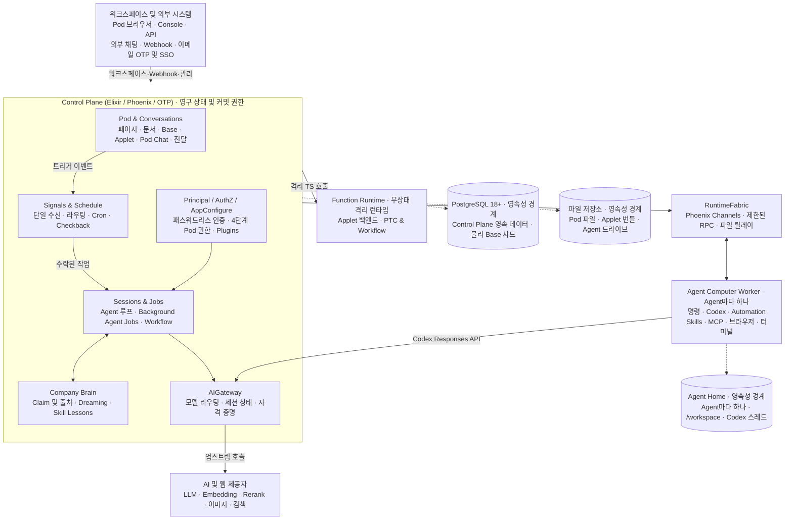

<div align="center">


# Ankole

**사람과 AI Agent가 함께 회사 업무를 운영하는 오픈 소스 디지털 본사(Pod)**

[](LICENSE)
[](https://github.com/AgentBull/ankole/releases)

[](https://deepwiki.com/AgentBull/ankole)

[웹사이트](https://ankole.agentbull.com/ko-KR/) · [문서](https://ankole.agentbull.com/ko-KR/docs/introduction/) · [빠른 시작](#빠른-시작) · [작동 방식](#작동-방식) · [Discussions](https://github.com/AgentBull/ankole/discussions)

[English](./README.md) · [简体中文](./README.zh-Hans.md) · [日本語](./README.ja.md) · **한국어**

</div>

Ankole은 AI 네이티브 팀을 위한 오픈 소스 온라인 워크스페이스(**Pod**)이자 멀티 에이전트 런타임입니다. 하나의 브라우저 워크스페이스 안에서 구성원과 AI Agent가 **공동 편집 문서**와 **슬라이드**, 관계형 업무 테이블(**Base**), 무상태 클라우드 백엔드를 갖춘 맞춤형 업무 도구(**Applet**), 그리고 다자간 멀티 Agent 채팅방(**Pod Chat**)을 함께 사용하며, Slack, Lark/Feishu, Microsoft Teams, DingTalk, WeCom, 이메일은 외부 채널로 연결됩니다.

단발성 프롬프트나 무분별한 완전 자동화 대신, Ankole은 회사 업무를 **사람이 핵심 지점을 책임지는 업무 루프(Loop)**로 조직합니다. 데이터 모니터링, 내부 도구 제작, 전용 Linux 컨테이너에서의 장시간 작업은 Agent가 지속해서 수행하고, 현장의 맥락 입력과 고위험 결정 승인은 사람이 **선택 카드(Choice Card)**로 확정합니다. 공유 **Company Brain**, **Skill 교훈(Skill Lessons)**, 패스워드리스 인증, 4단계 데이터 권한이 모두 Apache 2.0 셀프 호스팅 코어에 기본 포함되어 있습니다.

<p align="center">
  <a href="https://x.com/AgentBullLab/status/2108582424959721707/video/1">
    
  </a>
</p>

## 빠른 시작

Docker Compose로 Linux, macOS, Windows 호스트 한 대에 전체 환경을 배포할 수 있습니다. 스택은 PostgreSQL 18, `ankole-function-runtime`(무상태 Applet 및 스크립트 격리 실행 환경), 데이터베이스 마이그레이션, Control Plane, HTTPS 서버인 Caddy를 실행합니다. 준비 사항:

- Linux `amd64` 또는 `arm64` 컨테이너를 실행할 수 있는 Docker와, PostgreSQL, 파일 저장소, 활성 Agent당 하나씩 생성되는 Worker 컨테이너용 메모리 및 디스크.
- Ankole에 Docker 소켓 접근을 허용할 수 있는 호스트. Control Plane은 `/var/run/docker.sock`을 통해 Worker 컨테이너를 생성하며, 이 소켓 접근 권한은 호스트의 root 권한과 같습니다.
- 호스트를 가리키는 DNS 이름과 열린 `80` / `443`번 포트(로컬 컴퓨터에서 시험할 때는 `ankole.localhost`를 사용할 수 있습니다).
- 모델 제공자의 API 키, 그리고 패스워드리스 이메일 OTP용 SMTP 설정 또는 엔터프라이즈 SSO 앱. Slack, Lark/Feishu, DingTalk, WeCom, Discord, Telegram, 이메일은 Ankole이 밖으로 연결하므로 로컬 시험에서도 동작하며, Microsoft Teams, LINE, WhatsApp은 호스트로 Webhook을 보내므로 공개 HTTPS 주소가 필요합니다.

1. 배포 파일을 가져옵니다:

```bash
git clone https://github.com/AgentBull/ankole.git
cd ankole/tools/deploy/docker-compose
cp .env.example .env
chmod 600 .env
```

2. `.env`에 다음 필수 값을 설정합니다:

| 변수 | 값 |
| --- | --- |
| `ANKOLE_HOST`, `ACME_EMAIL` | 호스트 DNS 이름(로컬 시험 시 `ankole.localhost`)과 TLS 인증서 알림을 받을 이메일 주소 |
| `POSTGRES_PASSWORD` | `openssl rand -hex 24`로 생성한 16진수 값 |
| `ANKOLE_SECRET_BASE`, `RELEASE_COOKIE`, `ANKOLE_FUNCTION_RUNTIME_TOKEN` | `openssl rand -hex 32`로 각각 따로 생성한 독립적인 16진수 값 세 개 |
| `ANKOLE_DOCKER_GID` | Linux에서는 `stat -c %g /var/run/docker.sock`의 출력, macOS Docker Desktop에서는 `0` |

3. 스택을 시작하고 일회용 활성화 코드를 확인합니다:

```bash
docker compose pull
docker compose up -d
docker compose logs control-plane | grep "SETUP ACTIVATION CODE"
```

코드는 Control Plane 시작이 끝난 뒤 출력됩니다. 마지막 명령에 출력이 없으면 잠시 기다렸다가 다시 실행하세요.

`ankole.localhost`를 사용할 때는 Caddy가 자체 로컬 인증 기관으로 인증서에 서명하며, `/setup`에는 신뢰할 수 있는 HTTPS가 필요합니다. 로컬 루트 인증서를 복사한 뒤 운영 체제의 인증서 도구로 신뢰 설정을 추가합니다:

```bash
docker compose cp caddy:/data/caddy/pki/authorities/local/root.crt ./ankole-local-ca.crt
```

4. `https://<ANKOLE_HOST>/setup`을 열고 활성화 코드를 입력한 뒤, 필요한 플러그인을 고르고 관리자 패스워드리스 로그인 방식을 **6자리 이메일 인증 코드(SMTP, 저장 전 실제 테스트 메일 발송으로 잠김 방지)** 또는 **엔터프라이즈 SSO**로 설정합니다. 이어서 관리 콘솔에서 모델 제공자를 추가하고 Agent를 생성합니다(API 키는 `.env`가 아니라 콘솔에 저장합니다). 설정을 마치면 곧바로 **Pod 워크스페이스**에서 문서, Base 테이블, Applet, Pod Chat을 사용하거나 외부 채팅 플랫폼을 연결해 Agent와 대화할 수 있습니다.

<details>
<summary>Claude Code 또는 Codex와 함께 설치 진행하기</summary>

```text
https://ankole.agentbull.com/ko-KR/docs/quickstart/index.md 문서를 참고하여 Ankole 프라이빗 인스턴스를 배포하고 구성하도록 도와주세요. 먼저 내 실행 환경을 점검해 Docker Compose, Kubernetes, 소스 빌드 설치 중 가장 알맞은 방식을 추천해 주세요. 이어서 이메일 인증(Email OTP) 또는 엔터프라이즈 SSO Identity Provider(IdP) 로그인 설정과 LLM Provider, Agent, Channel Provider, Signal Routing Rule(Signal Binding) 구성을 안내해 주세요. 로그인 방식과 메신저 플랫폼을 아직 지정하지 않았다면 어떤 방식(SMTP 이메일 인증 또는 엔터프라이즈 IdP)과 메신저를 쓸지 먼저 물어보고, 임의로 선택하지 마세요. 대화창이나 명령 출력에 비밀 키를 절대 노출하지 마세요. 선택한 메신저에서 Agent의 실제 응답을 확인했을 때만 작업을 완료로 처리하세요.
```

</details>

다른 실행 방법:

- **Kubernetes**: 내장 또는 외부 PostgreSQL을 사용하는 [Helm 차트](tools/deploy/helm/ankole-agent/README.md)(영어).
- **Cloudflare Containers**: [Cloudflare Worker 어댑터](tools/deploy/cloudflare/agent-workers/README.md)(영어).
- **소스에서 실행**: [CONTRIBUTING.md](CONTRIBUTING.md)(영어)(`bun install`, `bun run services:start`, `bun run control-plane:setup`, `bun dev`).

ID 제공자, 모델 제공자, 채팅 플랫폼별 상세 절차는 전체 [빠른 시작](https://ankole.agentbull.com/ko-KR/docs/quickstart/)에서, 백업·업그레이드·문제 해결은 [Compose 가이드](tools/deploy/docker-compose/README.md)(영어)에서 확인하세요.

## Pod를 구성하는 5가지 핵심 모듈

각 기업이나 팀은 격리된 **Pod** 안에서 서로 연결된 다섯 가지 모듈을 사용합니다:

- **워크스페이스 페이지(`Pod Home`)**: 팀 공유 **스페이스**와 개인용 **비공개** 페이지 트리로 나뉘며, 하위 페이지 구성과 권한 범위가 즉시 반영되는 전문 검색을 지원합니다.
  - **공동 편집 문서(`Doc`)**: 사람과 Agent가 커서를 빼앗지 않고 동시에 문서를 편집합니다. 문서에 포함된 과거 보고서 스냅샷은 당시 수치를 그대로 고정하므로, 이후 실시간 테이블이 갱신되어도 지난 주간·월간 보고서의 숫자가 바뀌지 않습니다.
  - **관계형 다차원 테이블(`Base`)**: 여러 하위 테이블, 그리드·칸반·갤러리 보기, 수식, 관계형 연결, 첨부 파일을 지원합니다. 작은 표는 즉시 열리고, 대규모 표는 물리 샤딩된 PostgreSQL 위에서 단일 테이블 **10만 행 이상**도 쾌적하게 동작하며 사람·Agent·Applet이 동일한 실시간 데이터를 읽고 씁니다.
  - **온디맨드 업무 애플릿(`Applet`)**: 업무 규칙을 일상 언어로 설명하면 Agent가 몇 분 만에 React 프론트엔드와 선택형 무상태 TypeScript 백엔드(`Function Runtime`)를 갖춘 도구를 만들어 게시합니다. 마진 계산 슬라이더, 필터링, 모바일 현장 검수 폼, 출고 처리대 같은 정형 UI 조작은 일반 프로그램 코드로 실행되어 **LLM 토큰을 전혀 소모하지 않습니다**. 각 Applet은 격리된 환경에서 현재 사용자의 권한으로 실행되며, 엔지니어는 언제든 `applet pull`로 프론트엔드·백엔드 전체 소스 코드와 설정을 내려받아 자체 파이프라인에서 이어서 개발할 수 있습니다.
  - **파일 및 슬라이드(`File` / `Slides`)**: PDF, 발표 슬라이드, 스프레드시트, 이미지, 오디오·비디오를 브라우저에서 바로 미리 보고 모든 페이지와 채팅에서 `@`로 참조할 수 있습니다.
- **멀티플레이어·멀티 Agent 채팅(`Pod Chat`) 및 페이지 채팅**: 1:1 대화에서 언제든 동료나 다른 전문 Agent를 초대해 그룹 채팅으로 확장할 수 있으며 `@Agent`, `@동료`, `@페이지` 멘션을 지원합니다. 각 Agent에는 독립적인 **‘대화방 자율 개입 허용’** 스위치가 있어, 꺼 두면 사람끼리 논의할 때 모델 비용이 전혀 들지 않으며 **Agent의 응답이 다른 Agent를 깨우지 않아** 무한 대화 루프가 원천 차단됩니다. 사람의 판단이 필요한 시점에는 `1~4`개 선택지(직접 입력 가능)가 담긴 **선택 카드**를 띄우며, 권한 있는 첫 구성원이 선택하는 즉시 잠기고 결정자가 기록됩니다. 긴 작업 도중 대기열 메시지를 편집하거나 처음부터 다시 돌리지 않고 방향을 바꾸는 **Steer(즉시 보충)**, 페이지 열람 권한과 연동되는 우측 **페이지 채팅**도 제공합니다.
- **Company Brain 및 Skill 교훈(`Skill Lessons`)**:
  - **Company Brain**은 문서, Base 레코드, Applet, 파일, Pod Chat, 외부 대화 스레드를 권한 경계 안에서 자동으로 연결합니다. 모든 Claim에 출처, 시점, 보유자, 공개 범위, 인식 상태를 기록해 **객관적 사실**, **미검증 가설**, **AI의 추론**, **사람이 확정한 결정**을 엄격히 구분합니다. 검증되지 않은 추측이 여러 번 인용되어도 사실로 둔갑하지 않으며, 상충하는 내용은 자동으로 표시해 검토를 요청하고, AI 추론이 Base의 실제 업무 상태를 임의로 덮어쓰지 않습니다.
  - **Skill 교훈(`Skill Lessons`)**은 실제 업무 수정과 시행착오에서 얻은 주의 사항을 사례 출처가 담긴 규칙으로 **Skill**에 축적해(사람이 언제든 검토·수정 가능) 팀 전체가 같은 기준을 재사용하게 합니다.
- **외부 시스템 커넥터 및 백그라운드 지속 실행**: 통합 커넥터가 쇼핑몰, 물류창고, ERP, 티켓 시스템, 메신저를 Applet·채팅·자동 트리거에 연결합니다. 외부 시스템 상태는 **실제 API 호출 영수증**을 기준으로 삼으며(테이블 메모 수정만으로 환불이나 재고 잠금이 완료된 것으로 처리하지 않음), 영향이 큰 외부 작업은 선택 카드로 책임자 승인을 거칩니다. Lark/Feishu, WeCom, Slack 등에서 들어온 외부 메시지(`Externals`)는 연결·대화방·스레드 단위로 정돈되어 채널 간 정보 유출을 막습니다. 일정과 Webhook을 통해 노트북을 덮은 뒤에도 백그라운드 작업이 계속 진행되며, 승인이나 외부 회신을 기다릴 때는 조용히 절전 대기하고 장애 후에는 PostgreSQL에서 복구됩니다.
- **패스워드리스 로그인 및 엔터프라이즈 권한 거버넌스**:
  - **패스워드리스 인증과 탭별 계정 격리**: 개인 **이메일 OTP**와 **엔터프라이즈 SSO**(Lark/Feishu, Slack, Microsoft Entra ID, Google Workspace, DingTalk, WeCom) 병행, 이메일 도메인 허용 목록, 정직원 SSO 강제 옵션, 다중 Pod 전환 및 브라우저 탭별 신원 격리, 마지막 인간 관리자 삭제·잠김 방지 기능을 갖추고 있습니다.
  - **4단계 페이지·데이터 권한**(**50만 페이지** 규모에서도 즉시 검증): **보기 가능**(읽기 전용), **데이터 제출 가능**(현장 입력 전용: Applet으로 레코드 추가와 첨부 업로드는 가능하지만 별도 보안 처리된 원가 테이블 열람, 스키마 변경, Applet 소스·키 조회는 불가), **편집 가능**(문서 및 Base 스키마 편집, Applet 게시 및 소스 내보내기), **전체 액세스**(공유 권한 관리, 테이블 삭제, 휴지통 관리).
  - **3가지 보안 원칙**: ① **AI를 통한 권한 우회 방지** — 사람이 시작한 대화와 작업은 반드시 **`사용자 권한 ∩ Agent 권한`**의 교집합만 읽을 수 있으며, 관리자가 승인한 무인 회사 작업만 Agent 자체 권한으로 실행됩니다(Agent별 예산 상한 지원). ② **외부 게스트 격리** — 비공개 공간 없음, 조직도·설정·내부 공용 Company Brain 접근 차단, 명시적으로 공유된 페이지만 노출. ③ **계정 일시 정지와 퇴사 처리 분리** — 휴직 시 일시 정지로 즉시 동결·복구할 수 있고, 정식 퇴사 처리 시 모든 접근과 소유 일정을 중단함과 동시에 **사용하던 회사 이메일과 전화번호를 자동으로 반환**하여 이후 동명이인 신규 입사자에게 이전 데이터가 섞이지 않습니다.

## 업무 루프 및 엔지니어링 활용 예시

| 시나리오 | Ankole에서의 실행 방식 |
| --- | --- |
| **현장 모바일 검수 Applet과 단가 보안** | BOM **Base** 위에서 검수 규칙을 설명해 모바일 검수 **Applet**을 게시합니다. 공장 검수원에게는 **데이터 제출 가능** 권한만 부여해 사진과 합격률을 등록하게 하고, 공장별 단가 테이블은 경영진과 구매팀만 볼 수 있도록 격리합니다. |
| **다중 창고 재고 및 해상 운송 보충 루프** | 정기 실행 Agent가 창고 재고, 해상 컨테이너 입항 예정일, 캠페인 일정을 대조해 운영 대시보드 Applet을 갱신하고, 품절 위험이 감지되면 물류 채팅방에 창고 간 이관 **선택 카드**를 올려 승인 즉시 커넥터로 출고 지시를 내립니다. |
| **배치 품질 서킷 브레이커** | 신규 수리 티켓이 등록될 때마다 Agent가 제조 배치를 점검합니다. 특정 배치의 불량이 임계치를 넘으면 **Company Brain**에서 출하 검수표와 미출고 재고를 추적해 재고 동결 및 공장 클레임 요청용 승인 카드를 발송합니다. |
| **리포지토리 이슈 수정 및 PR 생성** | 채팅에서 `@Ankole`에게 이슈 번호를 지정하면 격리된 **Agent Computer Worker** 컨테이너 안에서 사전 구성된 저장소 자격 증명으로 Codex를 실행하고 풀 리퀘스트 링크를 반환합니다. |
| **경쟁 가설 Deep Research 및 주간 리뷰 자료** | 분리된 여러 컨텍스트에서 찬반 증거를 검증하는 **Deep Research** 보고서를 작성하거나, 매주 월요일 아침 실데이터를 바탕으로 주간 리뷰 **슬라이드** 초안과 숫자가 고정된 스냅샷 보고서를 자동 작성합니다. |

## 지원 생태계

| 분야 | 지원 범위 |
| --- | --- |
| 워크스페이스(`Pod`) | 공동 편집 문서, 관계형 테이블 Base(그리드·칸반·갤러리, 인라인 및 물리 샤드 PostgreSQL), React + TypeScript 맞춤형 Applet(`Function Runtime`), 파일 및 슬라이드 미리 보기, 멀티플레이어 Pod Chat |
| 외부 채팅 및 이메일 | Slack, Microsoft Teams, Lark/Feishu, DingTalk, WeCom, Telegram, Discord, LINE, WhatsApp, 이메일 |
| 로그인 및 디렉터리 동기화 | 패스워드리스 이메일 OTP(SMTP), Lark/Feishu, Slack, Microsoft Entra ID, Google Workspace, DingTalk, WeCom(OIDC/OAuth SSO 및 조직 디렉터리 동기화) |
| 모델 | OpenAI, Azure OpenAI, Claude, Google AI Studio, OpenRouter, AgentBull Cloud, ChatGPT 구독, OpenAI API 호환 모든 엔드포인트(자체 호스팅 모델 포함). 중국 시장 플러그인으로 Volcengine Ark, Alibaba Cloud DashScope CN, Z.AI Coding Plan, Xiaomi MiMo 추가 지원. |
| 웹 검색 및 페이지 읽기 | AgentBull Cloud, Parallel(`parallel.ai`), Jina, Bright Data SERP, 로컬 Chromium 렌더링 수집(`ankole-browser`) |
| Agent 컴퓨터 | Docker, Kubernetes, Cloudflare Containers, Vercel, AWS Lambda MicroVMs, Alibaba Cloud Function Compute |
| 배포 형태 | 단일 호스트 Docker Compose, Kubernetes Helm 차트, 또는 소스 빌드(기능 제한 없는 100% Apache 2.0 오픈 소스 코어, 선택 사항으로 AgentBull Cloud 통합 API 키 하나로 모델과 웹 검색 일괄 연동 가능) |

## 작동 방식

하나의 Ankole 사이트 배포에서 격리된 여러 테넌트를 호스팅할 수 있습니다. 각 테넌트는 고유한 Pod 페이지, Base 레코드(테넌트에 할당된 물리 Base 샤드에 저장), Principal, Agent, Company Brain, 외부 채널 연결을 소유하며, 사이트 운영자가 공유 모델 제공자, Worker 제공자, 인프라를 관리합니다.

Ankole 런타임은 다섯 부분으로 구성됩니다:

- **Control Plane**(Elixir, Phoenix, OTP): 영구 상태, 슈퍼비전, 커밋 권한을 보유하며 Pod 워크스페이스, Principal 및 AuthZ, 설정, Conversations, Signals, Schedule, Sessions, Background Agent Jobs, Workflow, Company Brain, AIGateway를 실행합니다.
- **Function Runtime**(`ankole-function-runtime`): Pod Applet 백엔드 라우트와 결정론적 TypeScript(`PTC` 및 `Workflow`) 프로그램을 무상태 Edge Runtime 격리 인스턴스에서 실행하며 영구 상태를 저장하지 않습니다.
- **Agent Computer Worker**(Bun과 TypeScript, Agent마다 하나의 Linux 컨테이너): 명령, 브라우저, Codex, MCP 서버, Skill, Automation 스크립트를 실행합니다. Control Plane은 컴퓨터가 필요한 작업에만 Docker, Kubernetes 또는 클라우드 플랫폼에 Worker를 생성합니다.
- **Kernel**(Rust, Rustler 및 Node-API로 로드): 암호화, 불투명 UID 및 단축 URL, CEL 권한 평가, Markdown/Markdoc 파싱 및 UTF-16 페이지 diff, AI 전송을 제공합니다.
- **PostgreSQL 18+ 및 파일 저장소**: PostgreSQL이 Control Plane의 영속 도메인 데이터와 물리 샤딩된 Base 테이블(`BASE_DB_URLS`)을 저장합니다. 파일 저장소는 Pod 파일, 빌드된 Applet 번들, Agent 드라이브, 첨부 파일을 보관하며, 각 Agent의 `/workspace`(Agent Home)는 컨테이너 교체 뒤에도 유지되고 `/var/cache/ankole` 캐시는 언제든 재구축할 수 있습니다.

<details>
<summary>아키텍처 다이어그램</summary>

소유권과 영속성 경계를 보여 줍니다(내부 호출 생략).



</details>

[docs/README.md](docs/README.md)(영어)는 각 모듈의 전체 구조를 보여 주고, [설계 문서](docs/design-docs/)(영어)는 각 하위 시스템의 계약을 정의합니다. [OTP가 멀티 에이전트 오케스트레이션에 더 나은 런타임인 이유](https://ding.ee/en-US/why-otp-is-a-better-runtime-for-multi-agent-orchestration/)(영어)에서 런타임 선택 배경을 설명합니다.

## 현재 상태와 알려진 제한

Ankole은 프로덕션 환경에서 운영 중이며, Ankole Agent가 기업 환경과 동일한 Pod, Company Brain, 도구, 업무 규칙으로 이 리포지토리 유지 관리에 참여하고 있습니다. 핵심 코드와 주요 상태 머신에는 정형 검증을 적용하며, 전용 end-to-end 테스트가 Pod 공동 편집, Base 샤딩, Applet, Slack/Lark/DingTalk/WeCom 메시지 경로, 일정, Worker 컴퓨터, 장애 복구, 동시 실행, 업그레이드를 검증합니다. 공개 API는 아직 버전 간 호환성을 보장하지 않으므로 업그레이드 전에 [변경 기록](CHANGELOG.md)(영어)을 확인하세요.

[트레이드오프와 알려진 제한](docs/TradeoffsAndKnownLimits.md)(영어)에 Ankole이 보장하지 않는 경계를 정리했습니다:

- 하나의 사이트에서 조직 데이터가 격리된 여러 테넌트를 운영할 수 있으나, 모든 테넌트는 사이트 운영자를 신뢰하며 Control Plane, `Function Runtime`, 모델 제공자, Worker 제공자를 공유합니다.
- Worker 컨테이너는 해당 Agent의 유일한 격리 경계이며, Ankole은 Agent 자신의 작업으로부터 Worker를 보호하지 않습니다.
- 클라우드 Worker 제공자마다 검증 범위가 다릅니다. 자세한 내용은 [Agent Workers](docs/design-docs/AgentWorkers.md#provider-verification)(영어)를 참조하세요.

## 문서

| 가이드 | 내용 |
| --- | --- |
| [소개](https://ankole.agentbull.com/ko-KR/docs/introduction/) | Pod, Agent, Company Brain, Skill, 권한 및 배포 구성 요소 |
| [빠른 시작](https://ankole.agentbull.com/ko-KR/docs/quickstart/) | 배포, 이메일 OTP 및 SSO 로그인, 모델 제공자, 채팅 플랫폼 설정 절차 |
| [아키텍처](https://ankole.agentbull.com/ko-KR/docs/architecture/) | Control Plane, Function Runtime, Worker 및 영속성 경계 |
| [FAQ 및 문제 해결](https://ankole.agentbull.com/ko-KR/docs/faq/) | 흔한 장애 원인과 해결 방법 |
| [배포 가이드](tools/deploy/README.md)(영어) | Docker Compose, Kubernetes Helm, Cloudflare Containers |
| [설계 문서](docs/design-docs/)(영어) | 각 하위 시스템의 계약과 불변 조건 |

## 기여

기여를 환영합니다. [CONTRIBUTING.md](CONTRIBUTING.md)(영어)는 깨끗한 머신에서 검증된 end-to-end 로컬 환경까지 안내하며, [AGENTS.md](AGENTS.md)(영어)는 엔지니어링 규칙을 정의합니다. 코딩 에이전트에게 다음 프롬프트를 전달해 설정을 진행할 수도 있습니다:

```text
https://github.com/AgentBull/ankole/blob/main/CONTRIBUTING.md 문서를 끝까지 읽고, 안내된 순서에 따라 로컬 Ankole 환경 구축과 문서화된 end-to-end 검증을 진행해 주세요. 해당 가이드를 기준 문서로 삼아 안전하고 되돌릴 수 있는 단계는 직접 실행·검증하되, 계정 로그인·비밀 키 입력·OAuth 인증이나 데이터 삭제처럼 되돌릴 수 없는 작업이 필요할 때는 멈추고 제 승인을 받으세요. 명시된 성공 기준을 모두 통과하기 전에는 완료로 보고하지 마세요.
```

## 커뮤니티

- 질문이나 Ankole로 만든 업무 루프·Applet 공유는 [GitHub Discussions](https://github.com/AgentBull/ankole/discussions)에 남겨 주세요.
- 버그 보고와 기능 요청은 [GitHub Issues](https://github.com/AgentBull/ankole/issues)에 등록해 주세요.
- Ankole이 도움이 되었다면 리포지토리에 Star를 눌러 주세요. 릴리스 알림을 받으려면 **Watch** → **Custom** → **Releases**를 차례대로 선택하세요.

## 라이선스

Ankole은 [Apache License 2.0](LICENSE)에 따라 배포됩니다.
