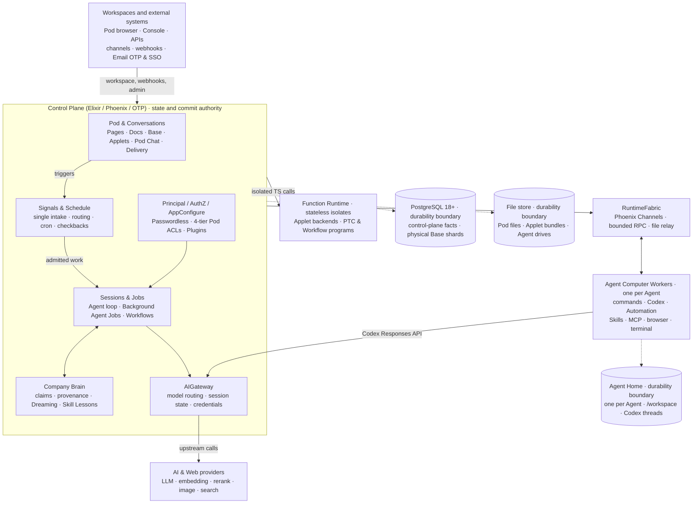

<div align="center">


# Ankole

**The open-source Digital HQ where people and AI Agents run company operations together**

[](LICENSE)
[](https://github.com/AgentBull/ankole/releases)

[](https://deepwiki.com/AgentBull/ankole)

[Website](https://ankole.agentbull.com/) · [Documentation](https://ankole.agentbull.com/en-US/docs/introduction/) · [Quick start](#quick-start) · [How it works](#how-it-works) · [Discussions](https://github.com/AgentBull/ankole/discussions)

**English** · [简体中文](./README.zh-Hans.md) · [日本語](./README.ja.md) · [한국어](./README.ko.md)

</div>

Ankole is an open-source workspace (**Pod**) and runtime for AI-native teams. In one browser workspace, people and AI Agents share collaborative **Documents** and **Slides**, relational **Base** tables, on-demand **Applets** with stateless cloud backends, and multiplayer multi-Agent **Pod Chat**, while Slack, Lark/Feishu, Microsoft Teams, DingTalk, WeCom, and email connect as external channels.

Ankole organizes company work into **human-in-the-loop operational loops**. Agents monitor data, build internal tools, and run long tasks in dedicated Linux containers; people supply real-world context and approve high-impact actions on **Choice Cards**. Shared **Company Brain** memory, **Skill Lessons**, passwordless authentication, and four-tier permissions ship in the Apache-2.0 self-hosted core.

<p align="center">
  <a href="https://x.com/AgentBullLab/status/2108582424959721707/video/1">
    
  </a>
</p>

## Quick start

With Docker Compose, you can run a complete Ankole deployment on a single Linux, macOS, or Windows host—bringing up PostgreSQL 18, `ankole-function-runtime` (stateless Applet and program isolates), database migrations, the control plane, and Caddy HTTPS. Before starting, make sure you have:

- Docker configured for Linux `amd64` or `arm64` containers, with enough memory and disk for PostgreSQL, file storage, and one dedicated Worker container per active Agent.
- A trusted host where Ankole may mount `/var/run/docker.sock` to launch Worker containers (mounting the Docker socket grants root-equivalent access on the host).
- A DNS name pointing to the host with ports `80` and `443` open, or `ankole.localhost` for a local trial.
- An API key for an LLM provider, plus either SMTP settings for passwordless Email OTP or an Enterprise SSO app. Slack, Lark/Feishu, DingTalk, WeCom, Discord, Telegram, and email connect outbound from Ankole and work locally out of the box; Microsoft Teams, LINE, and WhatsApp deliver inbound webhooks and require a public HTTPS address.

1. Get the deployment files:

```bash
git clone https://github.com/AgentBull/ankole.git
cd ankole/tools/deploy/docker-compose
cp .env.example .env
chmod 600 .env
```

2. Set these required values in `.env`:

| Variable | Value |
| --- | --- |
| `ANKOLE_HOST`, `ACME_EMAIL` | Your host DNS name (or `ankole.localhost`) and an email address for TLS certificate notices |
| `POSTGRES_PASSWORD` | One hex value from `openssl rand -hex 24` |
| `ANKOLE_SECRET_BASE`, `RELEASE_COOKIE`, `ANKOLE_FUNCTION_RUNTIME_TOKEN` | Three separate hex values from `openssl rand -hex 32` |
| `ANKOLE_DOCKER_GID` | Output of `stat -c %g /var/run/docker.sock` on Linux, or `0` with Docker Desktop on macOS |

3. Start the stack and read the one-time activation code:

```bash
docker compose pull
docker compose up -d
docker compose logs control-plane | grep "SETUP ACTIVATION CODE"
```

If the last command prints nothing, wait a few seconds for the control plane to finish starting and run it again.

With `ankole.localhost`, Caddy signs certificates with its local authority, and `/setup` requires trusted HTTPS. Copy and trust the local root certificate with your operating system's certificate tool:

```bash
docker compose cp caddy:/data/caddy/pki/authorities/local/root.crt ./ankole-local-ca.crt
```

4. Open `https://<ANKOLE_HOST>/setup`, enter the activation code, select your plugins, and configure passwordless administrator sign-in through **6-digit Email OTP** (verified with a test email before saving) or **Enterprise SSO**. Next, open the Console, add a model provider, and create an Agent. Keep provider API keys in the Console rather than `.env`. You can then work directly in your **Pod** workspace or connect an external chat platform and send the Agent a message.

<details>
<summary>Set up with a coding agent (Claude Code or Codex)</summary>

```text
Use https://ankole.agentbull.com/en-US/docs/quickstart/index.md to help me deploy and configure a private Ankole deployment instance. First, inspect my environment and recommend Docker Compose, Kubernetes, or installing from source. Then help me set up sign-in via Email OTP or an Enterprise SSO Identity Provider (IdP), plus the LLM Provider, Agent, Channel Provider, and Signal Routing Rule (Signal Binding). If I did not specify a sign-in method and IM platform, ask which sign-in method (SMTP Email OTP or enterprise IdP) and chat platform I want to use. Do not choose them for me. Do not expose secrets in chat or command output. You are finished only when I receive a real Agent reply in my selected IM.
```

</details>

Other ways to run Ankole:

- **Kubernetes**: [Helm chart](tools/deploy/helm/ankole-agent/README.md) with bundled or external PostgreSQL.
- **Cloudflare Containers**: [Cloudflare Worker adapter](tools/deploy/cloudflare/agent-workers/README.md).
- **From source**: [CONTRIBUTING.md](CONTRIBUTING.md) (`bun install`, `bun run services:start`, `bun run control-plane:setup`, `bun dev`).

See the full [quick start](https://ankole.agentbull.com/en-US/docs/quickstart/) for provider-specific setup and the [Compose guide](tools/deploy/docker-compose/README.md) for backups, upgrades, and troubleshooting.

## Inside a Pod

Each organization or team works in an isolated **Pod** that combines five modules:

- **Workspace Pages (`Pod Home`)**: Shared **Space** and personal **Private** page trees with subpages and permission-scoped full-text search.
  - **Documents**: People and Agents edit documents together without stealing cursors. Embedded report snapshots freeze historical numbers so later table updates do not alter past weekly or monthly reports.
  - **Base**: Multi-table relational databases with grid, kanban, and gallery views, formulas, relations, and attachments. Small tables open inline; large tables scale to `100,000+` rows on sharded PostgreSQL storage. People, Agents, and Applets read and write the same live records.
  - **Applets**: Agents generate custom React tools and optional stateless TypeScript backends (`Function Runtime`) from plain-language rules. Deterministic UI actions—such as calculators, filters, mobile inspection forms, and dispatch consoles—run as ordinary code with **zero LLM token spend**. Each Applet runs in an isolated frame and runtime under the current user's permissions, and engineers can export its complete frontend and backend project source (`applet pull`) at any time.
  - **Files and Slides**: In-browser previews for PDFs, slide decks, spreadsheets, images, audio, and video, referenceable with `@` from pages and chats.
- **Multiplayer Multi-Agent `Pod Chat` and Page Chat**: Direct chats expand seamlessly into group rooms with colleagues and multiple specialized Agents, supporting `@Agent`, `@person`, and `@page` mentions. Each Agent carries its own **ambient intervention** toggle: when turned off, human-to-human discussion spends zero model tokens, and Agent replies never wake other Agents. At decision points, Agents post **Choice Cards** (`1–4` options plus free-form input) that lock on the first authorized response and record who made the call. While a run is active, you can edit queued follow-up messages or **Steer** the Agent mid-execution without starting over, and open side-by-side **Page Chat** scoped to the current page's permissions.
- **Company Brain and Skill Lessons**:
  - **Company Brain** links pages, Base records, Applets, files, Pod Chats, and external threads into a tenant-scoped knowledge graph. Every claim keeps its source, timestamp, holder, audience, and epistemic status—separating **objective facts**, **unverified hypotheses**, **AI inferences**, and **human decisions**. Repeated citations do not turn an unverified guess into a fact, conflicting claims are flagged for human review, and AI inferences never overwrite Base records.
  - **Skill Lessons** attach cited, human-reviewable operational guardrails from real corrections and incidents to built-in or custom **Skills**, so future runs inherit team rules.
- **External Connectors and Background Loops**: Shared connectors integrate stores, warehouses, ERPs, ticketing tools, and chat platforms across Applets, Chat, and triggers. External systems remain authoritative for external state: mutations require a real connector call and receipt rather than a manual table edit, and high-impact actions pause on a Choice Card for approval. External chat messages (`Externals`) stay archived by connection, room, and thread without cross-room leaks. Schedules, webhooks, and events wake Agents or scripts while people are offline; tasks sleep while waiting for approvals or replies and resume from PostgreSQL after crashes.
- **Passwordless Sign-In and Enterprise Governance**:
  - **Passwordless authentication**: Personal **Email OTP** and **Enterprise SSO** (Lark/Feishu, Slack, Microsoft Entra ID, Google Workspace, DingTalk, WeCom), domain allowlists, optional SSO enforcement for members, multi-Pod switching with per-tab identity isolation, and last-admin lockout protection.
  - **Four-tier page and data permissions** (responsive at `500,000` pages): **Can view** (read-only), **Can submit data** (submit records and attachments through frontline Applets without viewing confidential linked tables, altering schemas, or reading Applet source and secrets), **Can edit** (edit documents, Base schemas, and Applets; export Applet source), and **Full access** (manage sharing, delete tables, and administer Trash).
  - **Three security boundaries**: ① **`Human ∩ Agent` permission intersection** on human-triggered turns so nobody can read unauthorized data through an Agent (only admin-authorized unattended tasks use the Agent's own Principal, with per-Agent spend quotas); ② **Guest isolation** (no Private space, directory, settings, or shared internal Company Brain memory); ③ **Suspend vs. Offboard** (suspending freezes sign-in and personal keys for leave; offboarding revokes access, stops owned schedules and jobs, and releases the corporate email and phone so a later hire with the same address receives a clean identity).

## Example operational loops

| Scenario | How it runs in Ankole |
| --- | --- |
| **Frontline mobile inspection Applet** | Tell an Agent the inspection rules on a BOM **Base**. It publishes a mobile Applet where factory inspectors hold **Can submit data** to upload batch photos and pass rates without seeing confidential supplier tier pricing. |
| **Cross-warehouse fulfillment loop** | A scheduled Agent checks warehouse inventory, ocean transit dates, and campaign schedules, refreshes the operations dashboard Applet, and posts a **Choice Card** in the logistics room before sending transfer commands through the warehouse connector. |
| **Batch quality circuit breaker** | Whenever a new warranty ticket arrives, an Agent inspects the batch; if one factory batch crosses the defect threshold, the Agent traces inspection records and remaining stock through **Company Brain** and posts an approval card to hold inventory and file a supplier claim. |
| **Repository bug fix and pull request** | Mention `@Ankole` with an issue number. The Agent runs Codex in an isolated **Agent Computer Worker** container with configured repository credentials and returns the pull request. |
| **Deep Research and weekly review decks** | Run **Deep Research** across isolated contexts to test competing hypotheses with citations, or schedule a Monday morning **Slides** draft and snapshot report from live channel metrics. |

## Works with

| Area | Supported |
| --- | --- |
| Workspace (`Pod`) | Collaborative Documents, Base relational tables (grid, kanban, gallery; inline and sharded PostgreSQL), custom React + TypeScript Applets (`Function Runtime`), File and Slides previews, multiplayer Pod Chat |
| External chat and email | Slack, Microsoft Teams, Lark/Feishu, DingTalk, WeCom, Telegram, Discord, LINE, WhatsApp, email |
| Sign-in and directory sync | Passwordless Email OTP (SMTP), Lark/Feishu, Slack, Microsoft Entra ID, Google Workspace, DingTalk, WeCom (OIDC/OAuth SSO and directory sync) |
| Models | OpenAI, Azure OpenAI, Claude, Google AI Studio, OpenRouter, AgentBull Cloud, ChatGPT subscriptions, and any OpenAI-compatible endpoint (including self-hosted models). The China-market plugin adds Volcengine Ark, Alibaba Cloud DashScope CN, Z.AI Coding Plan, and Xiaomi MiMo. |
| Web search and page reading | AgentBull Cloud, Parallel (`parallel.ai`), Jina, Bright Data SERP, and local Chromium rendering (`ankole-browser`) |
| Agent computers | Docker, Kubernetes, Cloudflare Containers, Vercel, AWS Lambda MicroVMs, Alibaba Cloud Function Compute |
| Deployment | Docker Compose on one host, Helm chart on Kubernetes, or source build (complete Apache-2.0 FOSS core; optional AgentBull Cloud key for aggregated models and web tools) |

## How it works

One Ankole site deployment can host one or more isolated tenants. Each tenant owns its Pod pages, Base records (on tenant-assigned Base shards), Principals, Agents, Company Brain, and channel connections, while site operators manage shared model providers, Worker providers, and infrastructure.

Ankole consists of five runtime parts:

- **Control plane** (Elixir, Phoenix, and OTP): Owns durable state, supervision, and commit authority—including Pod workspaces, Principals and AuthZ, configuration, Conversations, Signals, Schedules, Sessions, Background Agent Jobs, Workflows, Company Brain, and AIGateway.
- **Function Runtime** (`ankole-function-runtime`): Runs stateless Edge Runtime isolates for Pod Applet backend routes and deterministic TypeScript (`PTC` and `Workflow`) programs. It stores no durable state.
- **Agent Computer Workers** (Bun and TypeScript, one Linux container per Agent): Execute commands, browsers, Codex, MCP servers, Skills, and Automation scripts. The control plane starts a Worker on Docker, Kubernetes, or a cloud provider only when work requires a computer.
- **Kernel** (Rust via Rustler and Node-API): Provides cryptography, opaque UIDs and short URLs, CEL permission evaluation, Markdown/Markdoc and UTF-16 page diffing, and AI transport.
- **PostgreSQL 18+ and file storage**: PostgreSQL stores control-plane domain facts and sharded physical Base tables (`BASE_DB_URLS`). The file store holds Pod files, compiled Applet bundles, Agent drives, and attachments; each Agent's Home (`/workspace`) persists across container replacements while `/var/cache/ankole` stays rebuildable.

<details>
<summary>Architecture diagram</summary>

This diagram shows the boundaries for ownership and durability. Internal calls are omitted.



</details>

[docs/README.md](docs/README.md) maps every module, and the [design documents](docs/design-docs/) define their contracts. [Why OTP is a better runtime for multi-agent orchestration](https://ding.ee/en-US/why-otp-is-a-better-runtime-for-multi-agent-orchestration/) explains the runtime choice.

## Status and known limits

Ankole runs in production. An Ankole Agent helps maintain this repository with the same Pod, Company Brain, tools, and work rules that teams use. Formal verification checks critical code and core state machines, and dedicated end-to-end suites test Pod collaboration, Base sharding, Applets, Slack/Lark/DingTalk/WeCom message paths, schedules, Worker computers, crash recovery, concurrency, and upgrades. Public APIs have no compatibility contract yet, so releases can include breaking changes. Read the [changelog](CHANGELOG.md) before upgrading.

[Tradeoffs and known limits](docs/TradeoffsAndKnownLimits.md) states what Ankole does not guarantee. Key points:

- A site can host multiple isolated tenants, but all tenants trust the site operator and share the control plane, `Function Runtime`, model providers, and Worker providers.
- Each Agent's Worker container is its isolation boundary; Ankole does not protect a Worker from its own Agent.
- Cloud verification scope differs by Worker provider; see [Agent Workers](docs/design-docs/AgentWorkers.md#provider-verification).

## Documentation

| Guide | What it covers |
| --- | --- |
| [Introduction](https://ankole.agentbull.com/en-US/docs/introduction/) | Pod, Agents, Company Brain, Skills, permissions, and deployment parts |
| [Quick start](https://ankole.agentbull.com/en-US/docs/quickstart/) | Step-by-step deployment, Email OTP and SSO sign-in, model providers, and channels |
| [Architecture](https://ankole.agentbull.com/en-US/docs/architecture/) | Control plane, Function Runtime, Workers, and durability boundaries |
| [FAQ and troubleshooting](https://ankole.agentbull.com/en-US/docs/faq/) | Common failure modes and fixes |
| [Deployment guides](tools/deploy/README.md) | Docker Compose, Kubernetes Helm, and Cloudflare Containers |
| [Design documents](docs/design-docs/) | Subsystem contracts and invariants |

## Contributing

Contributions are welcome. [CONTRIBUTING.md](CONTRIBUTING.md) guides you from a clean machine to a verified end-to-end setup, and [AGENTS.md](AGENTS.md) defines the engineering rules. A coding agent can follow both documents using this prompt:

```text
Read https://github.com/AgentBull/ankole/blob/main/CONTRIBUTING.md in full, then guide me through a complete local Ankole setup and its documented verification from entry to result. Treat that guide as the source of truth. Perform and verify every safe reversible step. Pause for actions that require a human account, secret, OAuth flow, or approval for a destructive step. Declare completion only after its success criteria pass.
```

## Community

- Ask questions and share what you build in [GitHub Discussions](https://github.com/AgentBull/ankole/discussions).
- Report bugs and request features in [GitHub Issues](https://github.com/AgentBull/ankole/issues).
- Star the repository to help other teams discover Ankole. For release notifications, select **Watch** → **Custom** → **Releases**.

## License

Ankole is licensed under the [Apache License 2.0](LICENSE).
