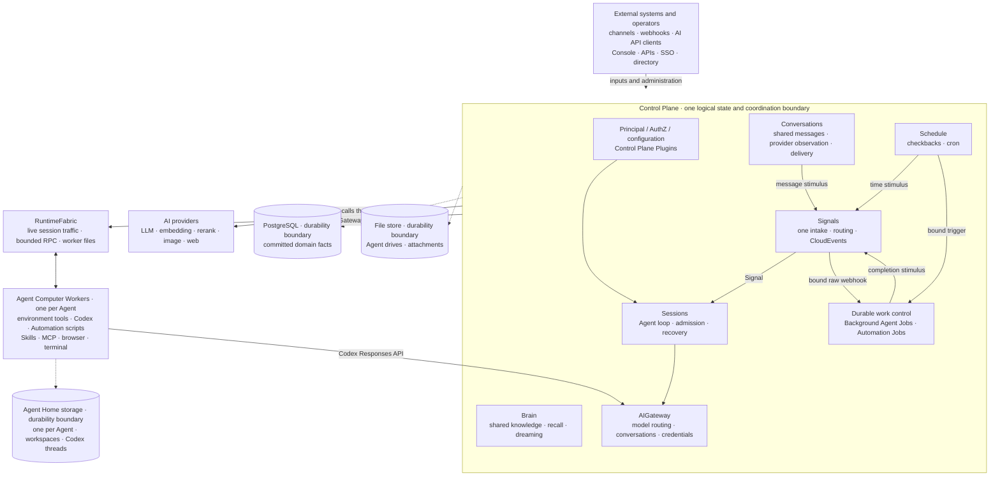

<div align="center">


# Ankole

**The open source Agent Harness with a Company Brain**

[](LICENSE)
[](https://github.com/AgentBull/ankole/releases)

[](https://deepwiki.com/AgentBull/ankole)

[Website](https://ankole.agentbull.com/) · [Documentation](https://ankole.agentbull.com/en-US/docs/introduction/) · [Quick start](#quick-start) · [Discussions](https://github.com/AgentBull/ankole/discussions)

**English** · [简体中文](./README.zh-Hans.md) · [日本語](./README.ja.md) · [한국어](./README.ko.md)

</div>

[](https://x.com/AgentBullLab/status/2108582424959721707/video/1)

Ankole runs AI Agents that do ongoing work for a company, from a one-person business to an enterprise. People reach them in the chat tools they already use, such as Slack, Microsoft Teams, Lark, DingTalk, and WeCom.

A model with a prompt and a few tools starts every task from zero. It does not know what your team decided last week, it acts with whatever access it holds, and its work ends when its process dies. Ankole is the harness that fills these gaps. Its Agents share a Company Brain that remembers what teams decide. They work within the access you grant, and they recover long tasks after crashes and restarts. Each Agent has its own Linux computer in a container, and you run the whole system on infrastructure you control.

Ankole is an open source alternative to Claude Tag, the Slack agent that Anthropic hosts. Ankole is not tied to Slack or to Claude models, and it keeps company context on your servers. Model and search calls go only to the providers you configure, which can include a model that you host yourself.

> **#research** · group chat
>
> **Ravi:** for cyclical stocks, use data from a full cycle; three years is too short\
> **Mia:** agreed, 7 years minimum
>
> *Three days later*
>
> **Sam:** @Ankole run a valuation on the metals stocks\
> **Ankole:** On it. Using seven years of data for the cyclical stocks, as this channel agreed three days ago.\
> Attached: `metals-valuation.pdf` (14 pages)

Nobody asked Ankole to remember that rule. Company Brain learned it from a chat that Ankole belongs to, kept its source and date, and applied it to the next request that needed it.

## Why Ankole

A model supplies the reasoning. The harness around the model decides what the model sees and what it may do. The harness also decides how work continues after a failure and how results reach the next decision. Ankole puts these decisions into the system instead of into each prompt:

- **Agents remember what the company decided.** Company Brain learns from conversations, registered files and URLs, and notes that Agents write. It stores each piece of knowledge as a claim with its source, time, confidence, audience, and holder: the person or Agent whose view it is. New evidence updates the current view and keeps the history, and conflicting claims stay visible for review.
- **Each Agent works within the access you grant.** People and Agents each have an identity and permissions, and Agents share no computer, home directory, or credential. Before the model reads company knowledge, Company Brain removes anything that the asker has no permission to see; in a group chat, it can apply the permissions of every member. PostgreSQL records what each Agent was asked, the model calls it made, and what it delivered. Token quotas cap the model spend of each Agent. Offboarding a person blocks their sign-in and stops the tasks and schedules they own.
- **Work starts when something happens.** A message, a schedule, a webhook, or another external event wakes the Agent that owns the work. An Agent can also set a reminder to check back later.
- **Long work survives failures.** A task can run for hours or days and accept new input while it runs. The control plane runs on Elixir/OTP, which confines a crash to the conversation where it happened while other work continues. PostgreSQL keeps the inputs, model history, and tool results that Ankole uses to continue the work.
- **Each Agent has its own computer.** A Linux container gives the Agent a browser, a terminal, files, Codex, MCP (Model Context Protocol) servers, and Skills: approved procedures for one kind of work. Its home directory survives restarts and upgrades.
- **Corrections and outcomes feed later work.** Deep Research gathers evidence in several separate contexts, tests competing hypotheses, and returns a cited report. After repeated corrections, an Agent can propose a Skill lesson: a short rule added to a Skill, which takes effect when a person approves it. When a forecast recorded in Company Brain comes due, Company Brain compares it with what actually happened.

Ankole is a complete system for company work, not a library. It brings its own control plane, database, and Agent computers. For an agent loop inside your own application, or a personal assistant for your private life, a smaller tool will fit better.

## What people ask Ankole to do

These requests arrive in a group chat or a direct message:

| Request | What Ankole does |
| --- | --- |
| "Every Friday at 17:00, send this channel a PDF digest of these nine accounts on X, grouped by topic." | Creates a weekly schedule. Each week it reads the accounts, writes the PDF, and posts it. |
| "@Ankole fix issue #482 in our repository and open a pull request." | Runs Codex in a background job with the repository credentials that an administrator configured, then replies with the pull request. |
| "Summarize what this group discussed this week and list the open action items." | Reads the channel history that it has permission to see and replies with the summary and the list. |
| "Turn this paragraph into a slide deck." or "Translate this PDF into Korean." | Sends back a PowerPoint file or the translated PDF. |
| "Is this rumor about our supplier true?" | Runs Deep Research and returns a cited brief with the evidence for and against the rumor. |
| "Rebuild this stock index from its published rules and chart it against the official values." | Gets the data, computes the index in a Jupyter notebook, and sends the chart. |

## Works with

| Area | Supported |
| --- | --- |
| Chat and email | Slack, Microsoft Teams, Lark/Feishu, DingTalk, WeCom, Telegram, Discord, LINE, WhatsApp, email |
| Sign-in and directory sync | Slack, Microsoft Entra ID, Google Workspace, Lark/Feishu, DingTalk, WeCom, built-in password accounts |
| Models | OpenAI, Azure OpenAI, Claude, Google AI Studio, OpenRouter, ChatGPT subscriptions, and any endpoint compatible with the OpenAI API. The China market plugin adds Volcengine Ark, Alibaba Cloud DashScope CN, Z.AI Coding Plan, and Xiaomi MiMo. |
| Web search and page reading | Parallel (parallel.ai), Jina, Bright Data SERP, AgentBull Cloud |
| Agent computers | Docker, Kubernetes, Cloudflare Containers, Vercel, AWS Lambda MicroVMs, Alibaba Cloud Function Compute |
| Deployment | Docker Compose on one host, a Helm chart on Kubernetes |

## Quick start

Docker Compose runs a complete deployment on one Linux, macOS, or Windows host. The stack contains PostgreSQL, the control plane, and Caddy as the HTTPS server. You need:

- Docker that can run Linux `amd64` or `arm64` containers, with memory and disk for one container per running Agent.
- A host where Ankole may have root access. The control plane creates the Agent containers through the Docker socket, and access to that socket equals root access on the host.
- A DNS name for the host and open ports 80 and 443. For a trial on your own machine, use the name `ankole.localhost` instead.
- An API key for a model provider, and permission to create a bot on your chat platform. Ankole connects out to Slack, Lark, DingTalk, WeCom, Discord, Telegram, and email, so they work in a local trial. Microsoft Teams, LINE, and WhatsApp send events to the host and need a public HTTPS address.

Get the deployment files:

```bash
git clone https://github.com/AgentBull/ankole.git
cd ankole/tools/deploy/docker-compose
cp .env.example .env
chmod 600 .env
```

Set these values in `.env`:

| Variable | Value |
| --- | --- |
| `ANKOLE_HOST`, `ACME_EMAIL` | The host name, and an address for certificate notices |
| `POSTGRES_PASSWORD`, `ANKOLE_SECRET_BASE`, `RELEASE_COOKIE` | Three separate values from `openssl rand -hex 32` |
| `ANKOLE_DOCKER_GID` | The output of `stat -c %g /var/run/docker.sock` on Linux, or `0` with Docker Desktop on macOS |

Start the stack and read the one-time activation code:

```bash
docker compose pull
docker compose up -d
docker compose logs control-plane | grep "SETUP ACTIVATION CODE"
```

The code appears when the control plane has started. If the last command prints nothing, wait a moment and run it again.

With `ankole.localhost`, Caddy signs the certificate with its own local authority, and the setup page needs trusted HTTPS. Copy the root certificate of that authority, then trust it with the certificate tool of your operating system:

```bash
docker compose cp caddy:/data/caddy/pki/authorities/local/root.crt ./ankole-local-ca.crt
```

Open `https://<ANKOLE_HOST>/setup` and enter the code. Choose the plugins that you need, such as the one for your chat platform. Set up how administrators sign in: through an identity provider such as Slack or Microsoft Entra ID, or with a local password. Then, in the Console, the web interface for administrators, add a model provider, create an Agent, and connect a chat platform to it. Keep provider API keys in the Console, not in `.env`. Send the Agent a message in that chat; its reply shows that the setup works.

A coding agent such as Claude Code or Codex can do the whole setup with you. Give it this prompt:

```text
Use https://ankole.agentbull.com/en-US/docs/quickstart/index.md to help me deploy and configure a private Ankole deployment instance. First, inspect my environment and recommend Docker Compose, Kubernetes, or installing from source. Then help me set up the Identity Provider (IdP), LLM Provider, Agent, Channel Provider, and Signal Routing Rule (Signal Binding). If I did not specify an IdP and IM platform, ask which identity source and chat platform I want to use. Do not choose them for me. Do not expose secrets in chat or command output. You are finished only when I receive a real Agent reply in my selected IM.
```

Other ways to run Ankole:

- Kubernetes: the [Helm chart](tools/deploy/helm/ankole-agent/README.md) uses a bundled or an external PostgreSQL.
- Agent computers on Cloudflare Containers: the [Cloudflare adapter](tools/deploy/cloudflare/agent-workers/README.md).
- From source: [CONTRIBUTING.md](CONTRIBUTING.md).

The full [quick start](https://ankole.agentbull.com/en-US/docs/quickstart/) gives the steps for each identity provider, model provider, and chat platform. The [Compose guide](tools/deploy/docker-compose/README.md) covers backups, upgrades, and troubleshooting.

## How it works

One Ankole site deployment can host one or more isolated tenants. Each tenant has its own people, Agents, Company Brain, and channel connections, while site operators manage shared model providers, Worker providers, and infrastructure.

Ankole consists of a control plane, one Worker for each Agent, a shared Rust kernel, and durable storage:

- The **control plane** (Elixir, Phoenix, and OTP) decides and records everything that must outlast a process. That includes identities and permissions, configuration, conversations and messages, signals, schedules, jobs, Company Brain, and the AI gateway that calls model providers. Sessions runs each Agent's model loop as a supervised process.
- Each Agent has one **Agent Computer Worker**, a Bun and TypeScript program in a Linux container. It runs commands, the browser, Codex, MCP servers, Skills, and Automation scripts. The control plane creates the Worker on Docker, Kubernetes, or a cloud platform, and calls it only for work that needs a computer.
- The **kernel** is a Rust library loaded by Elixir. It provides cryptography, identifiers, permission evaluation, and AI transport.
- **PostgreSQL** stores every fact that must survive a restart. A file store keeps the drive and attachments of each Agent, and the home directory of each Agent persists on its own storage.

<details>
<summary>Architecture diagram</summary>

This diagram shows the boundaries for ownership and durability. Internal calls are omitted.



</details>

[docs/README.md](docs/README.md) maps every part, and the [design documents](docs/design-docs/) define their contracts. [Why OTP is a better runtime for multi-agent orchestration](https://ding.ee/en-US/why-otp-is-a-better-runtime-for-multi-agent-orchestration/) explains the choice of runtime.

## Status and known limits

Ankole runs in production. An Ankole Agent helps maintain this repository with the same Company Brain, tools, and work rules that a company gets. Dedicated end-to-end suites exercise the Slack, Lark, DingTalk, and WeCom message paths, schedules, Worker computers, crash recovery, concurrency, and upgrades. The public API has no compatibility contract yet, so a release can include breaking changes. Read the [changelog](CHANGELOG.md) before you upgrade.

[Tradeoffs and known limits](docs/TradeoffsAndKnownLimits.md) states what Ankole does not guarantee. The most important points:

- A site can serve multiple tenants with isolated organization data. All tenants trust the site operator and share the site's model and Worker providers.
- The Worker container is the only isolation boundary of its Agent. Ankole does not protect a Worker from its own Agent.
- Cloud verification has a different scope for each Worker provider. [Agent Workers](docs/design-docs/AgentWorkers.md#provider-verification-evidence) records the evidence and remaining checks.

## Documentation

| Guide | What it covers |
| --- | --- |
| [Introduction](https://ankole.agentbull.com/en-US/docs/introduction/) | Agents, Company Brain, Skills, permissions, and the other parts of a deployment |
| [Quick start](https://ankole.agentbull.com/en-US/docs/quickstart/) | Deployment, sign-in, model providers, and chat platforms, step by step |
| [Architecture](https://ankole.agentbull.com/en-US/docs/architecture/) | Each component and the boundaries between them |
| [FAQ and troubleshooting](https://ankole.agentbull.com/en-US/docs/faq/) | Causes and fixes for common failures |
| [Deployment guides](tools/deploy/README.md) | Docker Compose, Helm, and Cloudflare Containers |
| [Design documents](docs/design-docs/) | The contract of each subsystem |

## Contributing

Contributions are welcome. [CONTRIBUTING.md](CONTRIBUTING.md) takes you from a clean machine to a verified end-to-end setup. [AGENTS.md](AGENTS.md) holds the engineering rules. A coding agent can follow both documents. To start, give your coding agent this prompt:

```text
Read https://github.com/AgentBull/ankole/blob/main/CONTRIBUTING.md in full, then guide me through a complete local Ankole setup and its documented verification from entry to result. Treat that guide as the source of truth. Perform and verify every safe reversible step. Pause for actions that require a human account, secret, OAuth flow, or approval for a destructive step. Declare completion only after its success criteria pass.
```

## Community

- Ask questions and show what you build in [GitHub Discussions](https://github.com/AgentBull/ankole/discussions).
- Report bugs and request features in [GitHub Issues](https://github.com/AgentBull/ankole/issues).
- If Ankole is useful to you, star the repository. Stars help other teams find it. For release notifications, select **Watch**, then **Custom**, then **Releases**.

## License

Ankole is licensed under the [Apache License 2.0](LICENSE).
