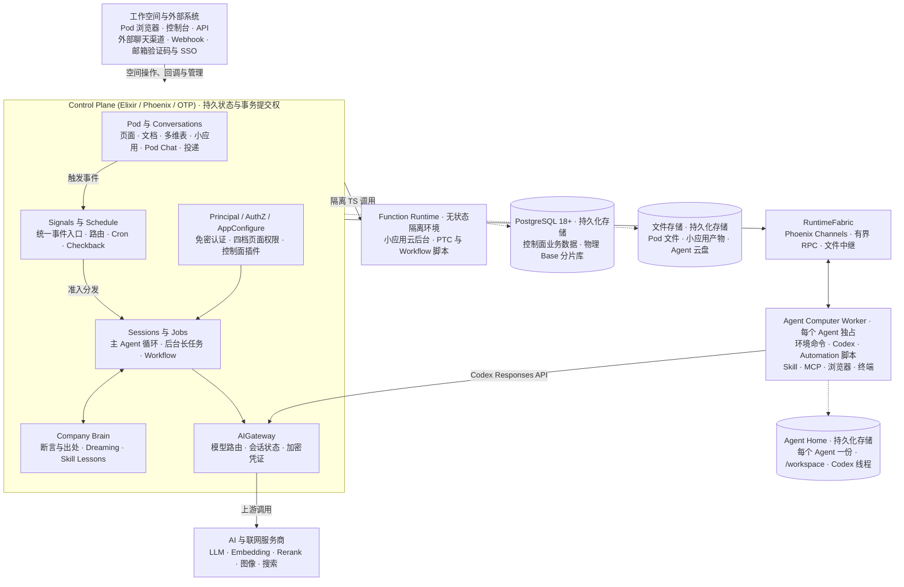

<div align="center">


# Ankole

**面向 AI 原生企业的开源数字总部与在线办公室（Pod）**

[](LICENSE)
[](https://github.com/AgentBull/ankole/releases)

[](https://deepwiki.com/AgentBull/ankole)

[官网](https://ankole.agentbull.com/zh-Hans-CN/) · [文档](https://ankole.agentbull.com/zh-Hans-CN/docs/introduction/) · [快速开始](#快速开始) · [工作原理](#工作原理) · [讨论区](https://github.com/AgentBull/ankole/discussions)

[English](./README.md) · **简体中文** · [日本語](./README.ja.md) · [한국어](./README.ko.md)

</div>

Ankole 是一套开源的企业数字总部（在线工作空间 **Pod**）与多智能体运行时。在同一个浏览器空间里，团队成员与 AI 同事（Agent）共用**协同文档**与**演示稿**、**实时业务多维表（Base）**、按需生成且自带无状态云后台的**业务小应用（Applet）**，以及**多人多 AI 协作聊天室（Pod Chat）**；飞书、Slack、Microsoft Teams、钉钉、企业微信和电子邮件作为外部通知与消息入口接入。

Ankole 将企业日常运作组织为**一系列有人把关的业务闭环（Loop）**：常规的数据巡检、工具搭建与跨系统流转由 AI 在独立 Linux 容器中持续推进，人类聚焦于提供线下真实上下文，并在关键节点通过**选择卡**一键拍板。共享**企业大脑（Company Brain）**、**技能实战经验沉淀（Skill Lessons）**、全套免密码认证与四档数据权限均完整内置在 Apache 2.0 开源自托管内核中。

<p align="center">
  <a href="https://x.com/AgentBullLab/status/2108582424959721707/video/1">
    
  </a>
</p>

## 快速开始

借助 Docker Compose，你可以在单台 Linux、macOS 或 Windows 主机上拉起完整的 Ankole 部署，一次启动 PostgreSQL 18、`ankole-function-runtime`（无状态小应用与脚本隔离运行时）、数据库迁移、控制面以及负责 HTTPS 的 Caddy。开始前请准备：

- 可运行 Linux `amd64` 或 `arm64` 容器的 Docker 环境，并为 PostgreSQL、文件存储及每个活跃 Agent 独占的 Worker 容器预留充足内存和磁盘空间。
- 受信任的宿主机环境，允许控制面通过 `/var/run/docker.sock` 按需创建 Worker 容器（挂载该 Socket 等同于授予宿主机 root 权限）。
- 解析到该主机的域名并放行 `80` 和 `443` 端口；本机体验可直接使用 `ankole.localhost`。
- 一个模型提供商的 API Key，以及用于免密邮箱验证码的 SMTP 发信服务或企业 SSO 应用。飞书、钉钉、企业微信、Slack、Discord、Telegram 和电子邮件均由 Ankole 主动外连，本机试用开箱即用；Microsoft Teams、LINE 和 WhatsApp 通过 Webhook 向主机推送事件，需要公网可访问的 HTTPS 地址。

1. 获取部署文件：

```bash
git clone https://github.com/AgentBull/ankole.git
cd ankole/tools/deploy/docker-compose
cp .env.example .env
chmod 600 .env
```

2. 在 `.env` 中配置以下必填项：

| 变量 | 取值 |
| --- | --- |
| `ANKOLE_HOST`、`ACME_EMAIL` | 主机域名（或本机试用填 `ankole.localhost`），以及接收 TLS 证书通知的邮箱 |
| `POSTGRES_PASSWORD` | 用 `openssl rand -hex 24` 生成的一组十六进制随机值 |
| `ANKOLE_SECRET_BASE`、`RELEASE_COOKIE`、`ANKOLE_FUNCTION_RUNTIME_TOKEN` | 用 `openssl rand -hex 32` 分别生成的三组独立十六进制随机值 |
| `ANKOLE_DOCKER_GID` | Linux 上取 `stat -c %g /var/run/docker.sock` 的输出；macOS Docker Desktop 上填 `0` |

3. 启动服务并读取一次性激活码：

```bash
docker compose pull
docker compose up -d
docker compose logs control-plane | grep "SETUP ACTIVATION CODE"
```

控制面启动完成后才会打印激活码；如果最后一条命令暂无输出，稍等几秒再执行一次。

使用 `ankole.localhost` 时，Caddy 使用内置本地 CA 签发证书，而 `/setup` 要求受信任的 HTTPS。复制本地根证书并用系统证书工具设为信任：

```bash
docker compose cp caddy:/data/caddy/pki/authorities/local/root.crt ./ankole-local-ca.crt
```

4. 打开 `https://<ANKOLE_HOST>/setup`，输入激活码，启用所需插件，并配置管理员免密登录方式：**6 位邮箱验证码（SMTP，首次保存前会真实发送测试邮件防止锁死）**或**企业 SSO（如飞书、Slack、Microsoft Entra ID 等）**。随后进入管理控制台添加模型提供商并创建 Agent（API Key 加密保存在控制台内，不要写进 `.env`）。完成后即可直接进入 **Pod 在线工作空间**新建文档、多维表、小应用与群聊，也可以绑定飞书或 Slack 等外部聊天渠道收发消息。

<details>
<summary>使用 Claude Code 或 Codex 自动引导部署</summary>

```text
请参考 https://ankole.agentbull.com/zh-Hans-CN/docs/quickstart/index.md，帮我部署并配置一个 Ankole 私有化实例。请先检查我的运行环境，在 Docker Compose、Kubernetes 和源码运行中推荐最合适的方式；随后协助配置登录方式（免密邮箱验证码 Email OTP 或企业 SSO 身份源 IdP）、模型提供商（LLM Provider）、Agent、聊天渠道（Channel Provider）和信号路由规则（Signal Binding）。如果我尚未指定登录方式和聊天平台，请先询问我使用哪种登录方式（SMTP 邮箱验证码或企业 IdP）及聊天平台，不要替我自行决定。切勿在对话或命令输出中泄露任何密钥；直到我在所选聊天工具中收到 Agent 的真实回复，部署才算完成。
```

</details>

其他运行方式：

- **Kubernetes**：使用 [Helm Chart](tools/deploy/helm/ankole-agent/README.zh-Hans.md)，支持内置或外部 PostgreSQL。
- **Cloudflare Containers**：参阅 [Cloudflare Worker 适配器](tools/deploy/cloudflare/agent-workers/README.zh-Hans.md)。
- **从源码运行**：参阅 [CONTRIBUTING.md](CONTRIBUTING.md)（`bun install`、`bun run services:start`、`bun run control-plane:setup`、`bun dev`）。

各身份源、模型提供商与聊天渠道的详细步骤见[快速开始文档](https://ankole.agentbull.com/zh-Hans-CN/docs/quickstart/)；备份、升级与排障见 [Compose 部署指南](tools/deploy/docker-compose/README.zh-Hans.md)。

## Pod 在线办公室的五大模块

每个企业或独立团队拥有隔离的 **Pod 工作空间**，内置五个互相打通的模块：

- **空间主页（`Pod Home`）**：左侧目录区分团队共享**工作区**与员工**私人区**，支持任意层级子页面与严格按权限过滤的秒级全文检索。
  - **协同文档（`Doc`）**：人与多位 Agent 可同时编辑同一篇文档且互不抢光标；文档内嵌的历史报告快照会定格当时的结论数字，后续实时业务表更新不会篡改往期周报或月报。
  - **实时多维表（`Base`）**：支持多子表、表格/看板/画廊视图、公式、跨表关联与附件。小表即点即开，大表通过物理分片 PostgreSQL 流畅承载单表 **10 万行以上**业务记录；人手动点改、Agent 更新与小应用读写共用同一份实时数据。
  - **业务小应用（`Applet`）**：用自然语言讲清业务规则，Agent 几分钟即可构建并发布带 React 界面与可选无状态 TypeScript 云后台（`Function Runtime`）的定制工具。算价拉滑块、列表筛选、驻厂手机填单等常规界面交互直接运行普通程序代码，**零大模型 Token 消耗**。每个小应用在独立环境与当前操作人权限下运行，故障互不连坐；研发团队随时可通过 `applet pull` 一键导出完整前后端源码与工程配置，绝无平台黑盒锁定。
  - **空间文件与演示稿（`File` / `Slides`）**：浏览器内直接预览 PDF、演示稿、电子表格、图片与音视频，支持在任意页面和聊天室中 `@` 引用。
- **多人多 AI 团队聊天（`Pod Chat`）与页面边看边聊**：单聊可随时拉同事或其他专职 Agent 升级为群聊，支持 `@Agent`、`@同事`、`@页面`。每位 Agent 均配有独立的**「允许旁听主动插话」**开关——关闭时同事之间的讨论不消耗任何模型算力，且系统保证 **Agent 的回复绝不会唤醒其他 Agent**，从根源上杜绝死循环互聊。遇到决策节点时，Agent 会发出含 `1~4` 个选项（支持自由补充）的**选择卡**，首位有权限的成员点选后全群立即锁定并记录拍板人。任务执行期间，既可随时修改排队中的待发消息，也能点击**「立即补充（Steer）」**中途纠偏而无需重跑；任意页面右侧还可展开继承该页权限的讨论栏。
- **企业大脑（`Company Brain`）与技能经验沉淀（`Skill Lessons`）**：
  - **企业大脑**在权限边界内自动串联文档、多维表、小应用、文件、群聊与外部消息，为每条记录保留出处、时间、持有者与可见范围，严格区分**客观事实**、**待验证假设**、**AI 推测**与**人工拍板结论**。未经证实的推测不会因多次引用变成事实，前后矛盾的说法自动标出待审，AI 推测也绝不会擅自覆盖多维表里的真实业务状态。
  - **技能实战经验（`Skill Lessons`）**将日常踩坑与人工纠偏沉淀为附带案例出处的规则笔记（人工随时可审阅修订），让通用技能越用越懂团队规矩。
- **统一外部连接器与后台持续运行**：连接器打通电商平台、海外仓、ERP、工单与聊天软件，供小应用按钮、聊天派活与自动触发共用。外部状态以**真实回执**为准（改表备注不等于外部退款或锁库成功），高风险外部动作先发选择卡等负责人确认；来自飞书、企微或 Slack 的外部消息（`Externals`）按连接、群组与会话串归档且严格隔离可见范围。定时与事件触发让长任务在合上电脑后继续推进，等待审批或外部回复时安静休眠，崩溃重启后从 PostgreSQL 精确恢复。
- **免密码登录与企业级安全治理**：
  - **免密码登录与标签页身份隔离**：支持个人**邮箱验证码**与**企业统一登录（SSO）**并存、邮箱域名白名单、强制正式员工走企业 SSO，以及多空间秒切与浏览器不同标签页身份互不串号；内置最后一位真人管理员防删与防锁死保护。
  - **四档页面与数据权限**（空间达 **50 万页面**仍即时鉴权）：**仅查看**、**可提交数据**（专为一线填报设计：可经小应用提交单据和附件，但无法查看单独保密的底价关联表、无法改动表结构、也看不到小应用源码与密钥）、**可编辑**（编辑文档与表结构、发布及导出小应用源码）、**完全控制 / 可管理**（管理分享权限、删表与回收站）。
  - **三条企业安全红线**：① **防借 AI 越权**——员工发起的交互任务严格取 **`员工权限 ∩ Agent 权限`** 交集，仅管理员授权的公司级无人值守任务使用 Agent 自身权限，并支持单 Agent 周期花费封顶；② **外部访客严密隔离**——无私人区、看不到通讯录与后台设置、自动屏蔽公司内部公共记忆；③ **暂停与离职分离**——临时停职可一键冻结并恢复，正式离职除切断一切访问与名下定时任务外，还会**自动释放占用的公司邮箱与手机号**，避免后续同名新员工串号。

## 典型业务闭环与研发场景

| 场景 | Ankole 如何闭环运行 |
| --- | --- |
| **驻厂手机验货台与采购底价隔离** | 对着 BOM **多维表**口述规则生成手机验货**小应用**：给驻厂员开**可提交数据**权限拍照录抽检结果，同时将代工厂阶梯底价子表设为仅老板与采购可见。 |
| **多渠道库存与海运船期补货巡检** | 定时 Agent 核对海外仓库存、海运在途船期与营销排期，刷新经营驾驶舱小应用；发现断货风险即在调度群发出跨仓调拨**选择卡**，主管点选后经连接器下发真实仓库指令。 |
| **售后批次质量熔断闭环** | 新增返修工单实时触发核查；同一生产批次故障达阈值时，顺着**企业大脑**拉出出厂验货单与未发库存并发出紧急选择卡，确认后同步锁库、发起索赔并更新质检标准文档。 |
| **代码仓库缺陷修复与自动提 PR** | 在聊天室 `@Ankole` 指定 Issue 编号，Agent 在隔离的 **Agent Computer Worker** 容器中调用 Codex 与预配仓库凭证完成修复、测试并返回 PR 链接。 |
| **多假设深度研究与周会汇报生成** | 调用 **Deep Research** 在多个隔离上下文中搜证检验正反假设并输出带引证报告；或每周一晨自动拉取真实经营数据起草复盘**演示稿**与定格历史数字的周报。 |

## 支持生态

| 类别 | 支持范围 |
| --- | --- |
| 在线工作空间（`Pod`） | 协同文档、多维表 Base（表格/看板/画廊视图；内联与物理分片 PostgreSQL）、React + TypeScript 定制小应用 Applet（`Function Runtime`）、文件与演示稿预览、多人多 AI 聊天室 Pod Chat |
| 外部聊天与邮件 | 飞书 / Lark、Slack、Microsoft Teams、钉钉、企业微信、Telegram、Discord、LINE、WhatsApp、电子邮件 |
| 登录与组织架构同步 | 免密邮箱验证码（SMTP）、飞书 / Lark、Slack、Microsoft Entra ID、Google Workspace、钉钉、企业微信（OIDC/OAuth SSO 与组织目录同步） |
| 模型 | OpenAI、Azure OpenAI、Claude、Google AI Studio、OpenRouter、AgentBull Cloud、ChatGPT 订阅，以及任意兼容 OpenAI API 的端点（含自托管模型）。中国市场插件另支持火山引擎 Ark、阿里云百炼中国区、Z.AI Coding Plan 与小米 MiMo。 |
| 联网搜索与网页读取 | AgentBull Cloud、Parallel（`parallel.ai`）、Jina、Bright Data SERP，以及本地 Chromium 渲染抓取（`ankole-browser`） |
| Agent 电脑（Worker） | Docker、Kubernetes、Cloudflare Containers、Vercel、AWS Lambda MicroVMs、阿里云函数计算 |
| 部署形态 | 单机 Docker Compose、Kubernetes Helm Chart 或源码运行（100% 功能完整的 Apache 2.0 开源内核；私有化部署亦可选配一把 AgentBull Cloud 聚合密钥接入全球模型与联网搜索） |

## 工作原理

一套 Ankole 站点部署可以承载一个或多个数据隔离的租户。每个租户拥有独立的 Pod 页面、多维表数据（存放在租户分配的物理 Base 分片库）、人员与 Agent 主体、企业大脑和外部渠道连接；站点运维人员统一管理共享的模型提供商、Worker 提供商与基础设施。

Ankole 运行时由五个核心部分组成：

- **控制面**（Elixir、Phoenix 与 OTP）：掌握持久化状态、进程监督树与事务提交权，统筹管理 Pod 工作空间、身份与权限（Principal / AuthZ）、系统配置、会话与消息、信号路由、定时计划、Sessions 主循环、后台长任务、Workflow、企业大脑，以及统一调度上游模型的 AIGateway。
- **Function Runtime**（`ankole-function-runtime`）：在无状态 Edge Runtime 隔离环境中运行 Pod 小应用的云端后端接口与确定性 TypeScript（`PTC` 与 `Workflow`）程序，自身不保存任何持久化状态。
- **Agent Computer Worker**（Bun 与 TypeScript，每个 Agent 独占一个 Linux 容器）：承载命令行、浏览器、Codex、MCP 服务、Skill 与 Automation 脚本。仅当任务确实需要电脑环境时，控制面才会在 Docker、Kubernetes 或云平台上按需拉起对应的 Worker。
- **Kernel**（Rust，经 Rustler 与 Node-API 加载）：提供密码学原语、不透明 UID 与短链接编解码、CEL 权限求值、Markdown/Markdoc 解析、UTF-16 页面差分，以及底层 AI 网络传输。
- **PostgreSQL 18+ 与文件存储**：PostgreSQL 保存全部控制面业务数据与物理分片多维表（`BASE_DB_URLS`）；文件存储托管 Pod 文件、小应用构建产物、Agent 云盘与会话附件；每个 Agent 的 `/workspace` 主目录（Agent Home）在容器重建后持久保留，而 `/var/cache/ankole` 缓存目录可随时销毁重建。

<details>
<summary>架构图</summary>

下图展示各模块的职责归属与持久化边界，省略模块内部调用细节。



</details>

[docs/README.md](docs/README.md)（英文）介绍每个模块，[设计文档](docs/design-docs/)（英文）定义各子系统的契约。[为什么 OTP 是更好的多智能体编排运行时](https://ding.ee/zh-Hans-CN/why-otp-is-a-better-runtime-for-multi-agent-orchestration/)解释了运行时的选择。

## 当前状态与已知限制

Ankole 已在生产环境中稳定运行，本仓库也由 Ankole Agent 使用同一套 Pod、企业大脑、工具和工程规则参与日常维护。核心代码与关键状态机经过形式化验证；专用端到端测试套件覆盖 Pod 协同编辑、多维表分片、小应用前后端、飞书/Slack/钉钉/企业微信消息链路、定时调度、Worker 容器、崩溃恢复、并发与平滑升级。公共 API 暂未提供跨版本兼容承诺，升级前请先查阅[更新日志](CHANGELOG.md)（英文）。

[取舍与已知限制](docs/TradeoffsAndKnownLimits.md)（英文）列出 Ankole 明确不做保证的边界，核心要点包括：

- 单套站点可承载多个数据隔离的租户，但所有租户信任同一站点运维方，并共享控制面、`Function Runtime`、模型提供商与 Worker 提供商。
- Worker 容器是对应 Agent 唯一的计算隔离边界，Ankole 不防范 Agent 改动或破坏其自身的 Worker 容器。
- 不同云端 Worker 提供商的实测范围不同，详见 [Agent Workers](docs/design-docs/AgentWorkers.md#provider-verification)（英文）。

## 文档

| 指南 | 内容 |
| --- | --- |
| [介绍](https://ankole.agentbull.com/zh-Hans-CN/docs/introduction/) | Pod、Agent、企业大脑、Skill、权限体系与部署组成 |
| [快速开始](https://ankole.agentbull.com/zh-Hans-CN/docs/quickstart/) | 部署、邮箱验证码与企业 SSO 登录、模型提供商和聊天渠道的逐步配置 |
| [架构](https://ankole.agentbull.com/zh-Hans-CN/docs/architecture/) | 控制面、Function Runtime、Worker 与持久化边界 |
| [常见问题与故障排查](https://ankole.agentbull.com/zh-Hans-CN/docs/faq/) | 常见故障原因与排查方法 |
| [部署指南](tools/deploy/README.zh-Hans.md) | Docker Compose、Kubernetes Helm 与 Cloudflare Containers |
| [设计文档](docs/design-docs/)（英文） | 各子系统的架构契约与不变量 |

## 参与贡献

欢迎参与贡献。[CONTRIBUTING.md](CONTRIBUTING.md) 带你从一台全新的机器完成本地环境搭建与端到端验收，[AGENTS.md](AGENTS.md) 规定工程与边界准则。你可以直接把下面的提示词交给编程 Agent 协助搭建：

```text
请完整阅读 https://github.com/AgentBull/ankole/blob/main/CONTRIBUTING.md，然后在当前 Ankole 仓库中严格依照该指南，带我完成完整的本地环境搭建及文档规定的端到端验收。把该指南作为事实来源；你能安全、可逆地执行和验证的步骤都由你完成；遇到账号、密钥、OAuth 或破坏性操作授权时暂停并指导我；在全部成功标准通过前不要宣称搭建完成。
```

## 社区

- 在 [GitHub Discussions](https://github.com/AgentBull/ankole/discussions) 交流问题，或展示你基于 Ankole 搭建的业务闭环与小应用。
- 在 [GitHub Issues](https://github.com/AgentBull/ankole/issues) 报告缺陷或提交功能建议。
- 如果 Ankole 对你的团队有帮助，欢迎点亮 Star 让更多开发者看到。如需订阅版本发布通知，可依次点击 **Watch** → **Custom** → **Releases**。

## 许可证

Ankole 采用 [Apache 2.0 许可证](LICENSE)。
