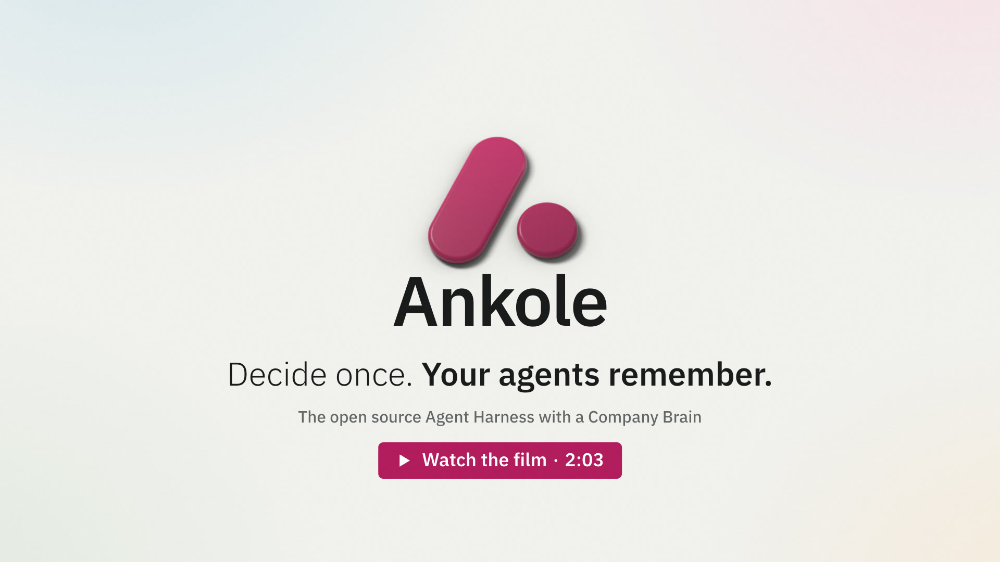
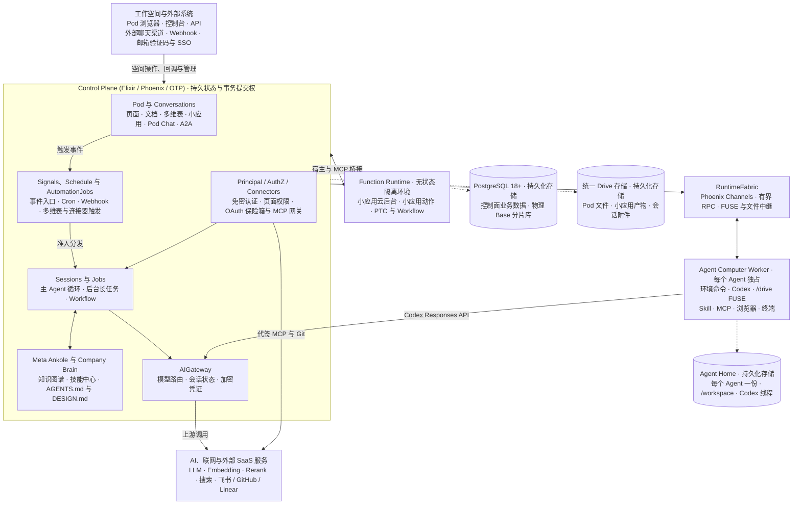

<div align="center">


# Ankole

**面向 AI 原生企业的开源数字总部与在线办公室（Pod）**

[](LICENSE)
[](https://github.com/AgentBull/ankole/releases)

[](https://deepwiki.com/AgentBull/ankole)

[官网](https://ankole.agentbull.com/zh-Hans-CN/) · [文档](https://ankole.agentbull.com/zh-Hans-CN/docs/introduction/) · [快速开始](#快速开始) · [工作原理](#工作原理) · [讨论区](https://github.com/AgentBull/ankole/discussions)

[English](./README.md) · **简体中文** · [日本語](./README.ja.md) · [한국어](./README.ko.md)

</div>

Ankole 是一套开源的企业数字总部（在线工作空间 **Pod**）与多智能体运行时。在同一个浏览器空间里，团队成员、每位成员专属的**个人助理（Personal Assistant）**与职能 **AI 同事（AI Colleague）** 共用**协同文档**与**演示稿**、**实时业务多维表（Base）**、按需生成且自带无状态云后台与确定性自动动作的**业务小应用（Applet）**、支持跨 AI 对等委托的**协作聊天室（Pod Chat）**，以及沉淀组织认知与规矩的 **`Meta Ankole`**（**企业大脑**、共享**技能库**与 **`AGENTS.md` / `DESIGN.md`** 规范）；统一**连接器（Connectors）**打通飞书、Slack、Microsoft Teams、钉钉、企业微信、GitHub、Linear 和电子邮件。

Ankole 将企业日常运作组织为**一系列有人把关的业务闭环（Loop）**：常规的定时同步、Webhook 回调与表格变更联动由已发布的**小应用动作（Applet Actions）**零大模型 Token 消耗确定性执行；开放式的分析与工具搭建由 AI 在独立 Linux 容器中持续推进；人类聚焦于提供线下真实上下文，并在关键节点通过**选择卡**或**操作审批卡**拍板。全部能力均完整内置在 Apache 2.0 开源自托管内核中。

<p align="center">
  <a href="https://x.com/AgentBullLab/status/2108582424959721707/video/1">
    
  </a>
</p>

## 快速开始

借助 Docker Compose，你可以在单台 Linux、macOS 或 Windows 主机上拉起完整的 Ankole 部署，一次启动 PostgreSQL 18、`ankole-function-runtime`（无状态小应用云后台、小应用动作与确定性程序隔离运行时）、数据库迁移、控制面以及负责 HTTPS 的 Caddy。开始前请准备：

- 可运行 Linux `amd64` 或 `arm64` 容器的 Docker 环境，并为 PostgreSQL、文件存储及每个活跃 Agent 独占的 Worker 容器预留充足内存和磁盘空间。
- 受信任的宿主机环境，允许控制面通过 `/var/run/docker.sock` 按需创建 Worker 容器（挂载该 Socket 等同于授予宿主机 root 权限）。
- 解析到该主机的域名并放行 `80` 和 `443` 端口；本机体验可直接使用 `ankole.localhost`。
- 一个模型提供商的 API Key，以及用于免密邮箱验证码的 SMTP 发信服务或企业 SSO 应用。飞书、钉钉、企业微信、Slack、Discord、Telegram 和电子邮件均由 Ankole 主动外连，本机试用开箱即用；Microsoft Teams、LINE 和 WhatsApp 通过 Webhook 向主机推送事件，需要公网可访问的 HTTPS 地址。

1. 获取部署文件：

```bash
git clone https://github.com/AgentBull/ankole.git
cd ankole/tools/deploy/docker-compose
cp .env.example .env
chmod 600 .env
```

2. 在 `.env` 中配置以下必填项：

| 变量 | 取值 |
| --- | --- |
| `ANKOLE_HOST`、`ACME_EMAIL` | 主机域名（或本机试用填 `ankole.localhost`），以及接收 TLS 证书通知的邮箱 |
| `POSTGRES_PASSWORD` | 用 `openssl rand -hex 24` 生成的一组十六进制随机值 |
| `ANKOLE_SECRET_BASE`、`RELEASE_COOKIE`、`ANKOLE_FUNCTION_RUNTIME_TOKEN` | 用 `openssl rand -hex 32` 分别生成的三组独立十六进制随机值 |
| `ANKOLE_DOCKER_GID` | Linux 上取 `stat -c %g /var/run/docker.sock` 的输出；macOS Docker Desktop 上填 `0` |

3. 启动服务并读取一次性激活码：

```bash
docker compose pull
docker compose up -d
docker compose logs control-plane | grep "SETUP ACTIVATION CODE"
```

控制面启动完成后才会打印激活码；如果最后一条命令暂无输出，稍等几秒再执行一次。

使用 `ankole.localhost` 时，Caddy 使用内置本地 CA 签发证书，而 `/setup` 要求受信任的 HTTPS。复制本地根证书并用系统证书工具设为信任：

```bash
docker compose cp caddy:/data/caddy/pki/authorities/local/root.crt ./ankole-local-ca.crt
```

4. 打开 `https://<ANKOLE_HOST>/setup`，输入激活码，启用所需插件，并配置管理员免密登录方式：**6 位邮箱验证码（SMTP，首次保存前会真实发送测试邮件防止锁死）**或**企业 SSO（如飞书、Slack、Microsoft Entra ID 等）**。随后进入管理控制台添加模型提供商并创建 Agent（API Key 加密保存在控制台内，不要写进 `.env`）。完成后即可直接进入 **Pod 在线工作空间**新建文档、多维表、小应用与群聊，也可以绑定飞书或 Slack 等外部聊天渠道收发消息。

<details>
<summary>使用 Claude Code 或 Codex 自动引导部署</summary>

```text
请参考 https://ankole.agentbull.com/zh-Hans-CN/docs/quickstart/index.md，帮我部署并配置一个 Ankole 私有化实例。请先检查我的运行环境，在 Docker Compose、Kubernetes 和源码运行中推荐最合适的方式；随后协助配置登录方式（免密邮箱验证码 Email OTP 或企业 SSO 身份源 IdP）、模型提供商（LLM Provider）、Agent、聊天渠道（Channel Provider）和信号路由规则（Signal Binding）。如果我尚未指定登录方式和聊天平台，请先询问我使用哪种登录方式（SMTP 邮箱验证码或企业 IdP）及聊天平台，不要替我自行决定。切勿在对话或命令输出中泄露任何密钥；直到我在所选聊天工具中收到 Agent 的真实回复，部署才算完成。
```

</details>

其他运行方式：

- **Kubernetes**：使用 [Helm Chart](tools/deploy/helm/ankole-agent/README.zh-Hans.md)，支持内置或外部 PostgreSQL。
- **Cloudflare Containers**：参阅 [Cloudflare Worker 适配器](tools/deploy/cloudflare/agent-workers/README.zh-Hans.md)。
- **从源码运行**：参阅 [CONTRIBUTING.md](CONTRIBUTING.md)（`bun install`、`bun run services:start`、`bun run control-plane:setup`、`bun dev`）。

各身份源、模型提供商与聊天渠道的详细步骤见[快速开始文档](https://ankole.agentbull.com/zh-Hans-CN/docs/quickstart/)；备份、升级与排障见 [Compose 部署指南](tools/deploy/docker-compose/README.zh-Hans.md)。

## Pod 在线办公室的五大模块

每个企业或独立团队拥有隔离的 **Pod 工作空间**，围绕 `Home`、`Chat` 与 `Meta Ankole` 组织为五个互相打通的模块：

- **空间主页（`Pod Home`）**：左侧目录区分团队共享**工作区**与员工**私人区**，支持任意层级子页面、易读的 `<title-slug>-<short-id>` 链接以及严格按权限过滤的秒级全文检索。
  - **协同文档（`Doc`）**：人与多位 Agent 可同时编辑同一篇文档且互不抢光标；支持行内 `@` 引用同事与关联页面、嵌入多维表实时视图与子页面列表；支持在正文段落、代码行、CSV 数据行及音视频时间点上打多模态版本绑定的**锚点批注**并直接 `@Agent` 唤醒处理；每次修改自动保留 `30` 天历史版本供对比恢复。
  - **实时多维表（`Base`）**：支持多子表、表格/看板/画廊视图、公式、跨表关联、附件、按业务主键自动去重更新（Upsert）与数据变更触发器。小表即点即开，大表通过物理分片 PostgreSQL 流畅承载单表 **10 万行以上**业务记录；人手动点改、Agent 更新与小应用读写共用同一份实时数据。
  - **业务小应用与自动动作（`Applet` & `Applet Actions`）**：用自然语言讲清业务规则，Agent 几分钟即可构建并发布带 React 界面与无状态 TypeScript 云后台（`Function Runtime`）的定制工具。常规查询按当前操作人权限（`AnkoleRuntime`）运行，一线受限填报等场景支持通过发布者显式声明的受控管理通道（`AnkoleRuntime.admin`）执行；**已发布的小应用动作（Applet Actions）**绑定定时计划、Webhook、多维表变更或连接器事件后，可分片续跑并**零大模型 Token 消耗**确定性执行。研发团队随时可通过 `applet pull` 一键导出完整前后端源码与工程配置，绝无黑盒锁定。
  - **空间文件、演示稿与统一云盘（`File` / `Slides` / `Drive`）**：浏览器内直接预览并对 PDF、演示稿、电子表格、代码、图片与音视频打锚点批注；Agent 在容器内通过 `/drive` FUSE 挂载直接读写授权范围内的页面与文件。
- **个人助理、职能 AI 同事与团队聊天（`Pod Chat`）**：每位正式成员自带专属**个人助理**（`新建对话`默认入口，投影成员本人的日常协作权限），职能 **AI 同事**则拥有固定的一对一单聊与独立的岗位权限——向任意单聊添加成员都会**新建独立群聊**，确保原有私聊记录绝不外泄。通过**对等 A2A 委托**（`send_to_agent`），个人助理可在后台独立房间委托职能 AI 同事协同推进专业任务，并将澄清提问**零中转**直接透传回当前对话。群聊支持 `@Agent`、`@同事`、`@页面` 与单 Agent 独立的**「允许旁听主动插话」**开关（关闭时人类讨论零模型消耗，且 Agent 回复绝不唤醒其他 Agent），提供**选择卡**、跨权限写入时的**操作审批卡**（`propose_action_card`）、中途纠偏 **Steer**、多选消息长图分享与导出文档，并在每个页面右侧提供仅本人可见的**私人助理栏**。
- **`Meta Ankole`：企业大脑、技能中心与 Agent 规范**：
  - **企业大脑（`Company Brain`）**将开启“提炼业务事实”的空间页面、多维表记录、小应用、文件、群聊与外部消息织成可交互的租户级知识图谱（支持本体分类与 `200` 个历史版本留存），为每条记录保留出处、时间、持有者与可见范围，严格区分**客观事实**、**待验证假设**、**AI 推测**与**人工拍板结论**，自动标出前后矛盾且绝不擅自覆盖多维表业务状态；后台提炼与夜间梳理（Dreaming）统一由内置的 `ankole_brain` 系统服务主体运行。
  - **技能中心与 `AGENTS.md` / `DESIGN.md` 规范**：正式成员可协同编写团队自定义 **Skill**，Agent 在实战中沉淀附带出处的 **Skill Lessons** 避坑提醒而不篡改共享 `SKILL.md` 源文件；全局与单 Agent 的 `AGENTS.md` 和 `DESIGN.md` 规范让所有 Agent 的行为准则与视觉风格保持一致。
- **统一外部连接器（`Connectors`）与后台持续运行**：Pod 连接器保险箱统一托管企业应用凭据与员工自助扫码授权的个人账号（PKCE OAuth），供企业 SSO、外部消息接入（`Externals`）、小应用后台、单回合 Git 鉴权以及控制面无状态 **MCP 网关**（原生覆盖飞书消息/审批/任务/日历、GitHub、Linear 及远程 HTTP MCP 服务）共用，真实密钥永不进入 Worker 或小应用沙箱。外部状态以真实回执为准，高风险动作需经人工确认；已发布的**小应用动作**、**后台长任务（Background Agent Jobs）**与空闲会话冷唤醒轮转保障合上电脑后业务持续推进。
- **免密码登录与企业级安全治理**：
  - **免密码登录与标签页身份隔离**：支持个人**邮箱验证码**与**企业统一登录（SSO）**并存、邮箱域名白名单、强制正式员工走企业 SSO，以及多空间秒切与浏览器不同标签页身份互不串号；内置最后一位真人管理员防删与防锁死保护。
  - **两级分享与页面权限**（支持仅本页 `self` 或含子页面树 `container` 按个人/用户组授权，空间达 **50 万页面**仍即时鉴权）：**仅查看**、**可提交数据**（专为一线填报设计：可经小应用提交单据和附件，但无法查看单独保密的底价关联表、改动表结构或读取小应用源码与密钥）、**可编辑**（编辑文档与表结构、发布及导出小应用源码）、**完全控制 / 可管理**（管理分享权限、删表与回收站），并支持独立的**可批注**权限控制。
  - **三条企业安全红线**：① **角色真实授权与会话受众交集**——员工个人助理严格投影本人日常协作权限（剥离管理台特权），职能 AI 同事按自身岗位授权执行并在超权限写入时递交**操作审批卡**由有权限的负责人放行，会话与企业大脑记忆披露严格执行 **`发起人 ∩ Agent ∩ 房间全体成员`** 交集以防群聊泄密；② **外部访客严密隔离**——无私人区、无个人助理、看不到通讯录与后台设置、自动屏蔽公司内部公共记忆；③ **暂停与离职分离**——临时停职可一键冻结并恢复，正式离职除停用个人助理、吊销名下全部个人外部连接器授权与定时任务外，还会**自动释放占用的公司邮箱与手机号**，避免后续同名新员工串号。

## 典型业务闭环与研发场景

| 场景 | Ankole 如何闭环运行 |
| --- | --- |
| **驻厂手机验货台与采购底价隔离** | 对着 BOM **多维表**口述规则生成手机验货**小应用**：给驻厂员开**可提交数据**权限拍照录抽检结果，同时将代工厂阶梯底价子表设为仅老板与采购可见。 |
| **多渠道库存与海运船期补货巡检** | 定时小应用动作与专职 Agent 核对海外仓库存、海运在途船期与营销排期，刷新经营驾驶舱小应用；发现断货风险即在调度群发出跨仓调拨**选择卡**，主管点选后经连接器下发真实仓库指令。 |
| **售后批次质量熔断闭环** | 新增返修工单经多维表触发器实时核查；同一生产批次故障达阈值时，Agent 顺着**企业大脑**拉出出厂验货单与未发库存并发出紧急审批卡，确认后同步锁库、发起索赔并更新质检标准文档。 |
| **代码仓库缺陷修复与自动提 PR** | 在聊天室 `@Ankole` 指定 Issue 编号，Agent 在隔离的 **Agent Computer Worker** 容器中通过连接器单回合 Git 凭据调用 Codex 完成修复、测试并返回 PR 链接。 |
| **多假设深度研究与周会汇报生成** | 调用 **Deep Research** 在多个隔离上下文中搜证检验正反假设并输出带引证报告；或每周一晨自动拉取真实经营数据起草复盘**演示稿**并归档独立周报页面。 |

## 支持生态

| 类别 | 支持范围 |
| --- | --- |
| 在线工作空间（`Pod`） | 协同文档、多维表 Base（表格/看板/画廊视图；内联与物理分片 PostgreSQL）、React + TypeScript 定制小应用与小应用动作（`Function Runtime`）、带锚点批注的文件与演示稿预览、个人助理与 Pod Chat、`Meta Ankole`（企业大脑、技能库、`AGENTS.md` / `DESIGN.md`） |
| 连接器与 MCP 工具网关 | 统一应用凭据与个人 PKCE OAuth 保险箱（`Ankole.Connectors`）、控制面无状态 MCP 网关（飞书 / Lark 消息、审批、任务、日历，GitHub，Linear，远程 HTTP MCP 服务）及单回合 Git 凭据代理 |
| 外部聊天与邮件 | 飞书 / Lark、Slack、Microsoft Teams、钉钉、企业微信、Telegram、Discord、LINE、WhatsApp、电子邮件 |
| 登录与组织架构同步 | 免密邮箱验证码（SMTP）、飞书 / Lark、Slack、Microsoft Entra ID、Google Workspace、钉钉、企业微信（OIDC/OAuth SSO 与组织目录同步） |
| 模型 | OpenAI、Azure OpenAI、Claude、Google AI Studio、Google Vertex AI、OpenRouter、AgentBull Cloud、ChatGPT 订阅，以及任意兼容 OpenAI API 的端点（含自托管模型）。中国市场插件另支持火山引擎 Ark、阿里云百炼中国区、Z.AI Coding Plan 与小米 MiMo。 |
| 联网搜索与网页读取 | AgentBull Cloud、Parallel（`parallel.ai`）、Jina、Bright Data SERP，以及本地 Chromium 渲染抓取（`ankole-browser`） |
| Agent 电脑（Worker） | Docker、Kubernetes、Cloudflare Containers、Vercel、AWS Lambda MicroVMs、阿里云函数计算 |
| 部署形态 | 单机 Docker Compose、Kubernetes Helm Chart 或源码运行（100% 功能完整的 Apache 2.0 开源内核；私有化部署亦可选配一把 AgentBull Cloud 聚合密钥接入全球模型与联网搜索） |

## 工作原理

一套 Ankole 站点部署可以承载一个或多个数据隔离的租户。每个租户拥有独立的 Pod 页面、多维表数据（存放在租户分配的物理 Base 分片库）、人员主体、个人助理与职能 AI 同事、企业大脑、技能库和连接器；站点运维人员统一管理共享的模型提供商、Worker 提供商与基础设施。

Ankole 运行时由五个核心部分组成：

- **控制面**（Elixir、Phoenix 与 OTP）：掌握持久化状态、进程监督树与事务提交权，统筹管理 Pod 工作空间、`Meta Ankole`（`Library` 与企业大脑）、身份与权限（Principal / AuthZ）、连接器保险箱与无状态 MCP 网关（`Connectors`）、系统配置、会话与消息、信号路由、定时计划、`AutomationJobs`（已发布小应用动作编排）、Sessions 主循环、后台长任务、Workflow，以及统一调度上游模型的 AIGateway。
- **Function Runtime**（`ankole-function-runtime`）：在无状态 Edge Runtime 隔离环境中运行 Pod 小应用的云端后端接口、**已发布的小应用动作（Applet Actions）**与确定性 TypeScript（`PTC` 与 `Workflow`）程序，通过控制面宿主与 MCP 桥接回访业务能力，自身不保存持久化状态或原始密钥。
- **Agent Computer Worker**（Bun 与 TypeScript，每个 Agent 独占一个 Linux 容器）：承载命令行、浏览器、Codex、本地 MCP 服务与 Skill，通过 `/drive` FUSE 挂载读写授权范围内的空间页面与文件，并按回合经控制面完成 Git 鉴权。创建 Agent 后，控制面会在 Docker、Kubernetes 或云平台上后台启动 Worker。Worker 因空闲被释放后，只有需要电脑环境的任务才会再次启动它。
- **Kernel**（Rust，经 Rustler 与 Node-API 加载）：提供密码学原语、租户内 UID 与短链接编解码、CEL 权限求值、Page XML / OKF Markdown / WebDAV VFS 编解码、UTF-16 页面差分，以及底层 AI 网络传输。
- **PostgreSQL 18+ 与统一 Drive 存储**：PostgreSQL 保存全部控制面业务数据与物理分片多维表（`BASE_DB_URLS`）；统一 Drive 对象存储托管 Pod 文件、小应用构建产物与会话附件；每个 Agent 的 `/workspace` 主目录（Agent Home）使用运行方管理的存储，[持久性边界因运行方而异](docs/TradeoffsAndKnownLimits.md#worker-storage-durability-and-single-writer-fencing)，而 `/var/cache/ankole` 缓存目录可随时销毁重建。

<details>
<summary>架构图</summary>

下图展示各模块的职责归属与持久化边界，省略模块内部调用细节。



</details>

[docs/README.md](docs/README.md)（英文）介绍每个模块，[设计文档](docs/design-docs/)（英文）定义各子系统的契约。[为什么 OTP 是更好的多智能体编排运行时](https://ding.ee/zh-Hans-CN/why-otp-is-a-better-runtime-for-multi-agent-orchestration/)解释了运行时的选择。

## 当前状态与已知限制

Ankole 已在生产环境中稳定运行，本仓库也由 Ankole Agent 使用同一套 Pod、企业大脑、工具和工程规则参与日常维护。核心代码与关键状态机经过形式化验证；专用端到端测试套件覆盖 Pod 协同编辑、多维表分片、小应用前后端、飞书/Slack/钉钉/企业微信消息链路、定时调度、Worker 容器、崩溃恢复、并发与平滑升级。公共 API 暂未提供跨版本兼容承诺，升级前请先查阅[更新日志](CHANGELOG.md)（英文）。

[取舍与已知限制](docs/TradeoffsAndKnownLimits.md)（英文）列出 Ankole 明确不做保证的边界，核心要点包括：

- 单套站点可承载多个数据隔离的租户，但所有租户信任同一站点运维方，并共享控制面、`Function Runtime`、模型提供商与 Worker 提供商。
- Worker 容器是对应 Agent 唯一的计算隔离边界，Ankole 不防范 Agent 改动或破坏其自身的 Worker 容器。
- 不同云端 Worker 提供商的实测范围不同，详见 [Agent Workers](docs/design-docs/AgentWorkers.md#provider-verification)（英文）。

## 文档

| 指南 | 内容 |
| --- | --- |
| [介绍](https://ankole.agentbull.com/zh-Hans-CN/docs/introduction/) | Pod、Agent、企业大脑、Skill、权限体系与部署组成 |
| [快速开始](https://ankole.agentbull.com/zh-Hans-CN/docs/quickstart/) | 部署、邮箱验证码与企业 SSO 登录、模型提供商和聊天渠道的逐步配置 |
| [架构](https://ankole.agentbull.com/zh-Hans-CN/docs/architecture/) | 控制面、Function Runtime、Worker 与持久化边界 |
| [常见问题与故障排查](https://ankole.agentbull.com/zh-Hans-CN/docs/faq/) | 常见故障原因与排查方法 |
| [部署指南](tools/deploy/README.zh-Hans.md) | Docker Compose、Kubernetes Helm 与 Cloudflare Containers |
| [设计文档](docs/design-docs/)（英文） | 各子系统的架构契约与不变量 |

## 参与贡献

欢迎参与贡献。[CONTRIBUTING.md](CONTRIBUTING.md) 带你从一台全新的机器完成本地环境搭建与端到端验收，[AGENTS.md](AGENTS.md) 规定工程与边界准则。你可以直接把下面的提示词交给编程 Agent 协助搭建：

```text
请完整阅读 https://github.com/AgentBull/ankole/blob/main/CONTRIBUTING.md，然后在当前 Ankole 仓库中严格依照该指南，带我完成完整的本地环境搭建及文档规定的端到端验收。把该指南作为事实来源；你能安全、可逆地执行和验证的步骤都由你完成；遇到账号、密钥、OAuth 或破坏性操作授权时暂停并指导我；在全部成功标准通过前不要宣称搭建完成。
```

## 社区

- 在 [GitHub Discussions](https://github.com/AgentBull/ankole/discussions) 交流问题，或展示你基于 Ankole 搭建的业务闭环与小应用。
- 在 [GitHub Issues](https://github.com/AgentBull/ankole/issues) 报告缺陷或提交功能建议。
- 如果 Ankole 对你的团队有帮助，欢迎点亮 Star 让更多开发者看到。如需订阅版本发布通知，可依次点击 **Watch** → **Custom** → **Releases**。

## 许可证

Ankole 采用 [Apache 2.0 许可证](LICENSE)。
