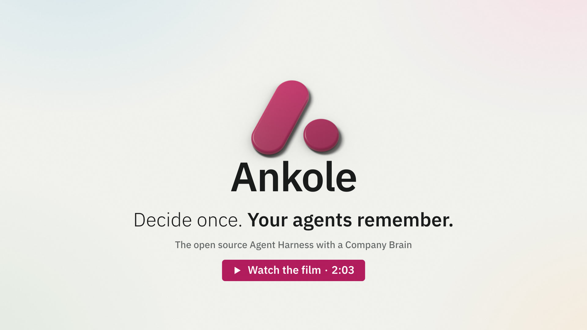
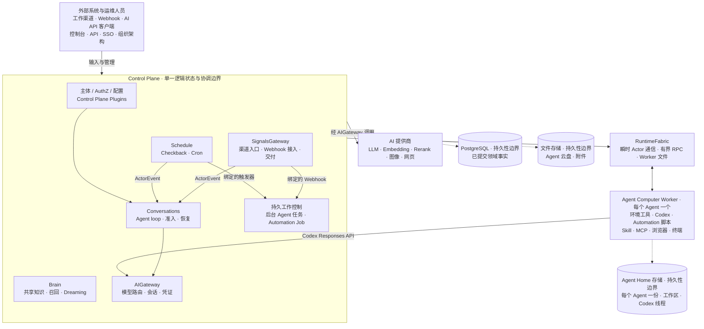

<div align="center">


# Ankole

**配备公司大脑的开源 Agent Harness**

[](LICENSE)
[](https://github.com/AgentBull/ankole/releases)

[](https://deepwiki.com/AgentBull/ankole)

[官网](https://ankole.agentbull.com/zh-Hans-CN/) · [文档](https://ankole.agentbull.com/zh-Hans-CN/docs/introduction/) · [快速开始](#快速开始) · [讨论区](https://github.com/AgentBull/ankole/discussions)

[English](./README.md) · **简体中文** · [日本語](./README.ja.md) · [한국어](./README.ko.md)

</div>

[](https://x.com/AgentBullLab/status/2108582424959721707/video/1)

Ankole 运行替公司持续工作的 AI Agent，从一人公司到大型企业都适用。大家在日常使用的聊天工具里给它们交代工作，例如 Slack、Microsoft Teams、飞书、钉钉和企业微信。

只配了提示词和几个工具的模型，每次任务都从零开始：它不知道团队上周定了什么，手里有什么权限就用什么，进程一退出，工作也随之中断。Ankole 就是补上这些缺口的 Harness。它的 Agent 共用一个公司大脑，记得团队做过的决定；它们只在你授予的权限内工作，长任务遇到崩溃和重启也能恢复。每个 Agent 在容器里有一台自己的 Linux 电脑，整套系统由你部署在自己掌控的基础设施上。

Ankole 是 Claude Tag 的开源替代方案。Claude Tag 是 Anthropic 托管的 Slack Agent；Ankole 不绑定 Slack，也不限于 Claude 模型，公司的上下文保存在你自己的服务器上。模型调用和搜索请求只发往你配置的提供商，其中也可以包括你自己托管的模型。

> **#投研** · 群聊
>
> **周远：** 周期股要覆盖完整周期，3 年窗口太短\
> **林书宁：** 同意，至少看 7 年
>
> *三天后*
>
> **Bob：** @Ankole 做一版有色金属板块估值\
> **Ankole：** 好。按照这个群三天前确定的规则，周期股估值采用 7 年数据计算分位。\
> 附件：`有色板块估值.pdf`（14 页）

没有人要求 Ankole 记住这条规则。公司大脑从 Ankole 所在的一个群聊中学到这条规则，记录来源和日期，并用在下一个需要它的请求上。

站点是一套完整部署，可以包含多个租户。各租户拥有独立的人员、Agent、Brain 和外部
平台连接；站点管理员管理共享的提供商与基础设施。管理员控制台默认位于
`/site-admin-console`；本次升级后 `/console` 返回 404。需要其他路径时，在启动前设置
`ANKOLE_SITE_ADMIN_CONSOLE_PATH`，并将路径保存在运维配置中。普通用户通过自己的
OIDC 应用登录，不使用站点管理控制台。


## 为什么选择 Ankole

模型负责推理。围绕模型的 Harness 决定模型能看到什么、可以做什么，还决定任务失败后怎样继续、结果怎样用于下一次决策。Ankole 把这些决定做进系统，而不是交给每条提示词：

- **Agent 记得公司做过的决定。** 公司大脑从对话、登记过的文件和 URL，以及 Agent 写下的笔记中学习。它把每条知识存为一条断言，并记录来源、时间、置信度、可见范围和持有者，即持有这一观点的人或 Agent。新证据会更新当前结论，同时保留历史；相互冲突的断言会一直显示，等待复核。
- **每个 Agent 只在你授予的权限内工作。** 每个人和每个 Agent 都有自己的身份和权限，Agent 之间不共用电脑、主目录或凭证。模型读取公司知识之前，公司大脑会先去掉提问者无权查看的内容；在群聊中，它还可以按群内每个成员的权限过滤。PostgreSQL 记录每个 Agent 接到的请求、发出的模型调用和交付的结果。每个 Agent 有单独的 token 额度，用来限制模型开销。为某人办理离职后，系统会禁止此人登录，并停止此人名下的任务和定时计划。
- **事情一发生，工作就开始。** 消息、定时计划、Webhook 或其他外部事件会唤醒负责这项工作的 Agent。Agent 也可以给自己设提醒，过一段时间再回来跟进。
- **长任务能从故障中恢复。** 一个任务可以运行几小时甚至几天，运行中也能接收新输入。控制面运行在 Elixir/OTP 上：某个对话崩溃时，只有这个对话受影响，其他工作继续进行。PostgreSQL 保存 Ankole 继续工作所需的输入、模型历史和工具结果。
- **每个 Agent 都有自己的电脑。** 一个 Linux 容器为 Agent 提供浏览器、终端、文件、Codex、MCP（Model Context Protocol）服务器和 Skill。Skill 是经过批准、用于某一类工作的操作规程。Agent 的主目录在重启和升级后依然保留。
- **纠正和结果会反馈到之后的工作中。** Deep Research 在多个相互隔离的上下文中收集证据，检验相互竞争的假设，并交付带引证的报告。经过多次纠正后，Agent 可以提出一条技能教训，即添加到 Skill 中的一条简短规则，经人批准后生效。预测会记录在公司大脑中；预测到期后，公司大脑会把它和实际结果对照。

Ankole 是一套面向公司工作的完整系统，不是程序库。它自带控制面、数据库和 Agent 电脑。如果只需要在自己的应用里嵌入 Agent 循环，或者想找一个处理私人事务的助理，更轻量的工具会更合适。

## 常见请求

下面这些请求来自群聊或私聊：

| 请求 | Ankole 的处理 |
| --- | --- |
| “每周五 17:00，把 X 上这 9 个账号的帖子按主题整理成 PDF，发到本群。” | 创建每周执行的定时计划。每周读取这些账号，生成 PDF 并发到群里。 |
| “@Ankole 修复我们仓库的 issue #482，并提交 PR。” | 在后台任务中运行 Codex，使用管理员预先配置的仓库凭证，完成后回复 PR 链接。 |
| “总结本群这周讨论的内容，单独列出待办。” | 读取它有权查看的群聊记录，回复总结和待办清单。 |
| “把这段话做成 PPT。”或“把这份 PDF 翻译成韩文。” | 发回 PowerPoint 文件或翻译好的 PDF。 |
| “关于我们供应商的这条传闻是真的吗？” | 运行 Deep Research，返回带引证的简报，列出支持和反驳这条传闻的证据。 |
| “按编制规则重新计算这个股票指数，和官方数值画在一张图上对比。” | 获取数据，在 Jupyter Notebook 中计算指数，然后发回图表。 |

## 支持的平台

| 类别 | 支持范围 |
| --- | --- |
| 聊天与邮件 | Slack、Microsoft Teams、飞书 / Lark、钉钉、企业微信、Telegram、Discord、LINE、WhatsApp、电子邮件 |
| 登录与组织架构同步 | Slack、Microsoft Entra ID、Google Workspace、飞书 / Lark、钉钉、企业微信、内置密码账号 |
| 模型 | OpenAI、Azure OpenAI、Claude、Google AI Studio、OpenRouter、ChatGPT 订阅，以及任何兼容 OpenAI API 的端点。中国市场插件另外提供火山引擎 Ark、阿里云百炼中国区、Z.AI Coding Plan 和小米 MiMo。 |
| 网页搜索与读取 | Parallel（parallel.ai）、Jina、Bright Data SERP、AgentBull Cloud |
| Agent 电脑 | Docker、Kubernetes、Cloudflare Containers、Vercel、AWS Lambda MicroVMs、阿里云函数计算 |
| 部署方式 | 单机 Docker Compose，或 Kubernetes 上的 Helm Chart |

## 快速开始

Docker Compose 可以在一台 Linux、macOS 或 Windows 主机上部署全套服务，其中包括 PostgreSQL、控制面，以及负责 HTTPS 的 Caddy。需要准备：

- 能运行 Linux `amd64` 或 `arm64` 容器的 Docker，并为每个运行中的 Agent 预留一个容器所需的内存和磁盘。
- 一台可以让 Ankole 拥有 root 权限的主机。控制面通过 Docker socket 创建 Agent 容器，而能访问这个 socket 就等于拥有主机的 root 权限。
- 指向主机的域名，并开放 80 和 443 端口。在自己的电脑上试用时，可以改用主机名 `ankole.localhost`。
- 一个模型提供商的 API key，以及在聊天平台上创建机器人的权限。Ankole 会主动连接 Slack、飞书、钉钉、企业微信、Discord、Telegram 和电子邮件，所以本机试用时也能使用这些平台。Microsoft Teams、LINE 和 WhatsApp 会把事件推送到主机，需要公网 HTTPS 地址。

获取部署文件：

```bash
git clone https://github.com/AgentBull/ankole.git
cd ankole/tools/deploy/docker-compose
cp .env.example .env
chmod 600 .env
```

在 `.env` 中设置以下变量：

| 变量 | 取值 |
| --- | --- |
| `ANKOLE_HOST`、`ACME_EMAIL` | 主机域名，以及接收证书通知的邮箱 |
| `POSTGRES_PASSWORD`、`ANKOLE_SECRET_BASE`、`RELEASE_COOKIE` | 用 `openssl rand -hex 32` 分别生成的三个值 |
| `ANKOLE_DOCKER_GID` | Linux 上取 `stat -c %g /var/run/docker.sock` 的输出；macOS 的 Docker Desktop 上取 `0` |

启动服务，并读取一次性激活码：

```bash
docker compose pull
docker compose up -d
docker compose logs control-plane | grep "SETUP ACTIVATION CODE"
```

控制面启动完成后才会输出激活码。如果最后一条命令没有输出，稍等片刻再运行一次。

使用 `ankole.localhost` 时，Caddy 用自己的本地证书颁发机构签发证书，而设置页面要求受信任的 HTTPS。先复制这个证书颁发机构的根证书，再用操作系统的证书工具信任它：

```bash
docker compose cp caddy:/data/caddy/pki/authorities/local/root.crt ./ankole-local-ca.crt
```

打开 `https://<ANKOLE_HOST>/setup` 并输入激活码。选择需要的插件，例如对应聊天平台的插件。设置管理员的登录方式：通过 Slack、Microsoft Entra ID 等身份源登录，或使用本地密码。接着在控制台（管理员使用的 Web 界面）中添加模型提供商、创建 Agent，并为它连接聊天平台。模型提供商的 API key 只填在控制台里，不要写进 `.env`。在这个聊天平台里给 Agent 发一条消息，收到回复就说明部署成功。

Claude Code、Codex 等编程 Agent 可以和你一起完成整个部署。把下面的提示词交给它：

```text
请参考 https://ankole.agentbull.com/zh-Hans-CN/docs/quickstart/index.md，帮我部署并配置一个 Ankole 私有化部署实例。请先检查我的运行环境，帮我在 Docker Compose、Kubernetes 和源码安装中选择最合适的部署方式。随后配置身份源提供商（IdP）、大语言模型提供商（LLM Provider）、Agent、聊天渠道（Channel Provider）和信号路由规则（Signal Binding）。如果我没有指定 IdP 和聊天平台，请先询问我使用哪个身份源和聊天平台，不要自行选择。不要在对话或命令输出里泄露 secret。直到我能在选定的 IM 中收到 Agent 的真实回复，这项工作才算完成。
```

其他运行方式：

- Kubernetes：[Helm Chart](tools/deploy/helm/ankole-agent/README.zh-Hans.md) 可以使用内置或外部的 PostgreSQL。
- 在 Cloudflare Containers 上运行 Agent 电脑：参阅 [Cloudflare 适配器](tools/deploy/cloudflare/agent-workers/README.zh-Hans.md)。
- 从源码运行：参阅 [CONTRIBUTING.md](CONTRIBUTING.md)。

完整的[快速开始](https://ankole.agentbull.com/zh-Hans-CN/docs/quickstart/)逐步说明每种身份源、模型提供商和聊天平台的配置方法。[Compose 部署指南](tools/deploy/docker-compose/README.zh-Hans.md)介绍备份、升级和故障排查。

## 工作原理

Ankole 由控制面、Worker（每个 Agent 一个）、共享的 Rust Kernel 和持久存储组成：

- **控制面**（Elixir、Phoenix 和 OTP）决定并记录所有必须在进程结束后保留的内容，包括身份与权限、配置、外部消息与 Webhook、定时计划、对话、后台任务、公司大脑，以及调用模型提供商的 AI 网关。每个对话的模型循环都是控制面里一个受监督的进程。
- 每个 Agent 有一个 **Agent Computer Worker**，即运行在 Linux 容器中的 Bun 和 TypeScript 程序。它执行命令，运行浏览器、Codex、MCP 服务器、Skill 和 Automation 脚本。控制面在 Docker、Kubernetes 或云平台上创建 Worker，只在工作需要电脑时调用它。
- **Kernel** 是由 Elixir 加载的 Rust 库，提供加密、标识符、权限求值和 AI 传输。
- **PostgreSQL** 保存所有重启后必须保留的事实。文件存储存放每个 Agent 的云盘和附件，每个 Agent 的主目录（Agent Home）保存在各自的存储上。

<details>
<summary>架构图</summary>

下图显示所有权边界和持久性边界。图中省略内部调用。



</details>

[docs/README.zh-Hans.md](docs/README.zh-Hans.md) 介绍每个组成部分，[设计文档](docs/design-docs/)（英文）定义各部分的契约。[为什么 OTP 是更好的多智能体编排运行时](https://ding.ee/zh-Hans-CN/why-otp-is-a-better-runtime-for-multi-agent-orchestration/)解释了运行时的选择。

## 当前状态与已知限制

Ankole 已在生产环境中运行。一个 Ankole Agent 也在参与维护本仓库，它使用的公司大脑、工具和工作规则与企业用户拿到的相同。专门的端到端测试覆盖 Slack、飞书、钉钉和企业微信的消息收发，以及定时计划、Worker 电脑、崩溃恢复、并发和升级。公共 API 还没有兼容性承诺，版本之间可能出现破坏性变更。升级前请先阅读[更新日志](CHANGELOG.md)（英文）。

[取舍与已知限制](docs/TradeoffsAndKnownLimits.md)（英文）说明 Ankole 不做哪些保证。其中最重要的几点：

- 一个部署实例只服务一个组织。不共享信任边界的组织需要分别部署。
- Worker 容器是对应 Agent 唯一的隔离边界，Ankole 不防范 Agent 改动或破坏自己的 Worker。
- 阿里云函数计算的 Worker 提供方还没有在云上完整运行过 Worker 生命周期。[Agent Workers](docs/design-docs/AgentWorkers.md#provider-implementations)（英文）列出了每个平台已经通过的检查。

## 文档

| 指南 | 内容 |
| --- | --- |
| [介绍](https://ankole.agentbull.com/zh-Hans-CN/docs/introduction/) | Agent、公司大脑、Skill、权限，以及部署实例的其他组成部分 |
| [快速开始](https://ankole.agentbull.com/zh-Hans-CN/docs/quickstart/) | 部署、登录、模型提供商和聊天平台的逐步配置 |
| [架构](https://ankole.agentbull.com/zh-Hans-CN/docs/architecture/) | 各个组件及组件之间的边界 |
| [常见问题与故障排查](https://ankole.agentbull.com/zh-Hans-CN/docs/faq/) | 常见故障的原因和修复方法 |
| [部署指南](tools/deploy/README.zh-Hans.md) | Docker Compose、Helm 和 Cloudflare Containers |
| [设计文档](docs/design-docs/)（英文） | 各子系统的契约 |

## 参与贡献

欢迎参与贡献。[CONTRIBUTING.md](CONTRIBUTING.md) 带你在一台全新的机器上搭好端到端环境并通过验证，[AGENTS.md](AGENTS.md) 规定工程规则。编程 Agent 也能按这两份文档工作。开始前，把下面的提示词交给你的编程 Agent：

```text
请完整阅读 https://github.com/AgentBull/ankole/blob/main/CONTRIBUTING.md，然后在当前 Ankole 仓库中严格依照该指南，带我完成完整的本地环境搭建及文档规定的端到端验收。把该指南作为事实来源；你能安全、可逆地执行和验证的步骤都由你完成；遇到账号、密钥、OAuth 或破坏性操作授权时暂停并指导我；在全部成功标准通过前不要宣称搭建完成。
```

## 社区

- 在 [GitHub Discussions](https://github.com/AgentBull/ankole/discussions) 提问，或分享你用 Ankole 做出的东西。
- 在 [GitHub Issues](https://github.com/AgentBull/ankole/issues) 报告缺陷或提出功能需求。
- 如果 Ankole 对你有用，欢迎为仓库点 Star，让更多团队发现它。如需接收新版本通知，依次选择 **Watch**、**Custom**、**Releases**。

## 许可证

Ankole 采用 [Apache 2.0 许可证](LICENSE)。
