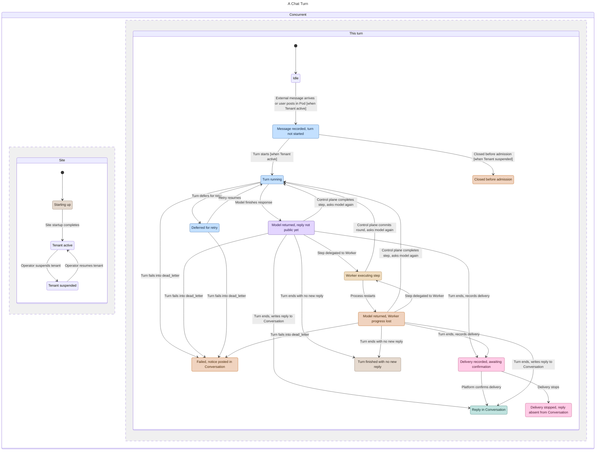
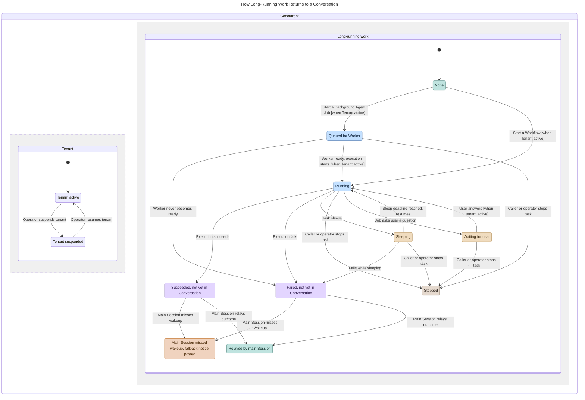
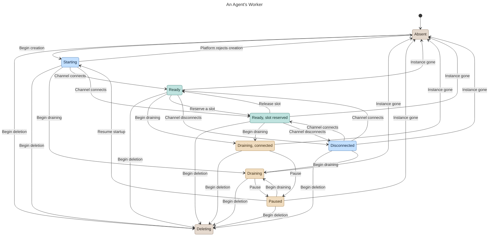
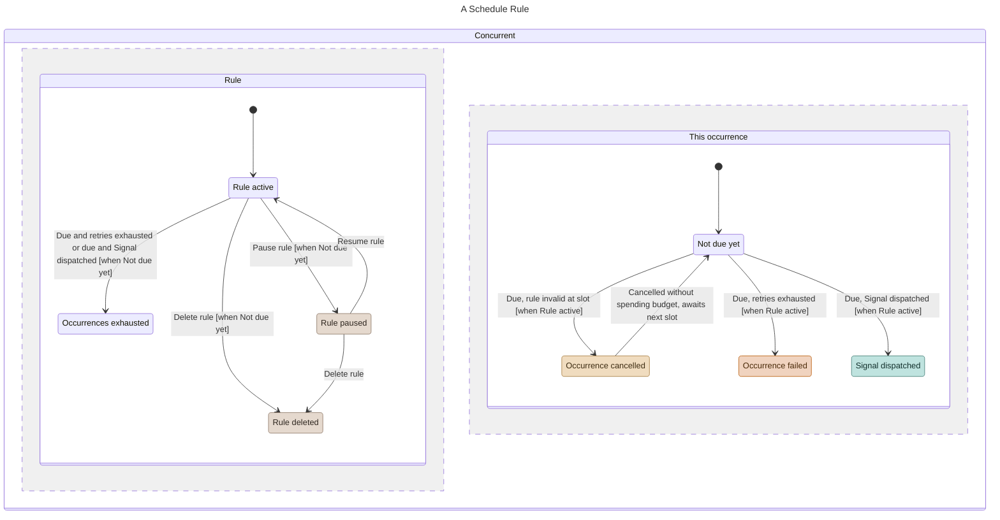
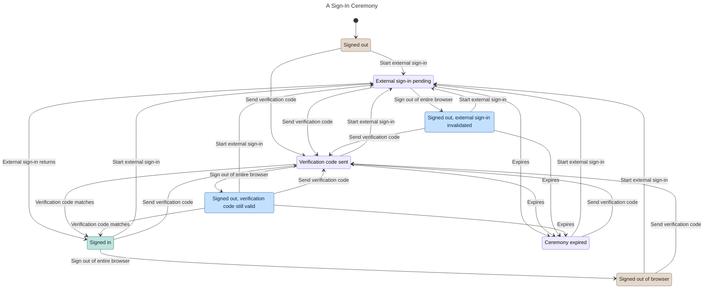
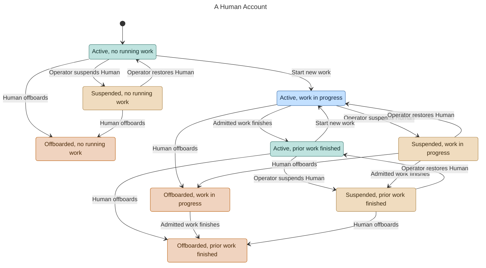
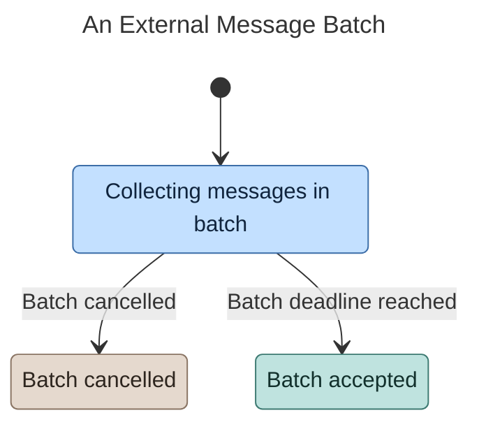
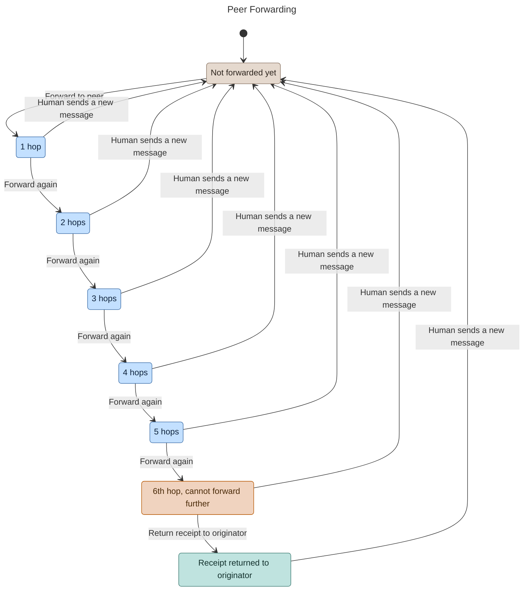
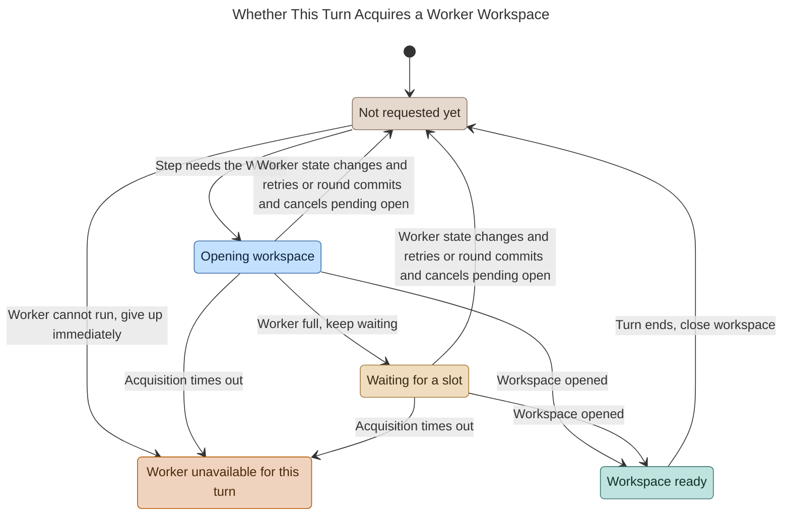
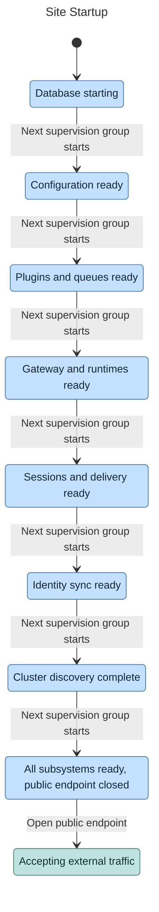

# Ankole Lifecycle Overview

The ten state machines below trace how Ankole advances each runtime concern through its lifecycle: chat turns, long-running work, Agent Workers, schedule rules, sign-in ceremonies, Human accounts, external message batches, peer forwarding, turn workspaces, and site startup. Ankole stores Pages, files, and Brain entries directly as durable content rather than giving them a separate execution lifecycle (see [Pod Content Model](PodContentModel.md), [Files](Files.md), and [BrainV3](BrainV3.md)), and `Connectors` refreshes personal OAuth tokens through the same versioned ceremony rules used for sign-in below (see [Connectors](Connectors.md)).

Whenever a diagram contains two parallel regions, read both regions together at the same instant: a `[when …]` guard on a transition names the state that the companion region must occupy for that transition to fire.

## A Chat Turn

External channel messages and native Pod messages enter the same chat turn pipeline (see [Conversations](Conversations.md), [Signals](Signals.md), and [Sessions](Sessions.md)). When the model finishes a response, the Conversation does not yet contain a public reply: for external channels, Ankole first records an outbound Delivery intent and writes the public Conversation message only after the upstream platform confirms delivery, whereas in Pod Ankole writes the reply directly into the Conversation when the turn ends.

Once an operator suspends a tenant, Ankole closes any queued input that has not yet passed admission without invoking the model (see [Tenants](Tenants.md)). By contrast, turns that were already admitted continue to completion, including turns that pause briefly and retry: when a turn defers for retry, Ankole returns the `Signal` to `queued` while preserving its admission timestamp, which Pod surfaces as `retrying`.

When an input enters `dead_letter`, Ankole posts a system notice in the Conversation rather than a model reply. A turn can also finish normally without posting a new public message. If external delivery stops in `failed` (exhausting automatic retries), `unknown`, or `expired`, Ankole never fabricates a public Conversation message; transient delivery failures that can still retry remain in `Delivery recorded, awaiting confirmation`.

The control plane executes its own built-in tools directly without involving a Worker. Whenever a turn delegates a tool step to a Worker, the control plane commits that completed tool round in PostgreSQL before calling the model again. If a process restarts, Ankole loses only uncommitted in-flight Worker progress and resumes from the stage already recorded in PostgreSQL.

Before an external inbound debounce batch reaches its deadline, `Conversations` has already recorded the observed message while `Signals` has not yet accepted a `Signal`; [An External Message Batch](#an-external-message-batch) covers that earlier window.

`Closed before admission` covers inputs revoked before a turn starts, whereas `Failed, notice posted in Conversation` covers admitted runs that exhausted retries and entered `dead_letter`. In both states, Ankole records a system notice in the Conversation rather than a model reply.

## Long-Running Work Returning to a Conversation

When a `BackgroundAgentJob` or `Workflow` finishes executing, the Conversation still contains no public reply until the main Session wakes up and relays the outcome (see [BackgroundAgentJob](BackgroundAgentJob.md) and [Workflow](Workflow.md)). If that wakeup `Signal` exhausts retries and enters `dead_letter`, Ankole posts a fallback system notice synthesized from the result stored on the `Signal`. Explicitly stopping the task suppresses both the wakeup relay and the fallback notice.

If a queued Background Agent Job never acquires a ready Worker within its queue deadline, Ankole marks the Job failed before execution ever begins. Once an operator suspends the tenant, queued tasks cannot start, while already running tasks finish their active execution. After a Workflow task calls `sleep`, PostgreSQL holds its progress in committed receipts, so Ankole resumes the task when its deadline arrives even if the tenant is suspended. While a Background Agent Job is waiting for user input (`waiting_on_user`), Worker inactivity timeouts do not mark the Job failed.

Both automatic continuations after completion and manual respawns create a fresh Job row rather than reopening the finished row. If a follow-up message cannot be delivered while a Job is waiting for user input, Ankole emits a separate wakeup notice while keeping the Job in `Waiting for user`. The main Session attaches any output files explicitly during its parent turn.

## An Agent's Worker

PostgreSQL maintains one `agent_workers` row per Agent (see [Agent Workers](AgentWorkers.md) and [RuntimeFabric](RuntimeFabric.md)). A Worker enters `Ready` only after its RuntimeFabric channel connects. `AgentWorkers` retains a live transport route only while the Worker is `Ready` or `Draining, connected`. Callers can reserve an execution slot only while the Worker is `Ready`, and a channel disconnect does not release slots that callers have already reserved.

While a Worker is `Starting`, reconciliation retries transient creation failures automatically; the row returns to `Absent` only if the cloud platform explicitly rejects creation or the instance disappears. Once deletion begins (`Deleting`), `AgentWorkers` accepts no further demand. A draining Worker can transition to `Paused` and later resume startup through `Starting`.

`Starting` transitions directly to `Ready, slot reserved` whenever a Worker resumes from `Paused` while still holding a slot reserved before the pause.

## A Schedule Rule

An automatic cron fire consumes one occurrence from the rule's budget whether it dispatches a `Signal` or exhausts its retry attempts (see [Schedule](Schedule.md)). If the rule cannot fire validly when its slot arrives, Ankole cancels that occurrence, advances the next planned timestamp without deducting from the occurrence budget, and keeps the rule active. `Schedule` skips overdue wakeups outright when a rule is paused, deleted, or already out of occurrences.

One-shot checkbacks and manual cron runs each use a separate `scheduled_events` row with the same four statuses: `scheduled`, `fired`, `cancelled`, and `failed`. Transient dispatch failures keep the row in `scheduled` across early retries and mark it `failed` only on the 10th attempt. A manual run neither consumes the rule's occurrence budget nor advances its next planned timestamp.

Each dispatched cron fire enters the dedicated `cron:<schedule_id>` execution Session rather than occupying the Session that created the rule.

## A Sign-In Ceremony

Ankole does not pin email verification codes to the browser revision active when the email was sent: even after a user signs out of the entire browser, an unused, unexpired verification code can still complete sign-in (see [Authentication](Authentication.md) and [Browser Sessions](BrowserSessions.md)). External SSO sign-in ceremonies, by contrast, bind to the browser revision captured when the ceremony started; signing out of the entire browser invalidates that in-flight external sign-in.

An external sign-in ceremony completes only when three conditions hold together: the ceremony is unconsumed and unexpired, the browser revision recorded when the ceremony started is at least the browser's latest full-logout revision, and—when the target account is already present in the browser—that account's revision is not newer than the revision at which the ceremony started.

## A Human Account

When an operator suspends a Human account (`suspended` disposition of `disabled`), Ankole retains its bound addresses and contact identifiers so restoring the account reactivates the same Principal with its permissions intact (see [Human Offboarding](HumanOffboarding.md) and [Principal](Principal.md)). When a Human offboards, Ankole releases those addresses and contact identifiers: looking up a released address does not resolve to the departed Human, an offboarded account cannot be restored, and anyone who later claims that address receives a new Principal identity.

Work that has already passed admission continues to completion after either suspension or offboarding, whereas neither a suspended nor an offboarded Human can start new work. When an operator deletes a tenant, Ankole offboards the Humans in that tenant, halts their unstarted work in other tenants, and allows already admitted attempts to finish (see [Tenants](Tenants.md)).

## An External Message Batch

`Conversations` aggregates rapid external instant messages into a short inbound batch before admitting work (see [Conversations](Conversations.md) and [Signals](Signals.md)). Ankole accepts a `Signal` only when the batch reaches its deadline; if the batch is cancelled before then, Ankole admits nothing. While a batch remains open, upstream message edits update that same batch in place.

Native Pod messages bypass inbound batching: Ankole commits the public `Message` and its `Signal` atomically in a single transaction.

## Peer Forwarding

An Agent-to-Agent peer relay chain allows at most six hops (see [Signals](Signals.md) and [Sessions](Sessions.md)). At the sixth hop, Ankole delivers the final receipt back to the originating Agent and rejects any further forwarding. Whenever a Human sends a new message, Ankole starts a fresh hop count from zero. `Sessions` queues ordinary peer messages for their own turn, whereas it allows priority peer messages to steer an active turn.

## A Turn's Worker Workspace

The Session Driver opens a Worker workspace only when the model requests a Worker step (see [Sessions](Sessions.md) and [Agent Workers](AgentWorkers.md)). While the Driver is opening the workspace or waiting for an execution slot, if the current tool round commits or the Worker changes state, the Driver cancels that pending open so the next round can request it cleanly. Once a workspace reaches `Workspace ready`, the Driver keeps it open for the remainder of the turn.

If workspace acquisition times out—or if the Worker is rejected, lacks a provider, or belongs to a disabled Agent—the Session Driver stops waiting for the Worker for the rest of the turn, keeping that unavailable verdict across any later model rounds in the same turn.

When executing control-plane tools, the Session Driver neither opens a Worker workspace nor pre-warms the Worker.

## Site Startup

The control plane starts its subsystems in strict dependency order and opens the public HTTP and WebSocket endpoint last. None of the earlier startup stages accepts external traffic.

The actual OTP supervision tree subdivides these stages further: PostgreSQL (`Repo`), the Base shard cluster, and `PubSub` start before `AppConfigure`; observability, initial setup bootstrap, `Oban`, and plugins start before `AIGateway` and `FunctionRuntime`; outbound Delivery, `AgentWorkers`, `Sessions`, and `Workflow` start before the public endpoint opens; and optional startup syncs for external identity providers and the Skill library also finish before the public endpoint opens. Once the public endpoint is open, every backing subsystem is already running.
