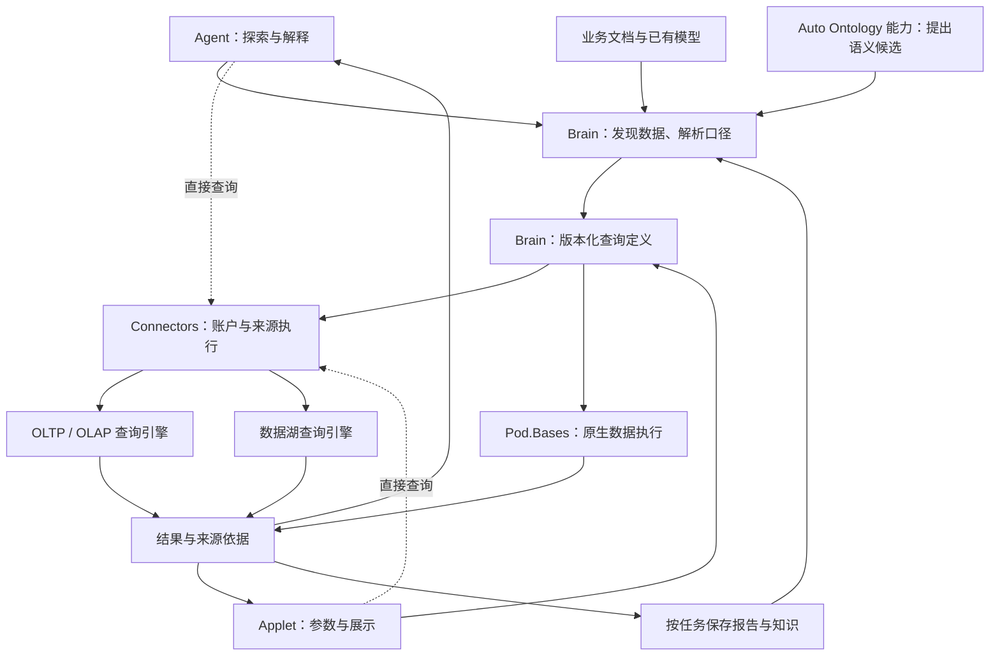

# Ankole 2.0：外部结构化数据、Brain 与 Auto Ontology

日期：2026-11-07。本文是 [Auto Ontology 源码调研](auto-ontology-source-analysis.md)的补充报告，面向 Ankole 的长期产品与架构设计。外部数据库接入、Agent 与 Applet 直接使用数据，是本次明确的产品方向；下文的模块划分、接口和实施顺序属于设计建议。

源码基准为 NVIDIA Auto Ontology [`c4495670947eb7b4616f0dd9900e5ced2a48ca1e`](https://github.com/NVIDIA/auto-ontology/commit/c4495670947eb7b4616f0dd9900e5ced2a48ca1e)，以及调研时的 Ankole 工作树。本文通过源码和官方文档推导方案，未执行外部数据库接入或模型准确率评测。

## 长期定位与主要判断

Ankole 2.0 面向企业已经存在的数据系统：业务 PostgreSQL、MySQL 等 OLTP 数据库，ClickHouse 等分析引擎，以及通过查询引擎访问的数据湖。用户可以让 Agent 分析这些数据，让 Applet 持续展示结果，也可以将选定数据同步到 Base 参与协作。外部数据的可用性不应取决于是否先复制进 Base。

在这个前提下，数据源无关的业务语义应成为 Brain 的核心职责。Brain 需要知道数据在哪里、代表什么、应当怎样计算、哪些结果可以作为知识证据。Connectors 负责实际连接和执行，原始数据继续由来源系统管理。Base 提供 Ankole 自有的结构化数据，作为这一能力的一个数据来源。

Auto Ontology 可以帮助补齐语义目录、字段解释、计算方式和关联候选，但完整整合还需要 Ankole 自己定义四个契约：

1. 业务概念与多个数据来源之间的稳定绑定。
2. Agent 和 Applet 共同使用的可执行查询定义。
3. 查询结果的来源、时效、完整性和知识证据。
4. 人工修正、来源结构变化与既有应用之间的版本关系。

2.0 方案建议由 Brain 拥有组织级口径，包括当前只绑定一个 Base 的共享指标。Base 内部公式和视图由 Base 管理，Base 适配器执行共享定义中的原生查询。是否属于组织级知识，取决于定义的共享用途，不能用当前是否包含外部来源判断归属。初步报告中的 Base 局部方案适用于范围受限的实现；长期实现应保持一个权威指标定义。

## 从 BI 使用体验推导 Brain 的缺口

用户连接数据库，通常是为了持续完成以下工作：找到有用的数据，弄清业务含义，获得正确结果，把分析做成可重复使用的应用，并将重要结论与组织知识结合。

考虑一个企业同时拥有三个来源：PostgreSQL 保存客户、订单及退款，ClickHouse 保存产品使用事件，数据湖保存长期历史；Brain 已经保存合同说明、会议纪要和收入确认政策。

用户问「哪些重要客户的产品使用下降，并且仍有未结款项」。Agent 需要识别客户身份、使用下降的计算窗口、未结款项口径和来源时效，再查询相应数据。回答还可以引用客户会议纪要解释已知背景，但应区分数据观察、文档陈述与原因推测。

用户随后要求制作客户经营 Applet。Applet 应执行已经明确的计算，按照日期、客户和团队等参数刷新结果。每次刷新都重新让模型理解问题、挑表和写 SQL，会增加延迟、成本和行为变化；已经确定的分析应形成可直接执行的契约。

用户还可能希望把其中少量客户同步到 Base，增加跟进人、优先级和行动计划。此时，同步服务于本地协作，不是获得所有外部分析能力的前置步骤。

这三种行为对应不同的数据流：

| 行为 | Brain 或 Ankole 获得什么 | 原始记录在哪里 |
| --- | --- | --- |
| 理解数据 | 结构、含义、业务口径、字段绑定、可用查询 | 来源系统 |
| 实时分析 | 指定条件下的计算结果、来源和执行依据 | 来源系统；必要结果有界返回 |
| 保存知识或协作副本 | 有明确时间范围的结论、报告，或选定记录的本地副本 | 来源系统及用户明确建立的本地内容 |

因此，「结构化数据接入大脑」不等于给每个单元格生成 embedding，也不等于为每行记录创建 Brain 对象。Brain 应长期保存理解和使用数据所需的知识，在回答需要时访问实时数据，并有选择地保存有来源的结论。

## Notion 的同步模式提供什么参考

Notion 当前官方文档介绍了 GitHub、Jira 和 Salesforce 的数据库同步：来源记录成为 Notion 数据库页面，来源字段作为只读同步属性，用户可以添加本地属性。官方文档也明确区分同步进度与数据完整性，并说明 Notion 中的共享与来源权限不是逐用户复制关系。[官方说明](https://www.notion.com/help/sync-data-from-other-tools-to-notion)

Ankole 可以吸收的产品经验是：连接之后，用户应能发现、理解、使用和协作处理外部数据。实现上可以同时提供直接查询与可选同步，由实际任务决定。

| 方式 | 适合的任务 | 必须明确的语义 |
| --- | --- | --- |
| 直接查询 | 大表分析、实时指标、数据湖查询 | 来源、执行身份、时间范围、结果完整性和来源时效 |
| 结果缓存或报告快照 | 仪表盘加速、重复展示、保存分析依据 | 缓存条件、生成时间、允许陈旧程度、快照是否保存 |
| 选定数据同步到 Base | 本地跟进、标注、关系协作和后续流程 | 外部稳定键、增量位置、删除处理、来源字段与本地字段的写入归属 |

缓存和同步的成本、时效及写入含义不同，不能隐式互换。用户选择同步后，Ankole 需要实现相应的一致性约定；用户选择直接查询时，不需要承担整表复制成本。

## 当前实现具备什么，缺少什么

Brain 已有 Page 身份、知识来源、Claims、对象关系、混合检索、来源权限和版本检查。`Brain.Recall` 当前主要组织 claims、entities 和 chunks；`SourceLearning` 的普通注册入口支持 file、url，另有 OIDC 专用学习路径。它还没有可发现、可解析、可查询的外部结构化数据契约。[Brain 规范](../design-docs/BrainV3.md)、[Recall](../../app/control_plane/lib/ankole/brain/recall.ex)、[SourceLearning](../../app/control_plane/lib/ankole/brain/source_learning.ex)

`Brain.Sources` 已提供稳定学习来源、归档、修订和处理水位。这个基础适合扩展结构化来源生命周期，但一条来源修订字符串不能同时替代表结构版本、数据刷新位置和查询快照。[Source 资源](../../app/control_plane/lib/ankole/brain/schemas/source.ex)

Connectors 已拥有连接配置、加密凭据、个人与应用账户，以及带输入输出 schema 的 ToolSpec。Agent Worker 和 Function Runtime 都能消费同一工具契约。Applet 的 `AnkoleRuntime.mcp.call` 已通过可信宿主调用 Connector，并区分普通调用者和显式的 Page Owner 调用。[Connectors](../design-docs/Connectors.md#tool-contracts-and-execution-authority)、[Applet 工具调用](../design-docs/MCPBackedSkills.md#applet-tools-and-streaming-files)

因而缺口并非另一套 Agent、凭据库或 Applet 宿主，而是以下连接：

| 缺口 | 用户遇到的问题 | 建议补充 |
| --- | --- | --- |
| 可发现的数据资产 | Agent 知道连接器存在，却不知道哪个表适合当前问题 | 结构化目录与授权范围内的检索 |
| 可执行业务含义 | 解释了「净收入」，实际查询仍可能用错字段 | 版本化语义定义与来源绑定 |
| 可复用查询 | Agent 能临时分析，Applet 无法稳定复用 | 参数、返回类型和计算口径明确的查询定义 |
| 结果证据 | Brain 记住一个数字，却不知道统计范围和来源时间 | 查询依据及有条件的知识学习 |
| 来源演化处理 | 字段变化或刷新延迟导致应用悄悄算错 | 依赖检查、版本检查和实际时效信息 |

## 建议的职责划分

图中的 Brain 数据语义能力是建议新增的职责，现有 runtime 和数据模块提供执行基础。Auto Ontology 提交可验证的候选；Ankole 控制平面负责持久化和版本提交。Applet 的固定查询路径不需要调用模型。

| 内容 | 权威归属 | 说明 |
| --- | --- | --- |
| 外部业务记录 | 外部来源系统 | Ankole 不要求接管记录的存储和事务 |
| 连接、凭据和执行账户 | Connectors | Brain 引用连接，不另存一份密码或 OAuth token |
| 来源注册和学习生命周期 | Brain.Sources | 扩展结构化来源支持，保持学习来源的含义 |
| 目录观察、数据集身份和字段绑定 | Brain 的数据语义子模块 | 目录反映来源结构；本地稳定标识和人工绑定是 Ankole 持久事实 |
| 业务概念、口径和解释 | Brain / Pod Knowledge | 概念可关联多个来源，保留各自业务含义 |
| 可执行定义与发布版本 | Brain 的数据语义子模块 | 面向来源的绑定由实际适配器验证和执行 |
| 原生 Base 记录、公式和视图 | Pod.Bases | 复用真实类型化查询与存储契约 |
| 文件形式的大结果和报告 | Pod / Files | PostgreSQL 保存权威引用，文件存储承载结果内容 |

组织级业务定义属于 Brain，并不意味着 Brain 承担每种数据库驱动或分布式查询引擎。数据库方言、连接池、远端查询状态与取消由 Connector 适配器处理；Base SQL 仍由 Base 编译器处理。

Ankole 的 PostgreSQL 持久化原则覆盖 Ankole 自己拥有的语义定义、绑定、权限和结果引用。外部数据库拥有的订单和事件继续是外部事实；接入它们并不要求把这些记录复制到控制平面数据库。

## 最小的语义与数据模型

这里先定义需要表达的事实，不预设一套庞大的表结构或独立顶层 domain。建议在现有 Brain domain 下增加聚焦的数据语义子模块，并通过 Ash 资源和已有事务约定持久化。

### 来源、数据集和执行入口

来源注册引用 Connectors 的连接及明确的账户选择。数据集表示用户可以查询的一张表、视图，或有明确定义的关系结果；执行入口表示实际负责计算的数据库或引擎。

这三个概念需要区分。一个 Iceberg 表可以通过不同引擎访问；两个连接账户可以访问同一数据集；修改凭据不能改变业务数据集身份。只有取得可靠来源身份时，才合并来自不同入口的同一个数据集，不能仅凭表名相同合并。

本地资源使用所属 domain 的 UUIDv7。外部定位保留来源提供的标识和 catalog/schema/table 等限定信息。来源提供稳定标识时，可据此识别改名；无法可靠判断时，保留失效绑定并显式重绑，避免用相似名称猜测身份。

目录包含字段、类型、键、关系、适用时间字段、粒度和来源声明。Base 的技术结构直接读取 Base 模块，不复制成另一套需要双向维护的表字段定义。外部结构观察可以刷新，但已分配的引用身份和人工语义不能在刷新时任意重建。

### 业务概念与可执行绑定

「客户」「净收入」「活跃客户」使用 Brain 已有知识页面表达含义、来源和讨论。概念与数据集、字段、关系之间的绑定使用类型明确的结构保存，避免执行时从自由文本重新猜测。

对于可执行规则，结构化定义是唯一计算依据；页面可以编辑解释并展示规则，保存通过同一个所属操作校验和提交相关修订。避免在页面 YAML、独立指标表和 Applet 代码里保留三份可独立修改的公式。

同一个业务概念可以具有多个明确区分的绑定。例如 PostgreSQL 的订单行和 ClickHouse 的每日客户收入汇总具有不同粒度；聚合后者时不能把行数当作订单数。财务确认收入与销售签约金额则可能是不同口径，名称相近不足以证明等价。

数据集的物理排序键、数据库声明的唯一约束、业务上认可的实体键以及样本观察到的唯一性，需要保留各自含义。样本推测可以帮助发现候选，不能自动升级成全量数据约束。

### 关系与业务对象

可执行关联至少需要实际字段对、关联方向、基数依据和适用条件。业务关系「属于集团」与 SQL 连接关系「customer_id 对应 id」具有不同用途；界面可以一起解释，但查询不能把任意 Brain 语义边当作 JOIN。

当任务需要将实时记录与某个 Brain 公司对象关联时，保存来源限定的业务键映射。`customer_id = 42` 只有在具体数据集和键空间内才有意义。公司显示名不能替代身份键，外部客户也不能因此变成新的 Principal。

无需为全库记录创建知识页面。只有需要长期关联文档、沟通和业务状态的对象才建立映射；聚合分析可以完全不创建行级 Brain 对象。

### 查询定义与执行依据

探索查询可以临时执行。用户希望跨会话或在 Applet 中复用时，才保存查询定义：明确引用的语义修订、参数类型、返回列、数据来源和计算方式。

查询定义组合已有口径，不复制可独立修改的指标公式。发布给 Applet 的版本应保持参数和返回结构稳定；不兼容变更形成新版本，避免页面刷新时隐式换用模型刚生成的逻辑。

每次执行返回来源依据，不要求给每次临时查询新增一套长期任务实体。普通执行使用既有调用结果；保存报告时保存必要依据和结果引用；长任务使用已有持久任务能力及远端查询标识。

## Auto Ontology 的具体整合方式

| 上游能力 | Ankole 中的落点 | 需要补充的边界 |
| --- | --- | --- |
| Catalog 提取 | Connector 提供真实结构，Brain 保存目录观察 | 来源身份、账户范围和结构版本 |
| Term / 同义词 | Brain 概念和候选业务说明 | 一个概念可对应多种粒度与来源，不能按表直接定义全部对象类型 |
| ColumnAttribute | 数据字段与业务含义的绑定 | 保留真实字段引用、单位、时间和来源 |
| Semantic FK | 可执行关联候选 | 区分声明、业务认可和抽样推测，验证聚合粒度 |
| SqlAttribute | 计算绑定、SQL 模板或已有指标引用 | 明确方言、参数、依赖和修订，执行端使用实际定义 |
| Embedding 与候选检索 | Brain 的检索设施 | 使用现有模型签名和权限边界，补充必要中间关联 |
| 查询探测与修复 | Agent 探索查询的工具反馈 | 控制总预算，区分缺数据、执行失败和真实空结果 |
| 人工修正与认证 | 版本化定义及其确认记录 | 确认针对具体版本；成功执行不等于口径已确认 |
| MCP 问答 | 外部服务试点或探索工具 | Applet 固定查询应使用确定性执行契约 |
| 模型导入导出 | 兼容适配 | 检查语义损失，不以交换格式代替内部权威模型 |

该映射依据上游 [catalog 提取](https://github.com/NVIDIA/auto-ontology/blob/c4495670947eb7b4616f0dd9900e5ced2a48ca1e/auto_ontology/catalog/extract.py)、[语义资源](https://github.com/NVIDIA/auto-ontology/blob/c4495670947eb7b4616f0dd9900e5ced2a48ca1e/auto_ontology/dal/schema.py)、[编译流程](https://github.com/NVIDIA/auto-ontology/blob/c4495670947eb7b4616f0dd9900e5ced2a48ca1e/auto_ontology/semantic/compile.py)及[候选准备](https://github.com/NVIDIA/auto-ontology/blob/c4495670947eb7b4616f0dd9900e5ced2a48ca1e/auto_ontology/retrieval/text_to_sql/agents/candidates_preparation.py)。

已有业务模型、数据库注释、经使用的查询和业务文档应先进入上下文，模型主要补充缺项和提出冲突。历史查询只是用法证据，不能因为执行成功或使用频繁就成为正式业务口径。

上游编译流程通过自己的 DAL 读写目录和语义状态，无法直接假定它已经是无状态的「输入 schema，输出 ontology」函数。复用 Python 编译实现需要拆出输入、采样和候选输出边界，或者先以独立服务验证效果。[编译和保存流程](https://github.com/NVIDIA/auto-ontology/blob/c4495670947eb7b4616f0dd9900e5ced2a48ca1e/auto_ontology/semantic/pipeline.py#L126-L239)

生产方向建议由 Ankole 拥有权威语义，选择性吸收上游解析、候选生成和验证机制。独立服务试点可以验证源端能力，但需明确试点中的定义归谁管理，避免两套界面同时修改同一个指标。服务整合与原生吸收是不同工作量，不能把 MCP 接通当作完整 Brain 整合。

上游 Ossie 导出会将涉及多张表的 Term 投影到一张表，并丢弃其他表的属性及部分关系。因此，交换格式应进行覆盖检查；不应假设导入导出可以无损往返。[导出实现](https://github.com/NVIDIA/auto-ontology/blob/c4495670947eb7b4616f0dd9900e5ced2a48ca1e/auto_ontology/server/model_interchange/service.py#L107-L154)

## Agent 与 Applet 共用的查询契约

建议分成发现、语义解析和执行三个步骤，允许调用者直接使用已知定义跳过发现。

连接器直接查询可以独立使用。一次性探索或 Applet 自有的参数化查询可以调用来源适配器；团队需要共享业务口径时，再引用 Brain 定义。语义编译和查询发布不构成所有数据访问的强制前置。

发现返回有权限使用的数据集、字段说明和已保存口径。Brain 检索可以同时返回知识片段和可查询数据引用，但普通 recall 不应暗中执行任意数据库查询。Agent 根据问题显式查询，系统才能说明执行范围和成本。

语义解析将已选口径、维度和参数转成来源可执行的计划。面向 Base 时使用现有类型化查询；面向外部数据库时使用该来源的 SQL 方言、参数化表达或已有视图。通用层只表达已经需要的业务语义，无需先实现覆盖所有 SQL 方言的中间语言。

执行通过 Connector 或 Base 适配器完成。固定 Applet 持有查询定义和发布版本，刷新时直接提供参数。Agent 的探索可以生成临时 SQL，也可以提出新定义；只有通过真实执行和业务核对的定义，才适合被保存为重复使用的应用契约。

| 契约部分 | 建议内容 | 用户价值 |
| --- | --- | --- |
| 请求 | 来源与定义引用、版本、类型明确的参数、实际执行身份 | 同一个定义在不同界面具有相同含义 |
| 结构 | 返回列、类型、数值精度、时间含义和必要的语义引用 | Applet 能稳定渲染，避免把大整数或金额变成近似值 |
| 数据 | 有界结果、后续游标或来源结果句柄 | 大结果无需塞进模型上下文或单个 JSON 响应 |
| 完整性 | 已返回数量、是否截断、是否还有数据；仅在可得时返回总数 | 防止将部分结果作为全量统计 |
| 来源依据 | 实际查询或计划、参数、定义修订、依赖结构、执行时间、可得的来源快照 | 能解释数字从何而来 |
| 执行状态 | 成功、失败、来源支持的异步状态和实际取消结果 | 超时、零行及取消具有不同含义 |

这些是建议新增的语义，不表示现有 Connector 已经提供统一 SQL API。具体接口应复用 ToolSpec 和既有宿主调用能力，并让 Agent 与 Applet 进入同一个执行模块。

Applet 当前的普通调用使用调用者身份，显式 `admin` 调用使用 Page Owner；两种模式应继续遵守现有契约。同一定义、参数和数据快照，在相同执行身份下应得到相同结果。不同数据库身份可能具有不同的行级可见范围，不能承诺跨身份结果相等。

JSON 响应应保持有界。需要保存大型结果到 Pod 文件时，使用明确的导出或保存操作，由允许写入的路由执行；普通读取可以分页或返回来源句柄。已有文件桥接和 ToolSpec 类型投影提供基础，但文件保存的写入含义需要保留。[现有文件与工具契约](../design-docs/MCPBackedSkills.md#applet-tools-and-streaming-files)

长查询优先使用来源已经提供的 query ID、状态和取消能力，配合现有持久任务保存必要引用。连接中断不一定代表数据库已停止计算；来源不能确认取消时应如实报告。无需为每次短查询创建一套新的工作流引擎。

## 用户如何发现和使用这些能力

接入过程先让用户选择来源和需要暴露的数据范围，随后即可浏览目录、预览数据或直接查询。业务语义生成按选定数据集推进，不以全库分析完成作为可用条件。针对成千上万张表，先利用名称、注释和已有定义缩小范围，再获取相关字段和样本，避免每次接入都逐列调用模型。

Brain 概念页面可以展示「可查询的数据与指标」，来源数据集页面展示结构、口径、真实关联及最近一次检查状态。页面中的数据浏览应执行来源的筛选和分页，不能把一份样本显示成完整数据库。网格、图表和关系可视化可以复用现有组件；来源是否支持编辑、实时更新或历史快照，由真实适配器契约决定。

Agent 完成一次分析后，可以按用户请求将查询与展示保存为 Applet。用户调整日期或维度时，Applet 运行已有查询；用户提出新的业务问题时，Agent 才参与解释或修改定义。这样可以同时保留探索能力和重复使用的稳定性。

## 面向 OLTP、OLAP 和数据湖的差异

### OLTP：保留业务键，限制分析对在线事务的影响

OLTP 通常提供较丰富的事务结构，但表名和外键仍不能自动解释业务口径。接入应优先使用用户选择的视图、数据库注释、业务定义和可用查询经验。用户已有只读副本时，可以把它登记为分析执行入口；没有副本不应自动变成无法接入的理由。

分析操作需要明确超时、并发及采样范围。返回 `LIMIT 100` 不代表数据库只扫描 100 行；全表去重和复杂关联可能仍然昂贵。来源适配器应使用数据库实际支持的限制，不能仅靠裁剪返回行控制资源。

### OLAP：粒度和键含义比表面统一更重要

上游 ClickHouse 适配器的 `get_pks` 返回 MergeTree 稀疏索引键，并明确说明它不保证唯一；`get_fks` 返回空。Trino 适配器的主键、外键和历史查询方法也返回空结果。因此，对这些来源，不能假定编译器一定获得关系数据库式的完整约束。[ClickHouse 适配器](https://github.com/NVIDIA/auto-ontology/blob/c4495670947eb7b4616f0dd9900e5ced2a48ca1e/auto_ontology/connectors/clickhouse.py#L689-L803)、[Trino 适配器](https://github.com/NVIDIA/auto-ontology/blob/c4495670947eb7b4616f0dd9900e5ced2a48ca1e/auto_ontology/connectors/trino.py#L547-L562)

整合时需要保留键的种类、来源和可信依据。不能因为通用接口名叫 `get_pks`，就把结果一律用于唯一关联判断。缺少声明关系时，可以利用业务模型和有界数据探测提出候选，但仍需检查一对多展开与聚合粒度。

对分析表还要记录已经聚合的维度、时间粒度、单位和允许的再聚合方式。例如日活用户数通常不能通过逐日相加得到月活用户数。模型知道字段中文名仍不够，执行定义必须表达计算规则。

### 数据湖：分别描述数据、目录和计算入口

对象存储地址本身不构成完整查询契约。Ankole 需要知道表格式、结构所在的目录、实际查询引擎，以及该入口支持的快照和类型语义。

ClickHouse 官方文档提供 Iceberg 查询及按快照或时间访问历史数据的能力；Trino 通过 catalog 和 connector 访问数据湖及关系数据库。这说明 Ankole 可以利用现有引擎执行查询，不必自行实现文件扫描、分区裁剪或分布式 JOIN。[ClickHouse Iceberg](https://clickhouse.com/docs/reference/engines/table-engines/integrations/iceberg)、[Trino 数据来源模型](https://trino.io/docs/current/overview/concepts.html#data-source)

快照能力需要按实际来源和版本发现。上游 Auto Ontology 的 Trino 适配器将一个连接绑定到一个 catalog，表定位使用 `catalog.schema.table`；不能把「有 Trino 连接器」直接等同于已经支持任意多 catalog 语义查询。[定位实现](https://github.com/NVIDIA/auto-ontology/blob/c4495670947eb7b4616f0dd9900e5ced2a48ca1e/auto_ontology/connectors/trino.py#L338-L359)

首批数据湖能力建议通过企业已有 ClickHouse、Trino 或其他实际查询入口实现。为有界文件分析使用任务内引擎可以另行支持，但任务临时工作区不承担长期共享数据湖目录或权威状态。

### 跨来源分析：区分语义可组合与执行可组合

Brain 可以知道订单、客户和使用事件之间的业务关系，却不能据此假设所有数据能够在同一个 SQL 中连接。建议按实际能力选择：

1. 数据位于同一个可执行引擎内时，把过滤、连接和聚合交给该引擎。
2. 企业已有联邦查询引擎时，登记其实际支持的来源和引用方式。
3. 小规模分析可以分别查询后合并有界结果，明确身份键、各自时间范围与数据时效。
4. 大规模跨来源连接需要可承载计算的数据平台或明确物化流程；不能把百万级数据搬进模型上下文作为默认方案。

多个来源的分别查询不具备天然的统一事务快照。需要跨系统一致时点的报告，应依赖用户已有快照、水位或数据平台能力；无法取得时，结果应说明各来源的时效。

同一指标的实时库、仓库汇总表和缓存副本也不能自动互换。只有业务口径、覆盖范围和时效要求允许时，才能选择等价执行入口；「更快」不足以证明等价。

## 结构化结果怎样成为 Brain 知识

Brain 可以长期保存两类内容。

第一类是相对稳定的使用知识：字段含义、口径、来源关系、可复用查询，以及经过确认的修正。这些内容帮助下次查询，不需要保存原始业务行。

第二类是有时间和条件的观察：某个报告期的收入、某次分析发现的客户状态，以及对应的说明或判断。保存时需要关联结果依据，至少能够还原统计对象、条件、口径版本和来源时间。

例如「客户 A 最近 30 天使用下降」包含一个相对当前时间的窗口。进入长期知识后，应保存实际日期范围、比较基准和来源，不能永久保留一个缺少时间条件的当前状态。

临时查询不必自动形成 Fact。用户要求保存报告、需要后续跟进，或为特定来源明确启用了学习时，再通过已有知识写入和来源学习机制保存。报告可作为现有 `source_node_id`，相关公司或项目作为 `subject_page_id`；查询依据进入该报告或它引用的结果，而不是为每个结果单元格创建 Claim。[来源与主体契约](../design-docs/BrainV3.md#atomic-knowledge-and-authorization)

源数据更新后，系统可以重新计算明确登记的观察或报告。它不应把旧报告中的历史结果改写成新数字，也不能让一次普通数据刷新重写人工确认的业务定义。

## 来源变化、权限和时效

### 分开记录四种版本与时间

| 内容 | 回答的问题 | 建议行为 |
| --- | --- | --- |
| 结构版本 | 查询依赖的表字段是否仍然存在且类型兼容 | 检查受影响绑定；不相关变化不要求全量重编译 |
| 语义版本 | 当前使用哪一套业务解释与计算规则 | 保存修订，Applets 引用明确发布版本 |
| 数据快照或刷新位置 | 结果覆盖到哪个数据状态 | 使用来源真实提供的标识，缺失时明确未知 |
| 查询与保存时间 | Ankole 在何时读取或保存结果 | 用于审计和展示，不冒充来源数据更新时间 |

查询今天成功，不代表仓库已经包含今天的全部业务变化。某个时间字段的最大值也不必然证明更早记录完整。来源时效只有在能够解释其含义时才作为承诺展示。

模型生成在事务外进行；提交时重新检查输入目录与定义修订。人工说明和已确认口径不能被目录刷新覆盖。单个数据集分析失败只影响其状态，已经可用的数据集应能继续使用；无需等待全库完成语义生成才能开始提问。

### 执行权限与保存后的共享具有不同含义

连接账户决定来源系统实际允许执行什么，Ankole 的 Principal、Page 和调用权限决定谁能使用该能力。个人账户使用个人范围；管理员明确配置并授权共享应用账户时，按照已声明的共享范围使用。系统不需要为每次普通查询重复增加确认。

目录名称、字段样本、查询历史和结果也可能具有来源范围。语义候选检索应在授权范围内产生，不能先把高权限账户获取的全部上下文送给模型，再在展示时过滤。复用缓存时，键和授权检查必须包含实际来源、定义版本、参数及执行身份所影响的数据范围。

通过某个个人账户得到的样本不能自动变成全租户知识。用户明确保存或发布结果时，按照现有写入与共享权限处理；系统保留来源与保存范围，不承诺外部系统的所有未来 ACL 变化会自动撤回已经有权发布的报告。

实时查询的授权变化影响后续执行；Brain 来源撤销影响按来源授权的后续检索；用户明确保存的历史报告遵守其 Pod 生命周期。这些区别应在产品中可理解，而不是混成一个无法兑现的「始终跟随源权限」保证。

### 同步保留明确的写入归属

可选同步到 Base 时，来源字段由同步适配器更新，本地字段由 Base 用户管理。记录匹配使用来源稳定键，来源删除、同步范围缩小和本地标注的处理应有明确约定。该约定应由真实协作需求决定，不能从查询缓存行为推导。

外部写回是独立操作，适用 Connectors 已有写入权限和结果不确定性处理。只读查询、保存本地报告、建立同步和修改源端记录，应保留不同的业务含义。

## 实施顺序与完整验收

长期路线应从外部数据验证，不把外部接入排在 Base 完成之后。

| 阶段 | 交付范围 | 必须证明的用户行为 |
| --- | --- | --- |
| 外部读取基础 | 一个真实 PostgreSQL 来源和一个 ClickHouse 来源；结构发现、参数化查询、有界结果、执行依据 | Agent 和 Applet 可通过现有身份调用源端数据，无需同步 Base |
| Brain 语义整合 | 来源目录、业务概念、字段及关系绑定、真实探测、必要人工修正 | Agent 能找到正确数据和口径，区分推测与来源声明 |
| 可复用分析 | 版本化查询定义、稳定参数和返回结构、Applet 调用、报告证据 | Agent 形成的分析可以被 Applet 确定性复用，刷新无需 LLM |
| 数据湖与来源演化 | 一个真实数据湖查询入口，来源支持的快照、结构变化与时效处理 | 历史与当前结果有明确依据，失效定义不会悄悄改算 |
| 按需求扩展 | Base 适配、选定数据同步、已有引擎联邦查询、更多方言和模型导入 | 每一项扩展对应实际任务，不要求用户迁移全部数据 |

前三个阶段共同构成首轮完整用户流程：外部连接 → Brain 理解 → Agent 查询 → Applet 复用 → 保存依据。只返回一段生成 SQL，或只让 Agent 通过 MCP 获得自然语言答案，都不足以完成这个目标。

建议使用真实来源的代表性结构设计以下验收样例：

- **同一口径跨入口复用**：Agent 与 Applet 在同身份、参数和快照下返回相同指标；Applet 刷新没有模型调用。
- **关联与聚合**：同额订单、多条退款及多条商品明细不产生重复金额，样本唯一性不被当作约束。
- **ClickHouse 粒度**：排序键重复时仍计算正确；日聚合和明细表使用各自允许的聚合方式。
- **业务对象映射**：两个来源都有客户 42 时，不因编号或名称相同而混入另一家公司的知识。
- **知识修正**：修改口径产生明确修订，后续探索采用新定义；已发布 Applet 按其版本规则运行。
- **结构变化**：字段删除或类型变化指出具体失效依赖；迟到的生成结果不能覆盖新结构。
- **来源时效**：仓库刷新滞后、湖快照不同、真实空结果和结果截断都能正确呈现。
- **执行身份**：个人账户和明确授权的共享账户按各自范围执行；换人读取不复用不适用的结果缓存。
- **保存与同步**：历史报告保留当时结果；同步更新不覆盖本地协作字段；读取失败不伪造同步成功。
- **运行中断**：远端超时、取消或任务恢复使用真实来源状态，不把丢失连接视为已停止计算。

集成测试应使用真实 PostgreSQL、ClickHouse 和选定的数据湖协议；端到端测试覆盖真实对话、实际查询、Applet 调用及报告读取。模型单测只能验证局部解析或候选生成，不能替代业务结果验收。

评估时固定模型、工具能力与调用预算，对比「直接 schema」「加入业务语义」「再加入关系和值探测」。除了答案正确率，还记录静默错误、人工修正次数、目录维护成本、查询延迟、扫描量和模型成本。上游的一次性 schema 提示与完整 Agent 对比不能单独证明 ontology 的因果收益。[上游评测方法](https://github.com/NVIDIA/auto-ontology-eval/blob/ec41b2c5b795637759297b90c1d19b42693200f9/README.md#L21-L44)

## 进入实现前需要收敛的具体范围

外部数据接入和 Agent、Applet 直接使用数据是既定方向。实施方案还需要依据首批真实来源确定数据库版本、网络入口、账户模式、业务口径及交互规模。这些决定应围绕样例和成本作出，不需要先设计覆盖所有数据平台的抽象。

建议先选一个「客户、订单、退款」外部来源和一个产品使用分析来源，完成同一客户的定量分析、知识解释及 Applet 复用。这个样例同时检验语义绑定、真实数据执行和 Brain 知识关联，也能暴露 Auto Ontology 候选生成在哪些地方真正减少人工工作。

通过该样例确认的模块契约，再分别写入 Brain、Connectors、Pod/Applet 的所属规范。源码吸收范围以可证明的收益为准：优先复用关系路径、值探测、SQL 分析和候选组织；Ankole 自己保有统一的身份、语义版本、查询发布及知识来源。
