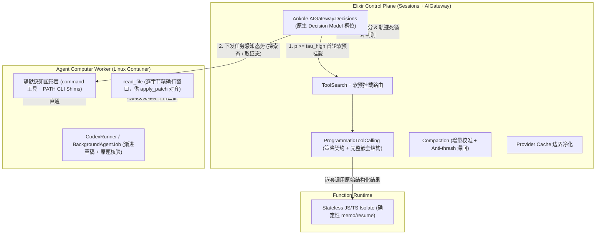

# Ankole Harness 优化计划：感知塑形、原生决策路由与长任务治理

> 关联前置研究：[alma-harness-deep-analysis.md](./alma-harness-deep-analysis.md)  
> 制定日期：2026-11-11  
> 时间边界：本文保留制定时的基线、问题判断与实施方案；各 Workstream 的「现状」指当时快照，实施进度与现行 contract 以 [AIGateway](../design-docs/AIGateway.md) 和 [AgentWorkers](../design-docs/AgentWorkers.md) 等 owning specifications 为准。
> 适用范围：`Ankole.AIGateway`、`Ankole.Sessions`、`AgentComputer`（含前台 `command` 工具与后台 `CodexRunner`）、`FunctionRuntime`（PTC 隔离执行器）

---

## 1. 背景与设计哲学转变

[alma-harness-deep-analysis.md](./alma-harness-deep-analysis.md) 对 Alma 参评包、本机实现与 FrontierHarness 公开数据的拆解列出了多种可能影响表现的机制；缓存命中率也需要结合总输入与实际成本解读（Alma 在 GLM-5.3 上 `cached/input` 高达 `95.1%`，但平均输入膨胀到 `3.311M`、单次通过成本达 \$1.680）。研究提出了三个需要对照实验检验的候选方向：**进入模型窗口的信息密度、工具与意图路由效率，以及长任务在异常与上下文边界上的状态收敛能力**。公开数据与静态阅读尚不足以确定各机制的因果贡献。

将 Alma 的经验转化为 Ankole 的优化路线时，必须在架构与产品设计上完成三个核心认知升级：

1. **区分 Ankole 的双层执行栈，不在错误平面照搬机制**
   - **控制面会话层**（`Ankole.Sessions` + `Ankole.AIGateway`）：负责多租户权限树下的文档、Base、Brain、跨同事委派与交互卡片。这里的 Programmatic Tool Calling（PTC）运行在 `ankole-function-runtime` 无状态隔离实例中，依赖确定性重放与 `Sessions.Receipt` 幂等提交，绝不能混入任意宿主 Shell。
   - **Worker 容器执行层**（`AgentComputer` 前台工具 + `BackgroundAgentJob` 下的 `CodexRunner`）：运行在独立 Linux 容器内，天然拥有完整 CLI 工具链与 `code_mode`，是终端命令治理与长时工程验收的主战场。
2. **从「字节保真管道」转向「认知感知塑形（Perceptual Shaping）」**
   - 大语言模型不是确定性的 POSIX 解析器，而是注意力有限、易受局部样本锚定、且会对「输出不完整警告」产生防御性重读焦虑（Epistemic FOMO）的概率观察者。
   - 工具输出不应作为原始审计日志原样倾倒进上下文，而应作为专为有限注意力模型渲染的视图：在探索性命令上**默认静默剥离低价值噪声与误导性锚点**（如全绿用例刷屏、常规 Merge 节点、实现层过期注释、超大 JSON 的重复样本值），并利用**命令自身的语法特指度**（管道符、精确过滤参数、结构化行读取工具）提供零摩擦的自然逃逸，而非挂免责警告诱发模型强迫症式回读原始日志。
3. **用 Ankole 原生「决策模型（Decision Model）」替代生成式辅助小模型**
   - Alma 使用生成式小 LLM 做工具预选与命令风险分析，付出了 10–30 秒超时窗口、格式错误与未校准猜测的代价。
   - Ankole 在 `Ankole.AIGateway.Decisions` 中已具备原生判别式决策模型能力（支持 SystemOne / TypeSafe Jev、Microsoft-Decision-1、OpenAI `/v1/decisions`、Cloudflare `clef`），可在一次请求中提交最多 64 个类型化问题（`noul` / `choice` / `score`）并返回 `0..1` 概率。概率的校准程度与请求延迟取决于 Provider 和任务分布，不能由统一接口保证；应按后文的 P50/P95 和任务指标验证，再为工具软预挂载、感知滤镜档位切换、风险门控与死循环熔断设置阈值。

---

## 2. 总体架构蓝图

---

## 3. 核心优化工作流（Workstreams）

### WS1：Worker 命令静默感知塑形层（Perceptual CLI Shaping）

#### 现状与痛点
- `AgentComputer` 当前在 `app/agent_computer/src/tools/computer/command-tool.ts` 与 `format.ts` 中对超过 `50,000` 字符的输出做 `40% 头 + 60% 尾` 几何截断并落盘至 `command-logs/*.log`。
- **阈值下膨胀盲区**：`10K–48K` 字符的常规测试、构建、装包与大 JSON 响应完全不触发截断，整段进度条、全绿用例与重复样本原样写入对话历史，并在后续数十轮请求中反复重放计费。
- **Codex 原生命令旁路**：`BackgroundAgentJob` 中的 Codex `app-server` 直接调用容器内 Shell，绕过了外层 `createCommandTool` 的格式化逻辑。

#### 优化方案
1. **双入口统一覆盖（`command` 工具层 + 容器 `/usr/local/bin` 轻量 Shim 层）**
   - 利用 `app/agent_computer/src/core/execution/command-env.ts` 中 `/usr/local/bin` 固定优先于继承 `PATH` 的契约，提供一套由同一核心引擎驱动的透明包装层，同时覆盖主会话 `command` 工具与后台 `CodexRunner` 的原生 Shell 调用。
2. **按认知收益分级的静默塑形规则（不挂引发焦虑的免责尾注）**
   - **测试与构建收敛（`pytest`、`vitest`、`jest`、`mix test`、`cargo test/build`、`tsc`、`oxlint`、`clippy`）**：默认注入非交互与非 watch 参数（如 `CI=1`、`--run` 防止进程挂死）；退出码为 `0` 时静默折叠全绿明细为单行统计；失败时完整保留进程 `exit_code`、全部失败项名称、断言差异与关键堆栈帧。
   - **包管理静默降噪（`npm`、`pnpm`、`yarn`、`bun`、`pip`）**：剥离下载进度条与生命周期刷屏；成功时仅输出耗时与变更摘要，失败时保留完整错误链。
   - **探索态大负载骨架化（裸 `curl`、裸 `git log`、Shell 内 `cat` 扫读）**：
     - 裸 `curl` 返回超大 JSON（例如 `> 4 KB` 且 Schema 显著更短）时，静默归并为全局联合 Schema（覆盖数组内所有元素的可选/可空字段变体），消除样本值锚定与头尾截断盲区；`< 4 KB` 响应或非 2xx 错误正文 100% 原样保留。
     - 裸 `git log` 默认收敛条数并静默排除常规 merge 节点。
     - Shell 内裸 `cat` 扫读源码时可静默折叠连续空行、重复 License 头与普通行内注释（保留 API Docstring / 模块文档），提升架构扫视密度。
3. **三条不可逾越的机械安全红线**
   - **从不伪造状态与校验真值**：退出码、测试失败数、`git status` 工作区脏文件、写入与补丁成败永远逐字真实。
   - **语法特指度自动直通（Zero-Prompt Escape Hatch）**：凡命令中包含管道或重定向元字符（如 `curl ... | jq`、`git log | grep`）、显式详尽参数（如 `-vv`、`--merges`、`--full-history`、`git show <sha>`）或环境变量 `ANKOLE_RAW=1`，塑形层立即完全旁路，原样返回字节流。
   - **编辑读取通道绝对保真**：`app/agent_computer/src/tools/computer/read-file-tool.ts`（`read_file`）严禁删改任何注释、空白或行号，确保 `apply_patch` 的上下文行匹配 100% 稳定。

---

### WS2：基于原生 `Decisions` 模型的 Harness 判别式控制面

#### 现状与痛点
- `Ankole.AIGateway.Decisions`（`app/control_plane/lib/ankole/ai_gateway/decisions.ex`）已实现完整的 `/decisions` 协议与多 Provider 适配，但目前仅向外部 API 与 Pod Applet 暴露，尚未接入 `Sessions` 与 `AIGateway` 的 Harness 主循环。
- `Ankole.AIGateway.ToolSearch.Index` 目前仅使用纯词法 BM25（英文词根 + 中文字符二元切分），面对口语化中文描述或跨语言隐含意图时首轮命中率受限，往往需要主模型额外消耗一轮去调用 `tool_search`。
- 此外，`Ankole.Sessions.Model.base_request/1` 当前将所有可用工具平铺发送，尚未启用 `defer_loading` 与 `programmatic_tool_calling`。

#### 优化方案
1. **严格区分「原生决策模型」与「LLM 模拟回退」**
   - 在 Harness 热路径调用决策能力前，先通过 `Ankole.AIGateway.Resolver.resolve_request_model/3` 检查当前站点/Pod 是否绑定了**真实的原生 `decision` 模型**。
   - **硬护栏**：当未配置原生 `decision` 槽位时，Harness 热路径**禁止**落入 `Decisions.emulate/5`（避免退化为未校准且高延迟的 `light` LLM 调用），而是直接走零延迟的本地确定性 BM25 与静态规则。
2. **单次决策调用承载四项并发判别任务（Batch Questions）**
   当原生 `decision` 模型可用时，在 Turn 准备阶段或关键轮次边界构造精简 `state`，通过一次 `create_decision` 请求并发完成：
   - **工具命名空间与 Skill 软预挂载（Soft Pre-mounting）**：对 BM25 粗召回之外的候选工具命名空间与高频 Skill 评估 `noul` 相关性概率 `p`。当 `p >= τ_high`（如 `0.70`）时直接挂载进首轮活跃工具集，省去主模型首轮 `tool_search` 往返；`p < τ_high` 的工具保留在 `defer_loading: true` 目录内供 `tool_search` 兜底，**绝不硬裁切目录**，彻底杜绝空工具集死胡同。
   - **任务感知态势定档（Perceptual Posture）**：通过 `choice` 判断当前请求属于 `exploratory_engineering`（默认开启激进静默塑形）还是 `exact_data_forensics`（如核对线上报文具体金额、审计特定注释与合并历史，自动通过 `runtimeEnv` 下调 Worker 塑形激进档位）。
   - **多维校准风险门控**：对高敏感操作并发评估正交 `noul` 谓词（`external_side_effect`、`irreversible_mutation`、`out_of_requested_scope`）。低概率静默放行，高概率触发 `clarify` 或 `propose_action_card`，用可观测概率阈值取代脆弱的提示词风控。
   - **长任务死循环与阶段边界检测（Loop & Phase Governance）**：在多轮工具执行后（例如每 6–8 轮或连续出现相似错误时），输入近期动作指纹与错误摘要，评估 `is_thrashing_without_new_evidence` 与 `clean_subtask_completed`。若判定陷入死循环（GLM-5.3 类高消耗根因），主动注入策略切换提醒或提前收敛；若判定刚完成独立子阶段且上下文已超中水位，可择机在干净边界提前准备摘要锚点。

---

### WS3：PTC（Programmatic Tool Calling）激活、策略契约与数据流解耦

#### 现状与痛点
- `Ankole.AIGateway.ProgrammaticToolCalling` 与 `ProgramExecution` 已完整实现基于 `ankole-function-runtime` 的无状态隔离执行、`fingerprint` 校验与 `memo/resume` 暂停恢复，但：
  1. `Ankole.Sessions.ToolCatalog` 尚未将适合批量编排的只读/查询类工具标记为 `"programmatic"` 并向会话注入 `%{"type" => "programmatic_tool_calling"}`；
  2. `synthesized_program_tool/1`（`programmatic_tool_calling.ex:173`）的工具描述只说明了运行时语法，缺少何时使用、何时禁用的决策契约；
  3. 嵌套工具输出若先经面向模型阅读的窄窗口截断，会削弱脚本在内存中做精确 `filter / join / reduce` 的能力。

#### 优化方案
1. **坚守控制面无副作用隔离边界**
   - 保持 `ankole-function-runtime` 禁止宿主文件系统、网络、定时器与 `sh()` 的确定性设计不变，保留 `memo/resume` 与最多 256 次嵌套调用的安全契约。
2. **升级模型可见的 PTC 策略契约**
   - 更新 `ProgrammaticToolCalling` 合成描述，明确正向与反向准则：
     - **正向触发**：预计需要 `3+` 次工具调用、跨列表循环查询、结果过滤/去重/聚合、或基于前一步结构化字段做条件分支时，优先编写 `program`，且只通过 `text()` 输出最终精简结论。
     - **反向禁区**：单次工具调用禁止包裹 `program`；涉及用户交互与任务里程碑的工具（`clarify`、`propose_action_card`、`create_background_job`、外发消息）保持 `allowed_callers: ["direct"]`，确保 Pod UI 的实时进度可见性与审批锚点不被黑盒脚本吞噬。
3. **在 `Ankole.Sessions` 分批开放 Programmatic 绑定与双层结果预算**
   - 第一批将 Pod/Base 查询、Brain 检索、会话只读上下文、Web 读取等高频聚合工具声明为 `allowed_callers: ["direct", "programmatic"]`。
   - 区分**脚本消费视图**与**模型重放视图**：嵌套调用返回给 `ProgramRunner` isolate 的结构化载荷采用宽内存预算（不走面向聊天的窄字符截断），仅对 `program` 最终产出的 `text()` 施加模型上下文预算。

---

### WS4：Compaction 增量校准、Anti-Thrash 滞回与缓存前缀卫生

#### 现状与痛点
- `Ankole.AIGateway.CompactionPolicy` 采用 `90%` 晚压缩阈值，配合 `CompactionRetention` 保留用户原文预算、未决 `clarify` 对与客户端 `tool_search` 契约，这一总体策略优于过早有损压缩。
- 但阅读 `Ankole.AIGateway.Compaction.maybe_plan_history/8`（`compaction.ex:78-110`）可见两个具体工程缺口：
  1. **缺少当轮增量预估校准**：`total_tokens` 仅读取上一条已完成 Response 的 `history_usage_tokens(history)`，未计入当轮新增的 `current_input`（如刚返回的多条大型工具结果）与新挂载工具 Schema。当上一轮处于 `82%` 水位而本轮追加 `12%` 工具输出时，预检会漏放并直接撞上上游 Provider 的上下文溢出错误。
  2. **缺少无效压缩熔断与滞回（Anti-thrash Hysteresis）**：当保留的固定开销（System 指令 + 活跃工具 Schema + 保留用户原文 + 最近 4 行大消息）本身已逼近阈值时，缺少「最小可压缩前缀收益检查」与滞回窗口会导致连续多轮重复调用 `CompactionSummarizer` 却无法实质压降体积。

#### 优化方案
1. **引入真实 Usage 校准的预检增量估算（Calibrated Preflight Estimate）**
   - 基于最近一次 Response 的真实 `input_tokens` 与对应历史内容的 `CompactionHistory.items_token_estimate/1` 计算会话级动态校准系数 `wire_ratio = clamp(actual_input_tokens / estimated_tokens, 0.75, 2.5)`。
   - 在 `maybe_plan_history/8` 中以 `last_actual_tokens + round(estimate(current_input + delta_tools) * wire_ratio)` 判断是否越过 `threshold.tokens`，将溢出消灭在请求发出之前。
2. **增加最小压缩收益门槛与 Anti-Thrash 滞回保护**
   - 在生成摘要前检查候选 `candidate.prefix` 的估算体积：若可折叠前缀不足窗口的 `5%`（或绝对值低于 `4,000` tokens），跳过 AI 摘要调用。
   - 若一次自动压缩完成后，下一轮真实 `input_tokens` 降幅低于 `8%` 且仍高于阈值，在会话元数据标记压缩冷却态，直到新增可折叠前缀累积超过滞回线后再重新激活，避免每轮空耗一次 `light` 模型摘要请求。
3. **Provider 缓存前缀边界审计（Cache Prefix Hygiene）**
   - 审查 `Ankole.AIGateway.Providers` 下 Anthropic、OpenAI、OpenRouter、Bedrock 等适配器的请求组装逻辑：确保跨轮次变动的动态上下文（当前时间、环境状态变化、瞬时提醒）不会混入静态 `instructions` 头部打碎前缀缓存，并在历史消息重放时剥离过期的临时缓存标记与 `store=false` 残留选项。

---

### WS5：长时 `BackgroundAgentJob` 渐进产物锚点与原题核验闭环

#### 现状与痛点
- `app/agent_computer/src/core/codex-runner/job/runtime-files.ts` 已要求最终回复包含验证证据、路径与剩余风险，但在超长探索或临近超时/步数上限时，模型仍可能把全部预算花在排查上而未落盘阶段性成果，或在局部走通后自行放宽原题验收条件。

#### 优化方案
1. **渐进式交付物落盘契约（Progressive Draft Checkpointing）**
   - 增强 `renderCodexJobAgents` 指令与长时 Job 引导：对于需要产出文档、报告、代码变更或数据文件的任务，要求模型在完成初步方案后尽早在 Job 工作区或目标 Drive 落盘第一版可工作产物，再在后续轮次迭代打磨，避免意外中断后零交付物。
2. **收尾阶段原题对账与诚实 `incomplete` 状态**
   - 在 Job 接近轮次/时间预算上限时注入收敛提醒，强制停止发散性新探索，要求模型对照初始 `task` 原文逐条核验交付物，并在未完全达标时结构化声明 `incomplete` 及已完成产物路径，杜绝把半成品包装成完全成功。

---

## 4. 度量体系与收敛验证方案

为避免陷入多维组合爆炸，不铺设全因子学术网格，而是统一采集核心反事实指标，并围绕高不确定性假设做定向对照：

### 4.1 统一观测字段（写入 `AIGateway` 与 `AgentComputer` 现有遥测）
- **经济与结果指标**：任务通过率、`cost_per_pass`（含失败与超时试跑总成本 / 通过数）、每轮平均重放 `input_tokens`、`cached_input_tokens` 占比、端到端墙钟耗时。
- **感知塑形指标**：`shaping_applied_count`、原始字节 vs. 塑形后字节、**后续 2 轮内对同一目标发起特指重读/管道逃逸的比例（`specificity_bypass_rate`）**。若某条静默规则的逃逸重跑率 `> 20%`，说明该规则过度伤及必要事实，直接回调或下线。
- **决策模型与路由指标**：原生 `decision` 请求延迟（P50/P95）、首轮软预挂载命中率、主模型 `tool_search` 补载轮次占比、死循环熔断触发率及熔断后任务挽救率。
- **Compaction 健康度指标**：上游 `context_overflow` 逃逸次数（目标趋近于 `0`）、单任务平均压缩次数、无效压缩拦截次数。

### 4.2 定向验证集设计
选取 **2 个代表性反差模型族**（如上下文收敛良好的 Kimi-K3 类模型 vs. 易发生长轨迹膨胀的 GLM-5.3 / DeepSeek 类模型）× **30 个真实任务切片**（含构建排错、多文件重构、API 联调取证、多表 Base 聚合、长时后台研究 Job），仅做三组增量消融：
1. **Baseline**（当前 Ankole 主干）
2. **+ WS1（静默感知塑形）+ WS4（Compaction 校准与缓存净化）**：验证上下文体积、重放成本与长任务溢出率的直接改善。
3. **+ WS2（原生 Decision 软预挂载与死循环治理）+ WS3（Sessions PTC 策略契约）+ WS5（长任务收尾核验）**：验证跨语言工具首轮命中率、高膨胀模型的轮次收敛效果以及超时边缘任务的产物留存率。

---

## 5. 分阶段实施路线图

| 阶段 | 交付内容 | 核心涉及模块 | 验收标准 |
|---|---|---|---|
| **Phase 1：地基加固与无悔优化** | 1. Compaction 当轮增量 `wire_ratio` 校准与 Anti-thrash 滞回保护 2. Provider 静态/动态前缀缓存边界审计与清理 3. 长时 `BackgroundAgentJob` 渐进草稿与收尾核验契约 | `app/control_plane/lib/ankole/ai_gateway/compaction.ex` `compaction_candidate.ex` `providers/*.ex` `app/agent_computer/src/core/codex-runner/job/runtime-files.ts` | 1. 大工具结果轮次不再触发上游 `context_length_exceeded` 2. 高固定开销会话不出现连续空转摘要 3. `mix test` 与 `agent_computer` 单元/集成测试全绿 |
| **Phase 2：Worker 静默感知塑形层** | 1. 实现测试、构建、装包、裸 `curl` 大 JSON、裸 `git log` 的静默塑形器 2. 接入 `command` 工具与容器 `/usr/local/bin` 包装层，实现管道/特指参数自动直通 3. 固化 `read_file` 零删改不变量测试 | `app/agent_computer/src/tools/computer/command-tool.ts` `format.ts` `app/agent_computer/Dockerfile` `command-env.ts` | 1. 常规测试/装包轮次进入上下文字符数下降 `60%+` 2. 带 `\| jq`、`--merges`、`< 4 KB` 错误响应 100% 原样直通 3. `apply_patch` 补丁成功率无回退 |
| **Phase 3：PTC 激活与策略升级** | 1. 升级 `ProgrammaticToolCalling` 模型可见策略描述（正向 `3+` 聚合 + 反向单调用/交互禁区） 2. 解耦 `ProgramRunner` 嵌套结构化输入预算与最终 `text()` 输出预算 3. 在 `Sessions.ToolCatalog` 为只读查询工具开放 `programmatic`，并仅对高置信度低频配置/设备枚举工具（`list_background_job_devices`、`set_channel_standing_orders`）开启 `defer_loading` | `app/control_plane/lib/ankole/ai_gateway/programmatic_tool_calling.ex` `program_execution.ex` `app/control_plane/lib/ankole/sessions/tool_catalog.ex` `model.ex` | 1. 批量查询任务自然触发 `program` 且中间结果不污染主历史 2. 单工具调用与 `clarify` / `propose_action_card` 保持直接调用与 UI 实时可见 |
| **Phase 4：原生 `Decisions` 接入 Harness** | 1. 封装仅在配置真实原生 `decision` 模型时启用的 Harness 决策客户端 2. 落地首轮工具/Skill 软预挂载与任务感知态势定档 3. 落地多轮轨迹死循环检测与高风险动作校准门控 | `app/control_plane/lib/ankole/ai_gateway/decisions.ex` `resolver.ex` `tool_search.ex` `app/control_plane/lib/ankole/sessions/model.ex` | 1. 未配 `decision` 槽位时零额外 LLM 请求、平滑回退本地 BM25 2. 开启原生 `decision` 后跨语言隐含意图首轮工具命中率提升，长轨迹死循环消耗显著收敛 |

---

## 6. 明确不做的事项（Explicit Non-Goals）

1. **不在控制面 `program` 运行时暴露 `sh()`、宿主文件系统或网络**：坚守 `ankole-function-runtime` 的无状态确定性重放与多租户隔离边界，系统级 CLI 编排统一归口 Worker 容器。
2. **不在静默塑形输出末尾普遍追加「内容已被裁剪，请去读原始日志」式警告**：避免诱发推理模型的防御性重读焦虑而抵消上下文收益；依靠命令语法特指度与任务态势档位实现无感逃逸。
3. **不在未配置原生 `decision` 模型时用生成式 `light` LLM 充当每轮前置路由器**：拒绝将不可预测的自回归延迟与未校准置信度引入交互主路径。
4. **不在拥有组织写副作用的业务工具上做激进的参数名/类型静默猜测（Silent Coercion）**：写操作契约不明确时直接返回清晰 Schema 校验错误或发起 `clarify`，不替用户猜测高风险写意图。
